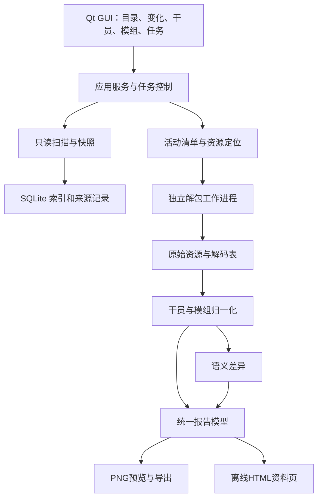

# 明日方舟 PC 资源解包与资料导出工具 — 完整开发计划

> 状态：Windows 0.1.0本机便携交付完成；128项回归及真实资源/GUI/冻结服务链通过，浏览器效果保留未实测项。日期：2026-10-19，时区：Asia/Shanghai。
> 执行者入口：遵循用户的 `agent-dev-workflow`；实施时按依赖分批并行，主 agent 负责公共契约、集成和交付。可结合 `superpowers:subagent-driven-development` 或 `superpowers:executing-plans` 逐项执行。复选框仅在对应证据取得后勾选。

**目标：** 用户选择 PC 游戏目录后，可以理解目录用途、浏览资源、识别文件变化、按资源类型解包，并将新增干员的完整资料和新增／变更模组导出为中文PNG及可离线浏览的HTML资料页。

**架构：** 原生桌面 GUI 调用独立的扫描、资源解析、数据归一化与报告服务；扫描快照、资源生效层和业务实体变化分别建模。解包引擎在独立工作进程中运行，游戏目录作为只读输入，所有输出进入用户选择的独立目录。

**技术栈：** Python 3.12 x64；PySide6 Qt Widgets；UnityPy 与固定版本的 Ark-Unpacker／Ark-FBS-Py 适配；SQLite；Pillow 中文长图排版；PyInstaller 目录式便携包。实际依赖精确版本已由 M0 样本验证锁定，不使用无约束的 latest。

**设计规格：** 本文第 1–10 节；实施任务为第 11 节。目录事实以 [游戏目录说明](docs/GAME_DIRECTORY_GUIDE.md) 为唯一正文，不另建重复总计划。

## 1. 任务范围与完成标准

用户最初要求先编写完整计划书，已完成规划、目录盘点和上游研究；随后明确授权持续开发全部功能和 Windows 程序交付。以下功能全部进入首个完整交付范围，实际证据见第13节与 [验收摘要](docs/ACCEPTANCE.md)。完整M9日志及样本留在本机，不随源码上传。

| ID | 用户能力 | 交付要求 | 实施任务 | 当前状态 |
| --- | --- | --- | --- | --- |
| F01 | 选择游戏目录并识别布局 | 文件夹选择器、路径校验、记住最近位置，兼容只含一层资源的输入 | M1、M3 | 已实现，真实Qt流程通过 |
| F02 | 理解各目录用途 | 资源管理器中显示功能标签、说明、推荐处理方式；未知目录明确标记 | M1、M3 | 已实现，目录文档与GUI一致 |
| F03 | 最近 N 小时更新列表 | 默认 24 小时，可修改；显示修改时间、首次发现时间及检测依据；可仅显示 `.ab` | M2、M3 | 已实现，时间窗口与GUI回归通过 |
| F04 | 检测新增／修改／删除 | 保存独立快照，比较文件与内容；首次扫描建立基线；失败扫描不冒充完整快照 | M2 | 已实现，模拟变化与本机扫描通过 |
| F05 | 资源管理器式浏览与选取解包 | 目录树、面包屑、排序、搜索、多选、递归选择、预览、任务队列、取消与失败重试 | M3、M4 | 已实现，持久任务／恢复独立复核通过 |
| F06 | 自动匹配解包方式 | 文件签名、对象类型与目录功能共同决定；支持匿名 `.bin`、数据、图片、音频、Spine 等 | M0、M4 | 真实12表、透明PNG、WAV、Spine、USM通过 |
| F07 | 新干员识别 | 对比完整、可比较的数据快照，按稳定角色 ID 识别新增；旧角色修改另列 | M5、M7 | 已实现，受控快照验证；未等待真实游戏更新 |
| F08 | 干员详细信息图片 | 满精英／满级／满潜／满信赖属性、潜能增量、天赋、所有专三技能、后勤、模组 | M6、M8 | 真实克莱门莎及代表角色通过 |
| F09 | 新模组／模组更新图片 | 按模组 ID 区分新增与已有修改；展示三级属性、特性／天赋效果及前后差异 | M6、M7、M8 | 已实现，真实三级模组与受控变化通过 |
| F10 | 完整桌面交付 | 双击可用的 Windows x64 程序、说明、许可证、日志、版本与来源清单 | M9 | 正式便携包、原生窗口、真实服务与ZIP摘要通过 |
| F11 | PRTS风格的HTML资料导出 | 与PNG共用数据，完整干员资料、目录跳转、表格与技能／模组分区；单文件可离线打开 | M8、M9 | 已实现，静态/转义/脚本检查通过；浏览器验收受限 |

### 1.1 首版明确支持

- 中文界面；Windows x64；优先验证本机 PC 客户端布局和 Unity 2021.3.39f1 样本。
- 游戏根目录、`Arknights_Data`、识别到的初始资源根或热更资源根；缺少另一层时提示当前覆盖范围。
- 原始文件浏览和当前生效资源浏览两种视图。用户可以有意解包历史底包，但报告默认使用可验证的当前资源。
- 单文件、多个文件、目录递归、选中变化、一键导出本次新增干员与模组；也允许手动导出现有干员。
- 默认离线完成扫描、解包、分析、导出；可导入历史快照／已解出的同服数据建立对照，不依赖在线数据库才能使用。
- 图片信息结构参考两张附件；文字、数值和版本来自解析结果，模板原创，不复制示例作者、群号、日期或水印。
- HTML参考PRTS干员资料页的信息层级和表格风格，作为首版必交付格式，与PNG并存；默认同时导出，可单独选择。

### 1.2 边界与默认决定

- “整理文件夹”落实为结构文档、软件内分类和用途标注，不移动或重命名实际游戏文件。
- 不包含资源回封、游戏文件替换、运行时注入、账号数据读取、自动下载游戏资源、战斗伤害模拟或基建排班求解。
- 附件中的“排班”结合图片语境按“排版／信息排列”理解；后勤技能会完整呈现，班表优化不属于当前功能。
- 从文件系统只能确定本机写入时间或两次观测之间的变化；不能据此断言服务器发布时刻或角色已开放获取。
- 数据包含但尚不可获取的角色单列“数据中新出现／未确认可获取”，与正式可获取干员区分。
- 视觉参考不是数据真值。已核对的 v078 参考表中，克莱门莎有两项后勤技能，附件一的“无基建技能”不可作为预期结果。

## 2. 已确认事实、资源复用与关键缺口

### 2.1 本地事实

- 项目目录本轮开始时为空；`git rev-parse --show-toplevel` 确认不在 Git 仓库内。没有现存程序、计划、工程命令或用户修改需要迁移，不为写计划强建仓库。
- 已只读盘点游戏根目录。详细统计、资源分类及采样路径见 [目录说明](docs/GAME_DIRECTORY_GUIDE.md)。本机为约 26.03 GiB 的物理文件集合，不能全量加载进 GUI 内存。
- 两层资源同时存在：`Arknights_Data/StreamingAssets/AB/Windows` 与 `Arknights_Data/PersistentData/Bundles`。
- 代表性 `.ab` 和 `anon/*.bin` 都有 UnityFS 头，版本为 Unity 2021.3.39f1；`.idx` 属于另一类数据，不能按 UnityFS 包直接读取。
- 当前活动清单中的部分资源未安装，部分底包版本已陈旧；匿名包的 `md5` 字段存在 4 位短值。不能一律以该字段当完整 MD5，也不能一律在热更缺失时静默回退底包。
- 2026-10-19 18:38:55 +08:00 的 24 小时窗口内，两层资源无最近写入项；全树变化集中在日志和 SDK 状态。此结论仅适用于该次观测。

### 2.2 已检查的复用资源

| 资源 | 采用方式 | 限制与理由 |
| --- | --- | --- |
| [Ark-Unpacker 固定提交](https://github.com/isHarryh/Ark-Unpacker/tree/4a4b9efc6be4690b68b70b4a16578950baa066d3) | 参考并适配其 AB 解压、导出、文本解码、透明通道合并与 Spine 分拣 | BSD-3-Clause；不是现成 GUI，也未实现本项目的快照和干员／模组领域层 |
| [Ark-FBS-Py 固定提交](https://github.com/isHarryh/Ark-FBS-Py/tree/161d5e229916d7193364983396076556fbeaa549) | 固定生成的表结构与 ResourceManifest 结构，记录与引擎的配套关系 | schema 随游戏更新漂移；本地实际解码仍需验收 |
| [UnityPy](https://github.com/K0lb3/UnityPy) | Unity 对象枚举、容器路径、图片／文本等导出底层 | 采用上游配套版本起步，原生依赖与自定义压缩须一起验证 |
| 既有 RIIC 项目 `scripts/import-gamedata.mjs` | 参考 `building_data.chars → buffChar → buffData → buffs` 和精英／等级阶段选择 | 已重新阅读源码；不会直接调用会写回 RIIC 项目的脚本，其输出仅覆盖后勤，不能作为完整角色数据源 |
| 既有固定 v078 原始表与来源清单 | 用作离线字段研究和已知样本核对 | 固定提交 `17759cc8cdf37388414145d16262a3a06f3ab25e`；不是本轮 PC 解包结果，也不宣称其为当前在线最新 |
| [Qt for Python](https://doc.qt.io/qtforpython-6/) 与 [PyInstaller](https://pyinstaller.org/en/stable/operating-mode.html) | 原生模型视图、字体排版、便携打包 | 需验证打包后的插件、中文字体和子进程，不能只验证源码启动 |

本次只读检查了相关字段与源码，没有运行既有 RIIC 导入脚本，也没有修改另一个项目。后勤效率与排班算法不复用；以后若增加机制计算，再启用 `arknights-riic-mechanics` 及相应验证。

上游程序声明版本为5.2.0，固定提交的依赖候选包括UnityPy 1.25.3、flatbuffers 25.12.19、Pillow 11.3.0、NumPy 2.2.6、PyCryptodome 3.23.0、bson 0.5.10、lz4 4.4.5、spine-asset 1.1.1、WannaCRI 0.3.3、ffmpeg-python 0.2.0、fmod-toolkit 0.1.3。上游Python约束为`>=3.10,<3.13`，但Spine代码使用`StrEnum`，因此本方案起步选3.12而非直接复用本机3.13；以[固定依赖声明](https://github.com/isHarryh/Ark-Unpacker/blob/4a4b9efc6be4690b68b70b4a16578950baa066d3/pyproject.toml)和[锁文件](https://github.com/isHarryh/Ark-Unpacker/blob/4a4b9efc6be4690b68b70b4a16578950baa066d3/poetry.lock)为核验入口。

发行前还需核对实际纳入的组件：Ark-Unpacker的BSD不自动覆盖其他仓库；本次固定Ark-FBS-Py及其schema来源未见明确LICENSE，schema再分发条件需解决。`fmod-toolkit`包的MIT不等于附带FMOD DLL的许可；FFmpeg须按实际构建记录许可。M0登记每个运行组件的来源与许可，M9只纳入已明确可随包交付的组件；对尚未明确的组件先验证本机方案，选择获准的来源或独立适配后再定发行清单，不把缺失依赖隐瞒为全功能包。PySide6/Qt随包材料也按实际使用模块核对。

核对入口：[Ark-Unpacker许可证](https://github.com/isHarryh/Ark-Unpacker/blob/4a4b9efc6be4690b68b70b4a16578950baa066d3/LICENSE)、[fmod-toolkit 0.1.3说明](https://pypi.org/project/fmod-toolkit/0.1.3/)、[FMOD官方条款](https://www.fmod.com/legal)、[FFmpeg构建与许可说明](https://ffmpeg.org/legal.html)。这里记录组件来源核对任务，不将某个Python包的许可推定到其捆绑二进制。

### 2.3 必须先闭环的技术问题

1. **表在哪里：** 从 `.idx` 或 AB 容器名称恢复 `character_table`、`skill_table`、`building_data`、`uniequip_table`、`battle_equip_table` 与匿名包的关系。
2. **怎样可靠解码：** 验证 PC 样本的特殊压缩、TextAsset 字节、AES／BSON／FlatBuffers 分支，固定引擎与 schema 版本。
3. **什么才是当前有效数据：** 核验活动清单、局部下载清单、底包和热更的关系；拒绝混用陈旧核心表生成“当前版本”报告。
4. **语义与渲染：** 潜能序号、信赖内部等级、天赋替换、模组阶段与富文本占位符必须有可追溯样本，不能靠替换字符串猜结果。

前 3 项为 M0 的准入条件。若失败，继续浏览器／扫描等独立工作，同时记录具体不支持的包和原因；不能将其他能力完成写成“完整解包与资料导出已完成”。

## 3. 技术选型与运行结构

### 3.1 GUI 方案比较

| 方案 | 优点 | 主要成本 | 决定 |
| --- | --- | --- | --- |
| Python + PySide6 Widgets | 与解包生态同语言；目录树、表格、进度、中文排版可直接实现 | 需处理原生依赖和 Qt 打包体积 | 采用 |
| C# WPF + Python 工作进程 | Windows 交互成熟 | 同时维护两套模型、协议与打包链 | 当前不采用 |
| Electron／网页 GUI + Python 服务 | 前端展示灵活 | 增加浏览器运行时与本地服务边界，本任务无需网络页面 | 当前不采用 |

选择 PySide6 的目的是尽快形成可维护的完整 Windows 工具。首版不引入插件商店、通用工作流引擎或后台服务。

### 3.2 执行与依赖方向



- GUI 只消费服务结果，不直接执行文件遍历、UnityPy 或数值公式。
- 扫描与哈希为后台任务；SQLite 写入由单一存储服务串行处理。
- 解包隔离到工作进程，任务私有 request.json／result.json 与 events.jsonl 传递结构化请求／事件，日志单独保存；兼容 Windows windowed 程序 stdout/stderr 均为 None，不依赖控制台流。大图和表数据通过受控文件传递。
- 任务状态统一为 `queued/running/cancelling/succeeded/partial/failed/cancelled`；成功数量、失败数量、跳过原因分别展示。
- 首版采用单调度器串行执行（并发1），GUI持续响应，第三方解码在独立进程；以控制Unity贴图内存及可预测取消为本机实施决定，不提供未验证的并发1–4选项。
- 首版“暂停队列”定义为不开始下一个任务，当前批次继续；需要停止当前批次时取消，先协作退出、超时终止所属工作进程。既有成功文件保留，未完成文件不进入成功清单。

### 3.3 上游接入方式

采用“**固定引擎代码 + 薄适配层 + 独立进程**”。只复制／引入确需的模块及许可证，保存原始提交与修改记录，自己的业务代码不散落到上游目录中。

- M0 先用固定版上游的明确模式作对照，验证样本；生产接口提供结构化进度与逐文件结果。
- 若短期通过 CLI 做兼容后端，必须显式传 `--image/--text/--audio` 等所需开关，工作目录放任务私有目录。
- 不透传上游 `-d/-delete`（固定版本为单横线别名）。它会删除目标目录，GUI 总是创建新的任务目录，失败重试只处理本任务未成功的文件。
- 上游参数中出现 `--spine` 不等于 AB 模式会执行它；源码核对显示专门导出应走 `-m sp`。自动策略按真实调用链接入。
- `fb` 模式处理 AB 导出的文本／字节资产，不是把所有 `.bin` 都当 FlatBuffers；本机匿名 `.bin` 首先需要 AB 解析。
- UnityPy自定义压缩映射仅在worker中注册；固定上游将`CompressionFlags.LZHAM`接到`decompress_lz4ak`，不得将其未经核验地应用于所有Unity工程。GUI运行进程不依赖这一全局修改。
- 上游个别异常被记录后仍计入“已处理”，CLI最后可能退出0；成功必须依据逐对象／逐文件结果和实际产物验证，不能仅解析退出码或进度条。
- USM的现有单文件CLI路径可能收集到零任务；适配器直接调用经验证的单文件入口。FFmpeg／FFprobe能力检测只在私有工作目录中执行，避免其固定测试文件覆盖用户文件。
- RGB／Alpha优先使用Material引用等明确配对关系；只有名称或图像相似度时记录为推断配对，并保留原图用于复查。
- `.idx` 探测不能依赖文件名自动猜 schema。候选为 `CN.resource_manifest` 的显式根类型；解出结构后仍须校验所有 BundleIndex、逻辑路径及物理包存在性。
- 另一条可行验证路线：枚举匿名 AB 的 `container` 与 TextAsset 原始名称，识别带 hash 后缀的表名，再明确指定表 schema。两条路线以样本结果决定主路径和回退路径。

固定源依据：[解压与异常处理](https://github.com/isHarryh/Ark-Unpacker/blob/4a4b9efc6be4690b68b70b4a16578950baa066d3/src/ResolveAB.py)、[模式调度](https://github.com/isHarryh/Ark-Unpacker/blob/4a4b9efc6be4690b68b70b4a16578950baa066d3/Main.py)、[USM实现](https://github.com/isHarryh/Ark-Unpacker/blob/4a4b9efc6be4690b68b70b4a16578950baa066d3/src/ResolveUSM.py)。

## 4. 游戏目录识别、资源管理器和解包策略

### 4.1 源识别与生效层

每个安装位置建立独立 `profile_id`，绑定规范化真实根路径、平台、语言／区服信息及当前清单标识。根目录移动可显式重定位；不自动把不同目录、区服或版本的历史混合。

文件键保留原始路径用于显示，另建立符合目标文件系统大小写规则的比较键；路径规范化、Unicode名称和Windows长路径需要测试，不能将名称清洗用于修改输入路径。检测不到区服时记录未知，历史基线导入必须显示这一限制。

“当前生效资源”以活动清单中的逻辑资源键建立映射，而不是先把热更内容物理复制覆盖到底包：

1. 找到最新可解析且稳定的活动清单，保存原始版本标识与摘要。
2. 搜索热更和底包候选，按大小、可用完整摘要及物理签名验证。
3. 同一逻辑资源优先选择与活动清单匹配的已安装候选；保留候选来源和被遮蔽版本供浏览。
4. 所需版本不存在时区分“未安装的可选资源”“仅有旧版”“文件不完整／读取失败”“暂不支持验证”；不静默把旧版当当前版本。
5. 若摘要为 4 位短值，保存为 `short_token`，不得套用标准 MD5 校验。以已验证的清单语义、大小、物理来源和本地 SHA-256 补充证据；无法确认时保留未验证状态。
6. 没有完整清单的独立目录仍可手动浏览／解包，但标记版本覆盖未知；业务报告记录限制，不能冒充完整当前安装。

具体目录与处理建议见 [目录映射](docs/GAME_DIRECTORY_GUIDE.md)。目录标签是推荐依据，文件签名和实际对象类型才决定解包器。

### 4.2 界面布局

```text
┌ 游戏目录 [选择…]   [扫描/重新扫描]   时间范围 [24 小时]  [仅 .ab] ┐
│ 资源浏览 | 更新记录 | 干员资料 | 模组更新 | 导出任务 | 设置       │
├────────────────┬─────────────────────────┬───────────────────┤
│ 目录树          │ 面包屑、搜索、筛选       │ 所选对象详情       │
│ 当前生效资源    │ 名称 / 功能 / 类型      │ 功能说明、来源层   │
│ 初始资源        │ 大小 / 修改时间 / 状态  │ 版本、校验、预览   │
│ 热更资源        │ 多选、排序、右键菜单    │ 推荐解包方式       │
│ 其他游戏目录    │                         │ [加入解包队列]     │
├────────────────┴─────────────────────────┴───────────────────┤
│ 扫描/解析进度、失败与跳过数、输出位置、取消/重试                 │
└─────────────────────────────────────────────────────────────┘
```

- 目录树使用懒加载模型；大列表分页／分批装载，不为每项创建重量控件。
- 树节点和文件行带中文用途标签，选中后显示完整说明、推断依据和适用的导出类型；未知目录显示“尚未分类”。
- `.ab` 过滤不隐藏目录层级，大小写不敏感；仅控制文件显示，不影响索引、清单、匿名包和依赖文件的解析。
- 双击文件查看对象列表；图片显示缩略图，文本显示限长预览与完整导出入口。可选整包或内部对象解包；AB 内对象列表为二级能力，M4 接入。
- 多选支持 Ctrl／Shift、全选当前筛选结果、选择子目录；“所选”与“所有结果”的数量明确显示。
- 任务开始前显示策略、文件数量和输出位置；可以切换原始导出／处理后导出，失败不影响其他文件继续处理。
- 干员／模组页独立于 `.ab` 文件筛选，避免用户开启过滤后无法找到逻辑资料。

### 4.3 自动处理流水线

| 资源判定 | 默认流水线 | 结果 |
| --- | --- | --- |
| UnityFS `.ab` 或 `.bin` | 包头探测 → 相容解压 → 对象枚举 → 按选择导出 | 对象清单、原始资源与来源清单 |
| 立绘／头像／图标 | Texture2D／Sprite → PNG；确认配对时合并 RGB／Alpha | 透明 PNG；缺配对则保存原图并说明 |
| 战斗／基建小人、动态立绘 | 专用 Spine 收集 → 骨骼、atlas、贴图一起输出 | 完整资源组与缺失依赖列表 |
| 游戏数据／剧情文本 | 提取原始 TextAsset 字节 → 格式探测 → AES／BSON／JSON／FlatBuffers 适配 | JSON／TXT 和原始字节，可定位失败 |
| 音效／语音／音乐 | AudioClip → 支持的解码导出 | WAV 或可用原始音频，标明格式 |
| 视频 | 真正 USM 文件才进入专用 demux 流程；其他格式按识别结果处理 | 视频／音频分轨与原始文件；外部依赖明确列出 |
| Mesh／未知 Unity 类型 | 按用户选择导出 OBJ／TypeTree／可得原始字节 | 可查看的结果或明确不支持说明 |
| SDK、DLL、日志和账号配置 | 只显示目录用途及普通文件信息 | 不纳入资源解包任务 |

Spine 首版要求正确导出完整文件组，不包含内置动画播放器；视频首版要求可识别、按上游支持范围导出，不承诺转码所有私有格式。任何未知格式都保留诊断，不能生成空文件并计为成功。

## 5. 最近 N 小时、文件快照与语义更新

### 5.1 两个时间维度必须分开

**最近写入视图：** 以扫描开始的固定 UTC 时间 `scan_started_at` 为右边界，筛选 `scan_started_at - N小时 <= mtime <= scan_started_at`。默认 N=24，允许正数小数；无效／非有限／非正数拒绝。内部存 UTC 和纳秒时间戳，界面按系统时区显示偏移。本机验收使用 Asia/Shanghai。

**内容变化视图：** 比较两次完整扫描，记录首次观察到变化的时间和覆盖区间。即使文件保留旧 mtime，只要清单或内容摘要变化也能进入这里；明确显示“本次检测到，实际写入时间未知”。

默认更新页同时提供“最近写入”和“相对基线变化”分组。用户可选“任一命中”或交集过滤，不把旧文件首次被看到称为刚发布。

### 5.2 首次扫描与之后扫描

- 首次扫描：全目录元数据与资源清单入库，核心数据相关包建立可验证摘要；界面可列出最近 24h 文件，但新增／修改状态为“首次发现，历史未知”。生成第一个完整数据快照后才具备后续自动识别能力。
- 默认快速扫描：重新枚举元数据、清单；对元数据变化、清单变化、核心数据、未完成校验和新文件计算流式 SHA-256。只用元数据跳过的文件标记“元数据未变”，不能声称逐字节相同。
- 严格扫描：对全部选定范围重新流式计算摘要，用于识别大小和时间均保留的修改。进度包含读取字节数，可取消；不使用抽样哈希冒充完整摘要。
- `added`：旧完整清单无该物理键、新清单有；`modified`：内容摘要不同；`metadata_only`：元数据变但完整摘要相同；`removed`：完整新扫描中确实缺失。
- 重命名先表现为新增／删除，可基于完整摘要显示关联建议，不因此改变原始事件；逻辑层额外记录资源来源切换。
- 同时保存物理变化和生效资源变化：旧底包变化但被热更遮蔽，不应触发当前角色资料改变。
- 扫描前后比较文件大小／时间和清单摘要；读到更新中的文件标记 `unstable`，有限重试，整批不晋升为完整业务快照。
- 权限错误、读取失败和半途取消生成部分结果；未扫描到的路径不能推断为删除。部分扫描不替换最后成功基线。

### 5.3 自动触发与留存

选择目录后自动扫描；下次打开软件自动检查已选目录。软件运行期间可开启目录变动监听，防抖后重新核对清单和变化文件；监听只作为提示，最终仍以重扫为准，不建立系统计划任务。

扫描记录和实体快照分开存储，语义基线默认为上次**完整成功**的数据快照，并允许选择历史对照或固定基线。每次差异和导出绑定两端快照，不因下一次扫描而丢失本次更新名单。

缓存可按大小上限清理重建；用户导出文件、固定基线和历史报告不自动删除。删除历史快照由用户在界面显式操作；若被报告引用，先说明关联。

### 5.4 新干员与新模组判定

- 干员按 `char_id`／形态键比较；模块按 `equip_id` 比较，不以 AB 文件名、最后一条记录、名字变化或最高编号判断新增。
- 归一化的业务记录使用稳定序列化摘要，区分新增、删除、属性变化、技能／天赋／后勤／模组变化和仅文案变化。JSON 键顺序变化不产生业务更新。
- 角色依赖的共享技能、职业特性、术语、后勤 buff 和模组变化，会通过反向引用索引使相关角色重新计算；不只比较 `character_table` 本身。
- 皮肤、语音和头像变化单独分类，不当作新干员；召唤物、陷阱、敌方和临时剧情记录不进入默认可获取干员名单，但保留可查询原始记录。
- 有形态／职业切换的记录通过 `char_patch_table` 等实际结构关联，保留独立形态资料，不能误报为新角色；别名和获取状态变化另列。
- 模组 `INITIAL` 证章与实际可升级模组区分；特殊／仅特定玩法生效模组标出适用条件。
- 当前快照缺核心表、缺引用或版本不一致时阻止“已确认新增”的结论。允许导出明确标注缺项的草稿，不能输出看似完整的正式报告。
- 首次安装时可导入用户已有的同服历史快照进行比较。外部数据必须展示来源、版本及缺项，不自动替换本地解析结果。

## 6. 核心数据模型、计算与文本解释

### 6.1 表与字段职责

以下名称为已核对的提取表结构入口；本地 PC 表可能带 hash 后缀，M0 建立逻辑名映射。解码不是全目录先全部导出再分析，而是只读取核心表及其依赖。

| 表 | 使用内容 |
| --- | --- |
| `character_table` | ID、职业、特性、精英阶段、属性关键帧、信赖关键帧、潜能、天赋候选、技能引用 |
| `skill_table` | 技能各等级、SP 类型／消耗／初始值、持续时间、触发方式、描述、blackboard |
| `building_data` | `chars.buffChar[].buffData[]` 的阶段选择、`buffs` 的名称／房间／说明 |
| `uniequip_table` | 模组 ID、所属干员、X／Y／其他类型、名称、解锁条件、证章／正式模组分类 |
| `battle_equip_table` | 各 `equipLevel` 的属性、特性覆盖／追加、天赋替换、潜能条件、召唤物属性 |
| `favor_table` | 信赖点数、显示百分比与内部阶段映射，避免直接把内部 level 当百分比 |
| `gamedata_const` 与相关字典 | 术语、类型／枚举展示映射；按实际依赖补充 |
| `char_patch_table`、相关角色字典 | 形态与职业切换、特殊角色关联，按本版实际字段解析 |
| `skin_table`、`range_table`、资源容器索引 | 头像／立绘与攻击范围的可选展示，不作为核心数值成立的前提 |
| `data_version`、资源清单 | 游戏数据版本、资源版本与来源证据 |

每个字段保存至少一个 `SourceRef`：源逻辑包、来源层、原始对象名／path ID、表名、JSON Pointer、输入摘要及解码器版本。用户点击数值可查看来源，JSON sidecar 能复查计算。

不能直接假定上游解码JSON与常见GameData镜像完全同构。固定版FBO导出按getter命名字段，存在PascalCase／camelCase差异，空向量可能变成null，显式null字段可能被省略。`table_decoder.py`须在getter／向量读取层保留原始字段存在性和长度证据，输出`DecodedTable`（表内容、字段证据、原始字节来源）；`normalize.py`再按各表的明确映射消费。不能先丢失信息再试图从上游JSON恢复，也不使用简单首字母小写规则处理所有键，不把因解码器丢失的数组解释为角色没有技能。原本已是JSON的TextAsset直接校验透传，不因上游批解码跳过而丢弃。M0/M5同时验收表结构、必要记录、向量边界和业务引用，而不是仅检查JSON能读取。

### 6.2 满级、满潜、满信赖面板

默认导出当前数据允许的最高精英阶段与该阶段最高等级。不是所有干员都固定“精二 90”，低星、特殊形态按实际上限处理。

1. 在目标阶段取合法属性关键帧；最高等级直接命中上限帧，不进行跨精英阶段插值。
2. 信赖显示为该版本满信赖值，属性按 `favor_table` 映射并截取属性关键帧上限；已核对样本的上限属性帧内部 level=50，不等于显示信赖 50%。
3. 潜能从零基内部 rank 转为用户显示等级；样本 `maxPotentialLevel=5` 对应潜能 6，不能把内部值直接印为潜能 5。
4. 依次应用已达到的属性修饰，依据 `attributeType`、`formulaItem`、数值和条件。简单加法的常见情形为 `面板 = 阶段满级基础 + 信赖 + 潜能属性修饰`；遇到非加法或动态修饰必须按已核验语义处理，不把所有项直接相加。
5. 主面板默认“无模组”；模组属性另列。用户若选择计入模组，只能选择一个，标题显示模组名和等级；不把 X／Y 等多模组同时相加。
6. 有条件触发的天赋、技能、战场／队伍增益不混入静态面板。明确属于面板的特殊恒定修饰按证据规则处理，并给来源说明。

输出至少包含：生命上限、攻击、防御、法抗、初始部署费用、再部署时间、阻挡数、基础攻击间隔；同时可显示基础攻速，避免把攻速与间隔混淆。部署费用不混入再次部署倍率。若补充理论攻击间隔，须明确标识计算口径，不冒充实战逐帧结果。

所有属性保留“基础、信赖、潜能、所选模组、最终值”分项。潜能造成的费用降低和再部署缩短同样标注。内部不提前四舍五入，显示层按属性规则格式化，避免浮点尾数。

**已核对参考样本，仅用于测试，不是本机当前 PC 解包证明：**

| 克莱门莎，固定 v078 | 应有结果 |
| --- | --- |
| 阶段／等级 | PHASE_2 / 90 |
| 攻击 | 920 基础 + 110 信赖 + 35 潜能 = 1065 |
| 生命／防御／法抗 | 2720 / 371 / 10 |
| 部署费用 | 23 - 1 - 1 = 21 |
| 再部署／阻挡／基础间隔 | 70 秒 / 2 / 1.2 秒 |
| 后勤 | 谈判技巧、合作原则；不能因截图缺失而输出“无” |

样本来源：[固定角色表](https://raw.githubusercontent.com/Kengxxiao/ArknightsGameData/17759cc8cdf37388414145d16262a3a06f3ab25e/zh_CN/gamedata/excel/character_table.json)、[固定后勤表](https://raw.githubusercontent.com/Kengxxiao/ArknightsGameData/17759cc8cdf37388414145d16262a3a06f3ab25e/zh_CN/gamedata/excel/building_data.json)。已读取本机缓存角色表的SHA-256为`e523c7c83c36e2d76697121079e17d0282da1a94d59a55e1cc55616edf0b41c4`，与其既有来源清单相符；本轮另定向读取了同提交的技能、信赖、模组元信息与战斗模组表以核对字段。

### 6.3 天赋、技能和后勤

**天赋：** 按角色形态、精英阶段、等级和 `requiredPotentialRank` 选择合法候选；同一天赋槽按显式阶段与 rank 排序，不能简单取数组最后一项。分别构建满潜与无潜能增强的基准候选，结合 blackboard 差异和原文潜能标记生成增量。已有 `（+15%）` 等标记不可重复附加；概率／倍率差异区分百分点和相对增幅。隐藏实现记录不直接当成额外可见天赋。

**技能：** 按干员技能栏次序输出一／二／三技能，支持实际只有零／一／二技能。专精 3 由技能等级及专精结构确认，常见十级列表的第十项作为已验证映射；不能无条件把任意最后一项标为专三。不支持专精的技能显示实际最高等级并说明。包含名称、技力回复类型、触发方式、初始 SP、消耗 SP、持续／弹药／充能类型、完整说明和必要条件。持续时间为 0 不自动解释为“无限持续”。

**后勤：** 通过 `buffChar` 的每个技能槽选择目标精英／等级已解锁版本，再取 `buffs` 名称、房间、完整描述和解锁条件。同槽升级版替换旧版，不同槽同时保留；浏览详情可展开历史阶段。缺表或引用断裂为“后勤数据未解析”，只有完整数据确证没有条目才显示“无后勤技能”。

### 6.4 富文本与 blackboard

建立一个共享解释器供技能、天赋、特性和模组使用：保留段落，识别颜色／强调标签、术语引用、占位符和格式说明。支持实际样本中的 `{key}`、`{key:0%}`、小数格式以及包含点、`@` 等字符的合法键；格式语法从样本补齐，不执行表达式 `eval`。

- 从对应层级的 blackboard 取数，保留 `valueStr`；明确局部／继承层的查找次序，避免同名键串用。
- 字面量百分比与格式化占位符分别处理；倍率 2.9 应按模板显示 290%，不是所有数值都乘 100。
- 术语引用可展开为正文或脚注；不直接用一个全标签正则删除语义。
- 无法解释的占位符保留可见原文、诊断位置与原始 blackboard。不能静默替换成 0、空串或编造自然语言。
- “未使用的 blackboard 字段”可在诊断附页展示，不等于“描述未填充失败”。附件一的原始字典不作为默认主图内容。
- 正式图片要求全部必需信息已解析；有关键未解析项时只能通过“导出带诊断草稿”明确输出，图上显示缺项标记。

### 6.5 模组解释与差异

- 以 `equip_id` 关联 `uniequip_table` 和 `battle_equip_table`，读取所属干员、模组名与类型，过滤证章；不能由文件名猜 X／Y。
- 默认报告三级模组最终效果，同时保留一级／二级／三级详情。某阶段缺失时如实标明，不将二级伪装成三级。
- 每个阶段的 `attributeBlackboard` 按该阶段语义读取，不把三个阶段的总属性再次求和。
- 解析 `parts` 中 `TRAIT`、`TALENT`、`TALENT_DATA_ONLY` 等已核验类型；分别处理特性追加、特性替换、天赋新增／替换、隐藏实现条目、召唤物和玩法条件。
- 兼容原始字段名，例如已有结构的 `overrideDescripton` 拼写；`description` 为空时检查 `upgradeDescription` 和继承关系，而非立即输出空白。
- 在最高养成与满潜条件下选择对应候选，并同时保留潜能提升量；角色自身和召唤物属性分区，玩法专用效果显示作用范围。
- 新模组报告给完整最终效果；已有模组变更报告给旧值 → 新值、增量、文案变化和基准版本。必须区分“潜能提升”“模组等级提升”“跨版本调整”三种差异。
- 原始记录有变化但当前展示未变化的项目标记为“原始字段变化”，保留诊断，不夸大为实战增强／削弱。

## 7. 图片、HTML、预览和导出文件规范

### 7.1 干员长图

默认单干员一张深灰底、浅色文字的纵向长图，宽 1200 px，可改 960／1440／自定义；正文默认 28 px，行距约 1.45，外边距 48 px，潜能增量用可辨识强调色和文字双重标注。深浅主题均可切换。字体使用系统中文字体回退链；发行包若附带字体，单独附字体许可证，不打包系统专有字体。

信息排列：

1. 数据来源、游戏数据／资源版本、生成时间和养成口径。
2. 干员名、ID、职业／分支、特性；头像／立绘可选。
3. 属性与信赖／潜能分项，部署费用、再部署、阻挡和攻击间隔。
4. 依次排列所有专三技能。
5. 天赋及潜能提升。
6. 后勤技能、设施和解锁条件。
7. 潜能条目清单。
8. 所有实际模组的三级说明；无模组或缺数据分别表达。
9. 诊断摘要、来源标识与可选自定义署名。

如果采用“天赋在技能前”的阅读顺序，提供模板设置；默认以附件一的信息组织为主。数据项齐全优先于完全复刻截图行距。

### 7.2 模组更新图

参考附件二的连续卡片形式：每个模组包含“干员名 + 类型 + 模组名”、三级增加属性、特性变化、天赋变化、满潜增量；已有模组修改时追加前后对照。支持单模组图、选中模组合集和本次更新总览。

不将所有模组强塞进无限高位图。渲染器根据内存和最大高度自动分段，默认单页上限 16000 px，在语义块／行边界分页，连续页带标题和页码，不截断技能段落尾行。

### 7.3 PRTS风格的离线HTML资料页

**用户追加决定（2026-10-19）：** 干员资料增加HTML导出，风格贴近PRTS。该项进入F11及M8/M9，不以“以后扩展”处理。

已读取 [PRTS阿米娅资料页](https://prts.wiki/w/%E9%98%BF%E7%B1%B3%E5%A8%85) 的内容结构：属性表、天赋条件、潜能条目、按技能划分的等级／技力表、模组和后勤分区。页面正在提供皮肤切换，故本方案参考资料组织方式并明确自己的模板规范，不将某次站点皮肤当永久样式或照搬整站。当前已确认结构，浏览器渲染截图未取得；实际模板视觉效果在M8中验收。

**默认视觉规范：** 白色内容背景、浅灰页面底和表头、深色标题文字、细表格边框、蓝色链接／强调；职业／稀有度可作为小面积标识色。桌面宽屏采用左侧资料目录、右侧正文，内容区域最大宽度约1280px；窄屏改为单列，目录可收起。干员概要由名字、ID、职业标识、可选头像／立绘和养成口径组成。属性表使用“项目／最终值／基础／信赖／潜能／模组”列，直接看清增量。具体颜色和间距为本工具模板决定，不声称是PRTS原CSS数值。

**内容与交互：**

- 目录锚点覆盖概览、属性、特性、天赋、潜能、技能、后勤、模组、来源与诊断；标签跳转可复制链接。
- 全部技能默认展示专三资料，以独立卡片或页签切换；不存在专三时显示实际最高等级。天赋和后勤用条件／说明表，潜能提升保持独立标识。
- 模组按X／Y等实际类型分块，默认三级；可展开已解析的一级／二级详情。已有模组更新显示前后值与版本，保留新增模组清单；复用同一HTML组件导出模组合集。
- HTML与PNG的最高养成、无模组／单模组选择、潜能增量和缺项状态完全一致。首版HTML是本次资料快照，不额外复制一个独立的浏览器养成计算器。
- 提供页面内搜索（姓名／模块标题／正文）、目录定位、展开／收起和打印样式。交互只操作已有内容；脚本禁用时仍可读全部核心资料，打印时展开所需区块，避免只印当前页签。
- 批量导出为每名干员独立HTML，加一个本地`index.html`目录页，列名字、职业、版本与新增／变更状态；链接使用相对路径，移动整个导出目录后仍有效。

**离线和实现约束：** 默认单干员一个自包含`.html`文件，CSS、少量交互JS及选用的本地图片嵌入文件；系统中文字体回退，默认头像，立绘可选以控制体积。无需启动服务器，不通过`fetch`加载同目录JSON，也不引用在线CDN、PRTS脚本、远程图片或字体。原始数值来自本地解码的`ReportDocument`，数据来源不伪装为PRTS；PRTS只作为设计参考，额外站点链接由用户主动点击打开。

HTML模板自行实现，不使用PRTS站点标识、导航广告或其他无关页面内容。游戏文本经白名单富文本转换与转义后输出，原始字符串不得直接拼入脚本／事件属性；嵌入JSON需处理`</script>`等边界。缺图用占位图，不能让HTML显示成损坏链接。Edge／Chrome以`file://`打开和离线断网是必做验收，窄屏与打印预览一并检查。

### 7.4 统一报告模型与落盘

- 使用统一、与显示格式无关的`ReportDocument`构建PNG与HTML。Qt `QTextDocument/QPainter/QImage`负责PNG测量与绘制，HTML使用独立模板输出相同字段；不从PNG截图反推网页，也不在两套模板内分别计算数值。
- PNG与HTML均为首版必交付格式；GUI允许“PNG／HTML／两者”，默认两者。同目录默认保存JSON sidecar和可复制纯文本。PDF不是首版必交付项，HTML打印由浏览器处理。
- PNG在Qt内预览；HTML提供“浏览器预览”打开本任务临时导出文件，不为预览强引入QtWebEngine。浏览器与GUI可并排核对。
- 导出保留版本、来源摘要、模板版本、缺项状态；不把软件版本、客户端版本、资源清单版本和表版本混为一个字段。
- 文件名建议 `干员名_charId_数据版本_养成口径.png/.html`，图片多页追加 `_p01`；模组合集 `modules_旧版本_to_新版本_p01.png`及相应HTML。名称净化Windows保留字／非法字符，重名以稳定ID和序号区分，批量HTML目录页始终链接实际落盘名。
- 导出至 `<用户目录>/<任务ID>/assets|tables|reports|manifest.json`。文件先写临时后原子替换到本任务新文件；默认不覆盖已有用户导出。
- 只创建本工具管理的输出，不写入游戏输入根及其子目录；识别 junction／符号链接的真实目标，拒绝通过链接落回输入目录。
- 路径校验、磁盘不足、超长名称、单图内存限制和失败重试都在用户看到具体错误与已成功结果的前提下处理。

## 8. 模块结构、公共接口与持久化

### 8.1 拟议源码结构

此树是实施目标，不代表这些文件已经存在。按任务创建，避免先建立空模块。

```text
src/arknights_unpacker/
├─ __main__.py, bootstrap.py          程序入口、服务装配、工作进程入口
├─ contracts.py                     跨模块类型、事件与协议版本
├─ library/
│  ├─ discover.py                   游戏根和资源层识别
│  ├─ scan.py, changes.py            元数据/内容扫描及文件差异
│  ├─ manifests.py, resolver.py      清单语义与当前资源选择
│  ├─ classifications.py           目录用途分类
│  └─ store.py                     SQLite、迁移与快照事务
├─ extraction/
│  ├─ probe.py, engine.py           格式探测与解包接口
│  ├─ ark_adapter.py               固定上游适配、对象导出
│  ├─ worker.py, controller.py      进程协议、队列、取消
│  ├─ locator.py                   idx/容器到逻辑资源映射
│  └─ table_decoder.py             TextAsset与表解码
├─ gamedata/
│  ├─ repository.py, normalize.py   表加载、引用检查与归一化
│  ├─ attributes.py, candidates.py 属性计算与阶段/潜能选择
│  ├─ descriptions.py             富文本、术语和blackboard
│  ├─ operators.py, modules.py      干员/模组领域资料
│  └─ diff.py                     实体差异和反向依赖
├─ reports/
│  ├─ model.py, compose.py          报告模型与内容编排
│  ├─ render.py                   文本测量、布局、分页和PNG
│  ├─ html_render.py              PRTS风格HTML、离线图片与批量目录页
│  └─ export.py                   清单、命名和安全落盘
└─ ui/
   ├─ main_window.py, models.py     主窗口与懒加载模型
   ├─ explorer.py, updates.py       资源与更新页
   ├─ operator_view.py, module_view.py
   ├─ jobs.py, settings.py          任务状态和配置
   └─ report_preview.py           统一报告预览
resources/folder_rules.json         版本化中文目录分类
resources/report_styles.json        图文样式和默认值
resources/html/                     自有HTML模板、CSS及少量交互JS
vendor/                             必需上游代码、schema和许可证
tests/{unit,integration,gui}/        算法、真实样本与GUI验收
tests/fixtures/                     小型合成/可合法随代码保存的夹具
scripts/{dev.ps1,verify.ps1,build.ps1} 稳定工程命令
packaging/ArknightsUnpacker.spec     目录式发行定义
pyproject.toml, uv.lock              精确依赖与工具配置
artifacts/                          本地验证证据，按任务归档
build/, dist/                       构建中间物与候选便携包
```

完整游戏包和原始大表不提交到源码仓库，也不随软件发行；本机真实样本路径用配置指定。图片素材是运行时用户输入，不将其他创作者截图当模板资源打包。

### 8.2 首批冻结的契约

公共类型由主 agent 单独维护；各模块只依赖这些契约，不跨目录调用对方内部 helper。实际定义时为枚举和可空字段补清楚 schema；协议初始版本为 1。

| 类型 | 核心内容 |
| --- | --- |
| `GameInstallation` | profile_id、根、平台／locale、source_roots、覆盖与诊断 |
| `SourceRef` | 逻辑／物理路径、来源层、object_name/path_id、表与JSON Pointer、hash、decoder_version |
| `FileRecord` | source_root_id + 相对路径键、size、mtime_ns、sha256、hash状态、功能标签、扫描错误 |
| `ScanSnapshot` | snapshot_id、起止时间、范围、完整性、资源清单摘要与文件记录 |
| `ResolvedResource` | logical_key、候选来源、选定实体、active/stale/missing/optional/unknown状态、依赖 |
| `ExtractionRequest/Result` | request_id、资源／对象选择、策略、输出根；逐文件结果、诊断、产物来源 |
| `GameDataSnapshot` | 数据版本、资源版本、schema版本、所需表摘要、覆盖状态、实体与反向引用 |
| `DecodedTable` | 表内容、getter层字段存在性／向量长度证据、schema、原始字节与SourceRef |
| `BuildSpec` | 形态、精英、等级、潜能、信赖、可选单个模组和等级；支持MAX语义 |
| `OperatorProfile/ModuleProfile` | 归一化值、条件、分项、文本、来源及解析诊断 |
| `EntityChangeSet` | 两端快照、新增/修改/删除实体、字段变化、依赖变化和不确定项 |
| `ReportDocument/ReportArtifact` | 格式无关的内容块、样式／元数据；PNG／HTML／文本／JSON路径、分页与状态 |
| `ExportFormat` | 枚举PNG、HTML、JSON、TXT；导出控制器对每种格式分别记录结果 |

拟定服务接口：

```python
discover_installation(root: Path) -> GameInstallation
scan_installation(source: GameInstallation, options: ScanOptions,
                  emit: ProgressSink, cancel: CancelToken) -> ScanSnapshot
compare_files(old: ScanSnapshot, new: ScanSnapshot) -> FileChangeSet
resolve_resources(snapshot: ScanSnapshot) -> ResourceCatalog
locate_tables(catalog: ResourceCatalog, names: set[str]) -> TableSourceSet
run_extraction(request: ExtractionRequest, emit: ProgressSink,
               cancel: CancelToken) -> ExtractionResult
load_gamedata(sources: TableSourceSet) -> GameDataSnapshot
build_operator(data: GameDataSnapshot, char_id: str,
               spec: BuildSpec) -> OperatorProfile
build_module(data: GameDataSnapshot, equip_id: str,
             spec: BuildSpec) -> ModuleProfile
compare_entities(old: GameDataSnapshot,
                 new: GameDataSnapshot) -> EntityChangeSet
compose_report(selection: ReportSelection, options: ReportOptions) -> ReportDocument
export_report(document: ReportDocument, target: Path,
              formats: set[ExportFormat]) -> list[ReportArtifact]
```

参数与结果辅助类型统一在 `contracts.py`（报告块在 `reports/model.py`）定义。`ProgressSink` 只接收序列化事件；不把 Qt 控件、数据库连接或 UnityPy 对象跨进程传递。

### 8.3 存储与恢复

默认运行数据位于 `%LOCALAPPDATA%/ArknightsUnpacker/`，与游戏根及程序安装目录分离：配置、`catalog.sqlite3`、核心表缓存、缩略图、任务日志。用户可选择独立数据根，迁移先验证读写并保留原数据。

实际存储采用 SQLite 的 scans／data_snapshots 完整JSON负载，包含安装profile、文件、清单、来源与实体索引；独立安装使用组合键隔离，不为相同内容建重复的关系表。语义变化可从持久化前后快照重新计算。任务及产物由应用数据下任务私有JSON保存，避免序列化Python回调；恢复只接受白名单操作。首版优先清晰正确，不提前实现复杂压缩存储。

数据库有 `schema_version`，迁移事务化并备份旧文件；取消／崩溃后的 `running` 任务恢复为“已中断”，提供检查完成文件与继续未完成项，不自动重复导出。缓存键包含输入内容摘要、解码器/schema版本、归一化版本或模板版本，不能升级解析器后沿用旧结果。

## 9. 验收策略与质量界限

### 9.1 必须覆盖的高风险场景

1. 首次扫描和保留时间戳的更新：不得把全部旧角色报新，也不得把 mtime 当全部证据。
2. 热更缺包、旧底包、短摘要和可选语音：分类正确，核心数据不静默降级。
3. 扫描中更新／权限失败／取消：不误判删除、不晋升不完整基线。
4. 潜能与模组条件、特殊角色、富文本未解析：不重复加成，不把缺项写成无。
5. 中文长文本、图片超高、Windows 文件名与路径冲突：不截字、不覆盖输入或既有结果。

### 9.2 分层证据

- 单元测试：合成夹具验证窗口边界、哈希判断、候选选择、数值分项、diff和分页算法。
- 固定参考样本：v078 克莱门莎数值、两项后勤、专三文本；至少一名低星、一个形态切换角色、一个天赋潜能增强角色、一组三级模组覆盖／追加／隐藏条目。
- 本机真实数据：从当前目录选取表、头像／立绘、Spine、语音、普通 TextAsset 和匿名包，走“定位 → 解码 → 归一化 → 导图”，记录各阶段来源和hash。
- GUI 自动化与人工复核：选择中文／空格路径、筛选、多选、预览、取消、错误、重试、退出恢复；真实查看图像，不能只判断 PNG 文件存在。
- HTML浏览器验收：离线`file://`打开、桌面／窄屏、目录／页签／折叠／搜索、无JS可读、打印、批量相对链接和文本转义；核对HTML/PNG/JSON同一组关键数值与描述，不以HTML语法通过替代真实浏览器检查。
- 发行包验证：在无开发环境依赖的目标条件下，双击便携包重复完整最小流程；源码通过不能代替打包程序验证。
- 新增识别使用可控前后数据集验证，并标明“模拟版本差分”；没有真实跨更新快照时不宣称已经现场识别过一次游戏更新。

### 9.3 性能验收目标

下列是待验证目标，不是本轮实测成绩。测试记录硬件、文件数量、是否暖缓存和输入字节量：

- 以当前约 1.7 万文件为基线，常规元数据扫描目标 30 秒内；完整摘要单独统计吞吐和时间，不与元数据扫描混算。
- 扫描／解包期间 GUI 持续响应；可见进度通常每 0.2–1 秒刷新，取消请求界面反馈目标 1 秒内。
- 单任务按文件释放解析对象，首版同时处理1个包；不能随着已处理文件数持续积累所有贴图。
- 预览默认限长与缩略图，完整内容按需读取；长图分段渲染，达到内存预算时提前分页。
- 大包无法立即中断时显示“正在取消”，超时后终止所属工作进程；不宣称固定秒数内所有第三方解码都可无损退出。

## 10. 实施分工与依赖

当前为个人模式：主 agent 统筹；没有共同维护者或已有远端。并行是本任务内部委派，不创建用户侧新聊天。主 agent 独占主计划、公共契约、依赖／锁文件、入口装配、数据库迁移序列和构建／交付。

| 批次 | 工作包 | 独占写入与输入 | 依赖及输出 |
| --- | --- | --- | --- |
| 本轮调研 | `game_layout` + `upstream_audit` | 只读目录与固定上游，无源码写入 | 已实际并行；主 agent 整合计划 |
| A | M0 兼容验证 + M1/M2 扫描实现 | 引擎样本与 library 子模块分工；公共类型由主 agent 先落定 | 可同时进行；M0 决定数据链后续 |
| B | M3 浏览器 + M4 解包队列 | ui/models/explorer 与 extraction/controller 等分开 | 消费A的固定契约 |
| C | M5/M6 数据语义 + M8 报告渲染 | gamedata 与 reports 分开；渲染先用固定 ReportDocument 夹具 | 数据语义最终接入真实资料 |
| D | M7 语义更新 + GUI业务页集成 | diff 与业务页独立；主 agent 集成 | 依赖归一化模型与报告接口 |
| E | M9 全链验证／打包 | 主 agent 串行生成候选，未编写相关模块的 agent 审查 | 固定候选后验收 |

实际派工时补具体 agent 与输出目录，避免提前虚构执行者。数据集、测试报告和临时输出按任务隔离；不允许多个 agent 同时修改契约、锁文件或同一数据库。并行解码受磁盘／内存限制时降低工作进程数，不为并行凑无用模块。

## 11. 实施里程碑与实际验收

实施后的权威文件入口见 [结构索引](PROJECT_STRUCTURE.md)。原设计测试已按模块重组为 tests/app、engine、library、gamedata、reports、gui、integration，不再使用拟议 tests/unit 文件名。以下状态取代规划阶段尚未执行的任务框；设计、口径和高风险要求仍保留于第1–10节。

### M0：本机核心数据链 — 完成

- [x] 锁定Python3.12.14、依赖与上游／schema来源，保留许可证实际状态。
- [x] IDX显式根解码、逻辑表与匿名包定位，完整解码五类核心表及依赖共12张表。
- [x] getter层保存空向量／缺失／null证据；PC building适配已知字段并记录未知槽。
- [x] 实际解码字节绑定候选SHA及可用完整MD5；变化窗口拒绝整组，短token不冒充摘要。
- [x] 真实78.2.0完整表集和32项引擎回归通过；样本与来源见 artifacts/M0。

### M1：目录与资源来源 — 完成

- [x] 游戏根／Arknights_Data／单层目录识别，中文用途规则、双层活动清单与IDX解析。
- [x] 区分当前候选、短token未验证、旧底包、可选未安装资源；不静默降级核心表。
- [x] 真实目录盘点与来源证据、路径保护及 library 回归通过。

### M2：文件快照与变化 — 完成

- [x] 默认24h可修改、首次观测、前后文件变化、快速元数据与严格内容校验。
- [x] SQLite事务／备份迁移、安装隔离、部分观测不覆盖完整基线、取消状态明确。
- [x] 本机二次快速5.38秒，普通AB内容读取为0；严格取消验证不冒充全库摘要通过。

### M3：GUI资源管理器 — 完成

- [x] 六页工作台、用途目录树、面包屑、排序、多选、搜索、AB大小写过滤与对象预览。
- [x] 后台任务与主线程隔离，真实Qt选择／解包／资料／预览和重启历史流程通过。
- [x] 排序保持记录身份，切干员不残留别人的模组，未知比较有明确状态和诊断。

### M4：实际解包与持久队列 — 完成

- [x] PNG及显式Alpha配对、TextAsset、音频、Spine完整组、IDX和USM真实样本通过。
- [x] 每任务独立批次，唯一文件、不覆盖旧清单；损坏包、取消、失败与跳过分别记录。
- [x] windowed独立worker文件IPC；暂停后续任务、取消／重试、白名单任务历史与手动恢复。
- [x] 对象／组完成检查点与文件大小校验；重启不自动执行，仅续未完成项，旧格式保守兼容。

### M5：一致快照与索引 — 完成

- [x] 归一化、形态归属、共享引用反向索引、来源与完整性；合法空与无法解析分开。
- [x] 本机434项资料／513正式模组均能构建，旧固定参考与本轮真实来源分开。

### M6：属性与完整资料 — 完成

- [x] 合法最高养成、信赖、潜能分项、天赋与潜能差额、所有可专三技能、后勤、三级模组。
- [x] 单模组面板、阶段总属性、可见升级、隐藏实现／召唤物／玩法范围与未知描述诊断。
- [x] 固定与真实代表角色／模组回归、领域独立复核通过；不宣称游戏内逐项核对。

### M7：实体新增／变化 — 完成

- [x] 首次未知，完整同服基线按稳定ID比较新增／修改／形态及共享依赖变化。
- [x] 同安装unknown带提示可比，跨来源unknown和已知不同服拒认；历史快照可导出／导入。
- [x] 受控前后快照与GUI新增导出测试通过，真实跨游戏升级尚未观察。

### M8：PNG与PRTS风格HTML — 实现完成，浏览器效果待实测

- [x] 同一语义资料生成PNG／HTML／JSON／TXT；主文中文可读，完整技术证据只保留JSON。
- [x] PNG分页／缩放／滚动预览、独立干员文件、模组合集、批次索引和结果清单。
- [x] HTML内嵌资源、锚点／搜索／折叠／打印入口，转义、静态链接与Node语法检查。
- [x] 取消保留并持久化成功产物，重启可重开；恢复实际执行前绑定原快照与安装。
- [ ] 实际浏览器离线／窄屏／无JS／打印：file://被工具策略拒绝，未尝试绕过。

### M9：Windows便携交付 — 完成，保留上述验证边界

- [x] 脚本入口、精确锁、正式PyInstaller目录包、中文说明与第三方材料。
- [x] 128项统一回归及当前源码真实Qt流程通过，独立审查问题全部关闭。
- [x] 正式EXE原生窗口与真实服务链通过，包括核心表、资源及PNG／HTML导出。
- [x] 143源输入／504程序文件SHA、完整ZIP逐项SHA与CRC核验；源码及构建期间无输入漂移。
- [x] 唯一计划、实际结构、使用说明、目录文档和 [验收摘要](docs/ACCEPTANCE.md) 已更新。

## 12. 交付、维护与本轮记录

### 12.1 最终程序交付清单

- Windows x64 便携程序及运行依赖，可双击启动，无需用户安装Python。
- 完整源码、精确依赖锁与构建入口；使用指南、目录说明、已知限制。
- 干员／模组PNG与PRTS风格HTML示例报告和对应脱敏来源清单；实际测试报告与制品SHA-256。
- 上游与第三方许可证、使用到的代码／schema提交清单。
- 配置、数据库和缓存位置说明，备份／迁移／恢复入口。升级只替换程序文件，不覆盖用户输出和历史基线。

初次本机构建时尚无Git或远端，按本机便携方式交付。用户后续明确要求推送GitHub并创建Release，按第13.4节执行；采用 `test` 开发验证、`main` 稳定交付，未从本机验收推定公开发布授权。

### 12.2 游戏更新后的维护策略

保留版本化的目录规则、解码器与schema兼容记录。新格式／新枚举出现时给出具体未支持项，保存最小诊断；增加代表样本回归后再升级适配，不为“兼容”静默忽略字段。每个里程碑核对实际项目结构、依赖方向与废弃文件，按影响维护唯一计划及使用说明。

### 12.3 规划阶段历史记录（后续实施见第13节）

- [x] 阅读用户工作流与相关规划指导，确认空项目和无Git状态。
- [x] 两个只读子任务实际并行：`game_layout` 调查目录／清单／包头；`upstream_audit` 固定上游代码和解包路线。
- [x] 主 agent 检查已有后勤导入资源，核对固定参考表的字段与克莱门莎样本；未调用会写回其他项目的导入命令。
- [x] 形成唯一完整计划与实际游戏目录说明。
- [x] 根据用户追加要求，将PRTS风格离线HTML纳入F11、统一报告模型、M8及M9验收；原有PNG要求保留。
- [x] 自审F01–F11与M0–M9覆盖、导出接口及未实现状态；UTF-8、Markdown代码块、全部本地文档链接和统计加总检查通过。两名调研agent分别复核上游事实与目录数据，已修正删除参数别名和解码信息保留的接口缺口。
- [x] 规划交付后已按用户后续授权执行M0–M9，实际结果见第13节及最终验收。

规划阶段的证据只覆盖文件元数据、部分清单／包头／摘要、上游静态调用链和参考表字段。没有解密本机核心表、没有批量解包、没有生成正式干员报告，也没有验证真实游戏中的数值表现。下一项工程工作是 M0 的核心数据链样本验证，同时可推进 M1/M2 的独立扫描实现。

## 13. 实施与交付记录（2026-10-19）

用户已授权按计划持续完成全部程序与Windows便携交付，包含PNG及PRTS风格离线HTML。上节为计划阶段的历史记录，不再代表当前实施范围。

实际分工：`pc_engine`完成M0/M4；`library_scan`完成M1/M2；`gamedata_domain`完成M5–M7；`report_export`完成M8；`desktop_ui`完成GUI；主agent完成公共契约、AppServices、进程隔离、环境、集成、审查和M9。共享类型位于`src/arknights_unpacker/contracts.py`，各写入范围互斥。实际结果与交付证据已补齐如下；恢复记录位于`.work/development/progress.md`，不以源码存在代替验收。

### 13.1 已取得的实现证据

| 范围 | 已完成事实 | 证据入口 |
| --- | --- | --- |
| M0 | 本机真实IDX含15,383包／196,352资源；12张表含五类核心表；78.2.0一致表集；短token不冒充MD5；摘要绑定实际解码字节 | `artifacts/M0/engine-report.md` |
| M1/M2 | 16,878文件／13,942AB；独立profile与完整／部分快照；二次快速扫描5.38秒；严格取消保留不完整状态 | `artifacts/M1M2/report.md` |
| M3/M4 | 原生六页Qt、实际源文件／对象选择；PNG透明合并、WAV、Spine完整组、USM IVF/SFA与可选MKV；任务私有文件IPC | `artifacts/M9/source-gui-release/receipt.json`、`source-services/verification.json` |
| M5/M6 | 实际434项干员资料、513模组均能构建；克莱门莎ATK1065、费用21、3专三与2后勤；令/夕/麦哲伦等模组回归 | `artifacts/M5M7/report.md` |
| M7 | 新增／修改／形态／共享引用语义变化；首次未知；同安装unknown警告可比，跨来源unknown拒认；模拟更新与真实来源分开 | `tests/gamedata/`、`artifacts/review-domain/report.md` |
| M8 | PNG／HTML／JSON／TXT同源、中文玩家正文、完整JSON字段证据、分页预览、取消和草稿；PRTS风格HTML静态／脚本检查 | `artifacts/M8/report.md`、`artifacts/review-reports-ui/report.md` |
| 稳定IO复核 | 同内容多安装、部分结果不覆盖完整基线、Arknights_Data归一化、空区服、解包批次隔离、运行目录拒写输入 | `artifacts/review-io/report.md` |
| 引擎复核 | 等长替包并恢复mtime时拒绝整组；图片模式透明、Alpha/Material/AtlasData选择对应完整组；32引擎测试 | `artifacts/review-engine/report.md` |

当前实际入口与拟议文件名不同：M0/M4为 `extraction/{manifest,unity,decoder,tables,images,spine,usm,engine}.py`；进程在根 `jobs.py`；M1/M2测试在 `tests/library`，M0/M4在 `tests/engine`，M5–M7在 `tests/gamedata`，M8在 `tests/reports`，GUI在 `tests/gui`，真实Qt流程为 `tests/integration/test_live_workbench.py`。拟议 tests/unit 命令不再作为运行入口。

主agent真实Qt流程已完成扫描、过滤选包、实际解包、数据解析、角色／模组资料、PNG／HTML导出与预览，并关闭重建窗口读取7项历史任务与既有PNG；最终候选41.16秒，事件循环1877次定时脉冲，未启动浏览器。最终恢复修复后 `scripts/verify.ps1` 为128 passed／1 deselected。此前125项是修前候选记录，保存在 `verify-before-recovery-fixes.log`，不得当作最终来源。

任务恢复另经13项专门测试与独立审查：活动／排队态重启标中断且不自动执行；仅读取自身解包批次和校验保留文件大小；普通对象／Spine组完成事件；报告取消保留已成功产物并能重开；恢复报告实际执行前再次验证快照与原安装。R6取消产物丢记录与R7排队期间来源变化均已实证修复，GUI+reports独立复核43 passed。最终功能代码已冻结，构建中只读源码并校验构建前后摘要不变。

### 13.2 保留的证据边界

- 新干员／新模组识别已用受控前后快照和GUI调用链验证；本轮没有等待一次真实游戏升级，不把模拟事件写成已观测服务器更新。
- PC building新增5个根字段只保存未知槽位证据；已知后勤字段可解，不宣称所有未来表结构通用。
- 浏览器工具明确拒绝 `file://` URL，未用本地HTTP或其他浏览器绕过；HTML转义、资源内嵌、锚点与JS语法已查，真实浏览器交互、窄屏、无JS显示与打印仍未实测。
- 实际包解码、资料数值与导出不等于逐角色在游戏画面／战斗中核对，也不代表全26GiB所有资源均已导出。
- 公开再分发许可未确立的schema/FMOD材料如实登记；当前交付限定本机便携使用与验收，不含公开发布动作。

最终固定候选、统一测试、便携包启动／真实服务运行、文件清单和残留限制见 [验收摘要](docs/ACCEPTANCE.md)；完整本机证据位于忽略的 `artifacts/M9/`，不得以构建成功代替运行验收。

### 13.3 固定交付物

正式程序为 `dist/0.1.0/ArknightsUnpacker/ArknightsUnpacker.exe`，ZIP为 `dist/ArknightsUnpacker-0.1.0-win64.zip`（73,538,541字节）。构建任务 `20261019-195541-707f818e`，143个源输入与504个程序文件摘要验证，ZIP所有条目逐项SHA及CRC通过。正式EXE真实生产服务45.67秒通过，原生Windows窗口6页签正常启动；源码真实Qt全流程及7项历史重开也通过。具体SHA与覆盖见 [验收摘要](docs/ACCEPTANCE.md)。构建时无Git，不追溯改写ZIP中的来源元数据；后续源码提交通过输入摘要核对与该制品的关系。

### 13.4 GitHub源码与Release交付

2026-10-19用户明确授权推送GitHub并创建Release。目标为私有仓库 [Panda-Panta/ArknightsUnpacker](https://github.com/Panda-Panta/ArknightsUnpacker)，稳定分支 `main`、开发分支 `test`、发布标签 `v0.1.0`。不修改可见性为公开，不自动建立CI或推定第三方公开再分发许可。

源码提交包含工程、锁文件、固定vendor及来源披露、测试、计划与文档；不提交 `.venv/`、`.tools/`、`.work/`、`artifacts/`、`dist/`、运行数据库、账号配置和原始解包输出。真实派生测试fixture与schema保留其来源／未知许可说明，不改称项目自有或已获公开许可。`.gitattributes`保留原始字节，防止Git换行转换破坏构建输入摘要关联。

Release附现有已验收ZIP和 `.zip.sha256`；上传前再次核验ZIP、EXE与143个构建输入。构建来源保持真实的Git初始化前工作区摘要记录，不把新提交伪称为原构建时提交。上传后分别读取GitHub分支／tag、Release状态／附件大小／摘要，核验远端结果；本次同步记录留在本机 `.work/github-push/`。

## 14. 使用反馈修复：持久结果与图片导出（2026-10-20）

### 14.1 范围与设计

用户反馈的六项均纳入本轮：恢复扫描／解析／查看状态；统一界面；图片原始像素；程序目录旁保存与比较结果；更新文件可批选导图；单图平铺、多图分包目录。沿用现有服务、SQLite 和 Qt 工作队列，在 `test` 开发；不改游戏文件或覆盖用户导出。

已确认：数据库已保存扫描与资料，但 AppServices 初始化内存为空且窗口启动只重扫，不读取历史数据；样式表指定浅色却未固定 Qt 基础 palette，原生控件可能混入系统深色；engine.save 总为每包建目录。游戏图片保存现有代码未调用界面缩放，需增加原始尺寸回归及清楚的保存入口，防止把预览像素误作导出像素。

- 默认数据目录改为程序目录旁 `data/`（源码运行时为源码根），不受启动工作目录影响；显式 `--data-dir` 继续有效。旧 LOCALAPPDATA 数据可非破坏迁入，保留原文件；不能写入时显示准确错误，不默默另存到临时位置。
- `AppServices.restore(root, emit, cancel)` 在后台恢复对应安装最后一次扫描、文件变化、解析快照与实体变化，返回 `snapshot/changes/catalog/gamedata/entity_changes`；启动先恢复，扫描由用户操作或已启用的监测触发，新的扫描与最后完整基线比较。保留取消、部分结果不晋升完整基线、安装隔离和旧数据库兼容。
- 统一浅色 PRTS 工作台：完整 Qt palette、各控件和弹窗颜色、清晰层级与状态，不改导出 HTML 的既有风格。预览缩放只作用于显示；资源图片按解码原始宽高，资料长图宽度仅是资料排版设置。
- 更新列表保留整行多选，增加 AB 筛选、搜索、全选、选择数和“导出所选包内图片”，沿用同一后台解包服务，拒绝已删除或不属于当前安装的来源。
- 图片解包在已隔离的任务根中，单图源文件不建包目录，多图源文件才建包目录；Spine 等需相对引用的组仍完整保存。命名冲突唯一化、不覆盖、对象完成检查点与清单路径必须准确。

### 14.2 实际工作包与写入归属

第一批并行：`feedback_persistence` 独占 paths/application/library.store 及新增持久化测试；`feedback_images` 独占 extraction.engine/images 及图片布局测试；`feedback_theme` 独占 ui.styles/settings/entity_view/report_preview 和主题／原始文件保存测试。主 agent 独占 main_window、updates、共享契约、项目版本／锁文件、集成测试、计划、用户文档及构建交付。各包不操作 Git 或改别人文件，临时输出分别放 `.work/feedback-20261020/<包>/`。

复用入口：`scripts/verify.ps1`、`scripts/build.ps1`、既有 tests/gui/app/engine 和显式本机 `tests/integration/test_live_workbench.py`；游戏作为只读样本。重要变更完毕交由未编写该部分的 agent 审查。验收重点：完整关闭并重启（不可再次解析也能查看）、修改后再扫发现变化、跨安装不串数据、暗色系统基础 palette 下界面仍统一、预览缩放后保存文件像素不变、更新列表多选真实包导图、单图/多图布局及清单/恢复一致。

### 14.3 状态与交付

当前状态：三包并行实现与集成已完成。`scripts/verify.ps1` 190 passed／1 deselected（31.17秒），源码真实 Windows Qt 流程 1 passed（69.36秒）：批选真实单／多图包、原始像素与缩放后原文件复制、PNG／HTML资料、关闭并新服务／窗口恢复相同扫描／数据ID、434／513项资料、所选模组和11项历史。独立审查实证修复迁入强杀、跨安装旧详情、恢复中关窗覆盖状态，另有快速关窗回归；见 [当前验收](docs/ACCEPTANCE.md)。

真实单图包发现 Sprite 与 Texture 为同一幅1600×900图；引擎新增本地引用／全幅／无旋转等预筛与RGBA摘要确认，只在自动整包时去重，显式对象选择与裁切图保留，完成检查点包含别名对象ID。目录在写文件和发送进度前决定，失败或取消不事后移动既有产物。新 SVG 主题图标随已有 resources 收集；程序构建来源现记录真实 Git commit／tree／dirty 状态和输入摘要。

复用的真实Qt测试第一轮在最后页签断言失败：导出会主动切换“导出任务”，测试却预期“模组更新”；修正为核对关闭前实际页签后完整重跑通过。一次快速关窗测试出现 Windows 原子替换访问错误，独立重跑通过；关闭时已合并成单次配置保存，相关8项再次通过，不将单次访问失败称为稳定复现。

0.1.1 正式构建和冻结验收已完成：候选 `32a935c7fe3259a0157ead65768b2fd99f2d8c61`，构建任务 `20261020-094705-ff405ce6`，146 个源输入均与干净提交一致；507 个程序文件与 ZIP 逐项 SHA／CRC 核对。冻结服务链46.38秒通过，默认程序旁data与实际Windows窗口重启5.22秒通过，相同快照／资料数及克莱门莎选择恢复、无重扫重解析，SVG图标可渲染且已查看截图。详见 [验收摘要](docs/ACCEPTANCE.md)。后补文档不改变构建输入，区分制品来源提交与最终文档提交。

本机正式程序为 `dist/0.1.1/ArknightsUnpacker/ArknightsUnpacker.exe`；ZIP为 `dist/ArknightsUnpacker-0.1.1-win64.zip`（73,577,456字节），SHA-256 `01708a508578dbf51264f1d0c23c9b1749eeb5867e43ab4fba9a0262efd402d3`。交付沿用私有 GitHub main/test 及 [v0.1.1 Release](https://github.com/Panda-Panta/ArknightsUnpacker/releases/tag/v0.1.1)，保留0.1.0、不改旧附件；远端refs、上传附件大小及GitHub摘要另核并保留本机收据。用户data、原始游戏和导出样本不进入源码／程序ZIP。

### 14.4 D:\Tools 程序同步（2026-10-20）

用户明确要求同步到 D:\Tools，已核实具体目标为 `D:\Tools\ArknightsUnpacker`，当前0.1.0；旁边的 `Arknights Unpack` 是另一工具。来源为已发布且运行验证的0.1.1目录包，远端main/test/tag为 `3cd1fda35578d60932c16865e5531c108f662709`，构建来源仍为32a935c，不修改已发布制品。

本轮仅安装同步：主agent唯一写入Tools；`feedback_images` 只读核验源507文件／146输入与提交，`feedback_persistence` 并行只读盘点目标及旧用户数据并保存摘要。工程暂无安装同步入口，按已有file-manifest与SHA256SUMS生成差异预览，备份旧托管文件后按清单更新，不镜像删除、不覆盖用户data或输出。操作脚本／预览／备份与结果置于 `.work/tools-sync-20261020/`；程序源码未变，无需重建或重发Release。

同步已完成：只读预览确认替换8项、新增3个SVG、删除0项、496项未变。旧0.1.0的504个文件已复制到 `.work/tools-sync-20261020/backup-0.1.0/` 并逐项核验；安装后507项大小／SHA全部与0.1.1发布包匹配。目标EXE SHA-256为 `55fe2fb79fbb8fc693da822d257361d691433a0996d2147bc356902181fae266`。未知文件和用户导出不参与覆盖，邻近工具未操作。

实际 `D:\Tools\ArknightsUnpacker\ArknightsUnpacker.exe` 在Windows原生Qt平台默认启动11.34秒、关闭后重启6.47秒，均退出0；截图已查看，浅色palette及3个SVG正常。从旧AppData非破坏迁入并恢复16,886个文件的历史扫描、434项干员／513项模组，前后scan_id／gamedata_id一致；旧库3个扫描及1个资料快照的payload完整保留，未重扫重解析。程序当前数据位置为 `D:\Tools\ArknightsUnpacker\data`，其中自动保留旧schema2的数据库升级备份；原AppData的85个文件均无增删且大小／SHA不变。运行后再次验证507项安装文件匹配，无遗留程序进程。证据：`sync-preview.json`、`backup-verified.json`、`sync-result.json`、`installed-verification.json` 和两次原生窗口截图，均在上述工作目录。只补本次交付日志，结构索引与程序源码无需改变。

### 14.5 默认输出改为程序旁 exports（2026-10-20）

用户要求默认输出与程序放在同一文件夹的 `exports/`，不存在自动创建。已查到 AppServices 默认写入 Documents/ArknightsExports，SettingsView 还有 data/exports 回退。统一由 paths 的程序位置计算 data 与 exports，独立于工作目录、PyInstaller的_internal及显式--data-dir；旧文档默认配置迁为新默认，其他自定义目录保留，旧导出文件不移动。创建默认目录前沿用游戏路径保护，失败显示实际输出路径。

本轮沿用个人main/test交付及D:\Tools\ArknightsUnpacker，版本0.1.2；复用scripts/verify.ps1、build.ps1、清单同步和原生EXE启动验证。主agent独占paths/application/界面入口/版本/计划/验收/构建/Git及安装；feedback_persistence并行独占tests/app/test_output_defaults.py；github_docs并行独占用户指南、README、便携说明及结构索引。独立产物在 `.work/output-defaults-20261020/`。检查新默认与旧默认迁移、目录创建和已有文件、自定义路径、换cwd及打包路径；安装保护data和既有导出，再从实际EXE核对启动／重启和资料恢复。

源码实现及两包集成完成；AppServices新增可选output_root让原有CLI覆盖先于默认目录创建，不因默认目录不可写阻止合法自定义输出。服务／GUI85项通过；最终默认路径13项及启动提示1项通过，独立只读核对无阻塞发现；README、用户指南、便携说明、结构索引及忽略规则已更新。当前Tools0.1.1共507托管文件均匹配，37个未托管用户文件及旧AppData85个文件基线已保存；构建前固定干净候选，后续只补冻结／安装／远端结果。

0.1.2已构建并安装：候选 `5faade8be701cc26b9e16ff2a4e6e674dc939f00`，构建任务 `20261020-121824-5fe3b1bd`，146输入与干净提交一致；507文件／ZIP逐项摘要与CRC通过，独立冻结GUI4.27秒确认从无关工作目录仍创建EXE旁exports。候选已普通快进推送main/test后才同步Tools：507旧文件备份核验，更新8项，其余499项一致，未增删程序文件。实际Tools GUI默认启动6.75秒、重启5.84秒，默认路径及设置均为 `D:\Tools\ArknightsUnpacker\exports`，目录由EXE创建；保存3次扫描／1次资料快照、434／513项资料且未重扫重解析，其他设置不变。同步时37个用户文件和旧AppData85个文件均保留，原生GUI运行演进后再次核验受保护文件及507程序项。备份／预览／运行收据在该任务目录；完整摘要见docs/ACCEPTANCE.md。ZIP73,579,521字节，SHA `fdc25f08c4f3570557e77537aaa11088e11b55e5322cefa3cfb71097fea160c6`，沿用私有GitHub v0.1.2发布新附件，实际远端refs与附件摘要由verify_remote.py另核；不改旧Release。当前仅补验收与交付记录，不重建相同程序。

### 14.6 HTML 交互与现行PRTS布局（2026-10-20）

用户指出HTML像旧版PRTS，顶部搜索／折叠／技能与模组按钮没有实际作用。以当前0.1.2的干员资料快照生成丰川祥子HTML，在真实Edge155离线file页面复现：模组子块被逐一放进顶栏，重复“阶段属性”及“天赋：None”；JS无异常，展开／收起会作用于下方报告，旧回归未覆盖浏览器。内置浏览器工具无法初始化沙箱，改用本机自带Playwright与Edge，不因此省略真实验证。复现入口 `.work/html-report-20261020/reproduce.cjs`，原始HTML／截图／收据与隔离数据库均留该目录；不修改用户导出或原始游戏。

本轮按现行 https://prts.wiki/w/Saki 的干员内容结构及新皮肤核对视觉（参考信息不替代本机数据），改为概览／属性／天赋／技能／后勤／潜能／模组的资料页，技能选择就近显示，模组按实际模组及其1—3级组织，不把子属性和天赋当成顶层模组。Block增加entry_id、entry_title、stage默认字段，保持PNG／TXT读取与数值不变；未命名天赋使用明确中文回退，不能写成None。搜索有命中反馈及清除、选择后定位正文、展开／收起有反馈；打印展示全内容并在结束后恢复筛选。离线、无JS阅读、窄屏、键盘及HTML转义仍保持。

主agent独占html_render.py／resources/html同步、版本、主计划、集成与构建／安装／Git；feedback_persistence独占reports/model.py及新增语义分组回归；desktop_ui独占浏览器验证脚本与新增HTML标记测试，同时只读采集现行PRTS视觉。共享契约由主agent发布后并行，产物分别放 `.work/html-report-20261020/semantic/` 与 `browser/`。复用scripts/verify.ps1／build.ps1及上一轮清单同步；按0.1.3交付到既有私有GitHub和D:\Tools\ArknightsUnpacker，保护正在使用的data／exports及旧报告，实际安装／重启与新HTML浏览器验证均取得后才标完成。

实现及源码验收完成：新HTML模板2.0.0采用实际skin-arknights内容层次和视觉参考，真实资源模板／CSS／JS成为运行入口并内联，不再维护无效副本。语义分组模型有先失败回归；纯空天赋占位不再制造假卡，原JSON保留。最终reports20项通过，reports+GUI67项通过；真实丰川HTML离线Edge9项通过，覆盖父模组完整效果、等级、搜索／恢复、折叠、键盘、390窄屏、打印状态与无JS，网络请求和脚本错误为0；打印的物理／原生对话框边界如实保留。github_docs并行更新README、使用指南、便携说明与结构索引；desktop_ui实际只新增长期浏览器脚本，不为凑目录另加浅层字符串测试。独立只读审查确认23个语义块与HTML正文逐项对应，模组父层级、1—3级和字段完整；现有静态报告不覆盖，需重新导出才能使用新界面。

0.1.3正式构建与Tools安装已完成：干净候选 `9af79e1d646532b5bee43e027eaf649b3541c507`，任务 `20261020-130102-935c34cd`，147源输入／507程序项及ZIP逐项核验。冻结EXE原生启动4.06秒，实际服务链50.58秒完成扫描、434／513资料与PNG／HTML及资源导出，其真实干员页／模组页另经离线Edge行为检查通过。main／test候选推送后安装：507旧程序项完整备份到本任务目录的 `backup-0.1.2/`，更新11项、496项不变；138个用户／旧AppData文件同步不变。Tools原生启动5.45秒、重启5.19秒恢复原3次扫描／1次资料快照与434／513项资料，无重扫重解析，其他设置及旧报告保留；运行后507项程序及GUI正常演进外86个文件再次核验。新版丰川示例非覆盖写入Tools exports的 `HTML示例_v0.1.3/`，交付路径再次通过浏览器检查。ZIP73,586,051字节，SHA `7ac8c9bdc591163dbeae5836286f07fcdf7a9a288072f91bc5e1b55d28e294d5`；完整EXE摘要与证据入口见docs/ACCEPTANCE.md。仅补主计划和验收记录，147项构建输入保持；私有GitHub新v0.1.3附件及main／test／tag由verify_remote.py另核写release-result.json，不更改旧Release。

### 14.7 新增模组合并导出（2026-10-20）

用户要求本次新增模组可合成为一张图片或一个HTML。已核对现有导出：HTML原本将所选模组合到modules.html，PNG虽同一合集但按max_page_height分页。保留现有模组领域数值、1—3级内容及单文件离线HTML；模组PNG默认改为单张自适应高度长图，设置提供分页选择；干员独立报告分页不变。“一键导出本次新增”使用明确合集标题及新增范围；仍允许手动多选模组合并导出。根据后续追加要求，模组列表提供逐项复选框、全选当前筛选及清空勾选；勾选按稳定ID跨排序／筛选保留，提示隐藏项，手动导出／预览优先全部勾选，无勾选兼容原选中行；切换安装／重载列表清空，新增按钮独立导出全部已确认新增。干员加入时间问题独立核对来源，本轮不把本机发现时间伪作实装日期。

共享契约ReportOptions新增module_image_layout，single／paged，默认single，旧保存请求缺字段时兼容默认。主agent独占contracts／compose／export／main_window／集成与文档版本交付；feedback_images独占reports/render.py及新增长图回归；feedback_theme独占ui/settings.py、ui/entity_view.py及新增GUI选项测试；feedback_persistence只读核对干员时间来源。独立产物在 `.work/module-merge-20261020/`。复用verify.ps1、build.ps1、verify-html.cjs及既有清单同步；在test验证后晋升main，按0.1.4交付既有私有GitHub及D:\Tools\ArknightsUnpacker，保留data／exports／旧报告。验收重点为多模组且超过旧分页高度时恰好一个完整PNG、HTML同页全部模组及切换、分页选项、单干员分页兼容、取消／失败清单、设置重启恢复与正式EXE实际输出。

实现与源码验收完成：模组合集单张长图及分页、局部稳定ID勾选、精确新增范围和标题均已集成；github_docs并行更新四份使用文档，主核对最终按钮文案。统一回归237 passed／1 deselected（46.73秒）；原生Windows Qt在隔离的保存快照中实际2模组合并为1张1200×5230PNG和1HTML，Edge离线检查通过。独立报告审查26项回归及2探针通过（旧任务缺新字段恢复、混合导出与变化范围）；独立GUI审查12项通过（排序／隐藏勾选／全选清空／跨安装快照重置），无确认阻塞缺陷。干员时间只读研究确认本地缺统一实装字段，可由官方公告补充区服首发日期，未将其写成已实现能力。固定0.1.4干净候选后进入正式构建、冻结输出、安装及远端核验，后续只补本节及验收记录。

0.1.4构建、冻结输出与Tools安装完成：干净候选 `e197598d4ecf329446cdbda08805e670cae637ca`，任务 `20261020-135128-6207a32b`，147源输入／507程序项／ZIP逐项校验。冻结Windows Qt启动4.41秒，真实服务58.36秒完成16,886文件扫描、434／513资料及资源导出；实际4模组合为一张1200×10669PNG和一个HTML，两个实际HTML经Edge离线验证。候选普通快进main后同步Tools；首轮预检在替换前发现用户设置／导出变化，保留原收据并按当前状态重盘，不恢复已移除输出。507旧程序先备份验证，替换8项、499项不变，当时152用户／旧AppData文件同步不变。安装EXE启动4.97秒、重启4.98秒，原3扫描／1资料快照payload及434／513资料、现存exports和既有设置保留；运行后程序清单及保护文件另核。备份在本任务backup-0.1.3，完整证据与摘要见docs/ACCEPTANCE.md；ZIP73,595,216字节，SHA `0ff36a5923045494ad6c35944769d71b4e0e22ff0725aaf7c919b2cd3868ce55`。只补主计划／验收不重建相同输入，私有GitHub v0.1.4的refs和附件由verify_remote.py核验并保留旧版；不额外写入用户刚清理的示例输出。

### 14.8 接续模块化改善与模组效果对照（2026-10-20，已实现并安装）

接续聊天 `01a153bc-becc-7642-b1da-c174a18d9608` 中用户“现在可以进行改善”及模组提升不直观的要求。以另一 AI 已提交的界面美化及版本 0.1.5 为基线（`55f51d4`，test/main，初始工作区干净），保留当前样式、资料计算、已有快照与导出行为。复用 `.work/architecture-audit-20261020/architecture-findings.json` 的页面固定下标、HTML 提前依赖及干员/模组循环依赖证据；本轮沿用个人模式、既有私有 GitHub main/test 和 `D:\Tools\ArknightsUnpacker` 交付授权，不重复开发已发布的 0.1.4 功能。

实现目标：页面用稳定 ID 装配并各自负责状态/刷新，移除可选页面及插入新页面不破坏其余页面和任务标签；旧数字 tab 状态可读取。报告按所选格式加载对应渲染器，经统一分派保留进度、取消、部分失败清单及文件名。共享构建状态/来源函数独立于干员与模组实现。模组阶段增加基于同一培养条件的未装备/装备后属性对照、较前一级的增量，以及原特性/天赋与当前效果的文字对照；潜能、条件及召唤物效果分列，不把条件战斗效果计入常驻面板。报告语义块统一供应 GUI 预览、PNG、HTML、TXT，JSON 兼容保留旧字段和完整证据；旧资料无新对照字段时仍可展示原内容。

边界与分工：主 agent 独占 gamedata（含公共构建模块）、reports/model.py 及相关新测试、文档/结构/版本/打包、集成、Git 与安装。`page_composition` 独占 ui/main_window.py、页面装配/控制模块和新增页面回归；`export_dispatch` 独占 reports/export.py、导出器模块与新增隔离回归。两包同批实施，不改 contracts.py 与对方文件；共享 BuildSpec/ReportDocument/Block 契约保留。新语义只由主 agent 在 gamedata 计算，各渲染器不重算游戏数值。独立工作及验证证据放 `.work/modularity-20261020/`。

资源与验收：复用 scripts/verify.ps1、scripts/build.ps1、scripts/verify-html.cjs、既有固定参考/本机模组样例及清单式备份同步脚本；补失败后通过的页面插入/移除/旧状态、HTML 缺省依赖隔离、真实模组各级属性与文字对照检查。完成受影响回归与统一检查后独立审查，固定候选再构建 0.1.6，验证冻结 EXE、真实数据生成的 PNG/离线 HTML 和安装启动/重启；保护游戏原文件、data、exports 与自定义设置。实际结果与证据缺口在本节和 docs/ACCEPTANCE.md 补记，不把源码测试写成安装或真实游戏验证。

接管后补充核对：另一 AI 已将来源 55f51d4 的 0.1.5 构建并安装到 Tools，dist/0.1.5 与相应 ZIP 均存在，未有 GitHub v0.1.5 Release。因此本轮使用 0.1.6，不覆盖或重标记该既有制品。模组对照为派生展示数据，不参与实体业务差分，避免把原天赋文案勘误误判成模组更新；该场景已先复现后修正。

实现与源码验证：两个独立工作包已集成，主 agent 完成共享数据及模组对照。最终统一检查 275 passed／1 local deselected（42.83秒）。只读真实快照遍历434干员／513模组、3371属性行、63条件阶段及137召唤物效果；能天使／令／夕实际四格式报告及两个HTML各9项离线Edge行为通过。页面独立审查75项及16缺页组合通过。领域独立审查发现9处前级说明被同编号实现条目覆盖，补回归后修正并在513模组复核为0，另3处跨target延续及统一语义块正确；领域／报告78项通过。浏览器发现既有美化CSS使无脚本按钮错误显示，已最小修复并复测。PROJECT_STRUCTURE、使用指南、README和便携说明已更新；经验归入现有结构/使用文档，不另建重复 skill。正式产物、安装、远端及保留记录见下文和docs/ACCEPTANCE.md。

正式0.1.6交付：干净来源 `6a852f4cfe45ba98eeb8b230692720b803d68cdf`，构建 `20261020-164912-d58d8877`，151输入／507程序项／ZIP逐项核对；EXE原生启动3.89秒，实际服务42.75秒完成16,886文件扫描、434／513资料与资源提取，4模组导出1张1200×14359 PNG及1 HTML。实际EXE输出的干员／模组HTML另经离线Edge通过；无模组干员的额外断言范围已更正，复用原结果检查，未重复扫描。候选按既定方式快进main／test后安装：备份核验504旧0.1.5程序项，再替换52、新增3、删除0、452不变，175用户／旧AppData文件同步不变。Tools启动5.34秒、重启5.03秒保留原3扫描／1数据payload和434／513资料，无重扫重解析，1根查看状态迁为稳定ID且筛选／选中／其余设置保留；程序及86保护文件复核。保留旧0.1.5包、必要回退备份、当前验收样本与收据；未操作原始游戏或用户清理过的输出。ZIP73,615,063字节、SHA `58f00745a36a70d0defcce6e850c1b1da391ad2864d94fd43eef672bc508a5e3`，完整证据与EXE摘要见docs/ACCEPTANCE.md。后补本文与验收记录不改变构建输入；私有v0.1.6远端refs／附件由verify_remote.py最终核验。

### 14.9 PNG／HTML 共用亮色与暗色样式（2026-10-20，已实现并安装）

用户要求统一 PNG 和 HTML 导出样式，并明确两种格式均需支持亮色／暗色模式。以干净 test/main `00d3307` 为基线，范围限定现有报告流程：沿用 PRTS 黑色页眉、青色分区和资料卡片，统一调色、字体层级、边框、表格与分区顺序；PNG 为静态完整内容，HTML 保留目录、搜索、技能／模组等级选择与打印。现有 report_theme 的 dark/light 值及用户选择保留，同一设置同时控制两种格式及批次目录。数值、原始图片、旧报告、快照和单张／分页行为保持。

根因已核对：PNG 在 render.py 硬编码双调色板，HTML CSS 固定亮色且忽略 ReportOptions.theme；resources/report_styles.json 仅为参考，无共同运行入口。采用资源 JSON 作为真实共享样式源，新增 reports/style.py 提供 theme_colors(theme)、theme_css(theme)、typography() 及 REPORT_GROUPS/ordered_groups(document) 小接口；两个渲染器仍各自实现输出，继续保留独立格式依赖，不增加浏览器运行依赖。

分工：主 agent 独占共享 JSON/style.py、设置文案及其新回归、版本、主计划/结构/使用说明、集成与交付。png_style 独占 reports/render.py 与新增 PNG 样式回归；html_style 独占 reports/html_render.py、resources/html/、exporters.py 的主题传递及新增 HTML 样式回归。共享接口先固定，两包同批实施；不改 gamedata 与语义数据。复用固定/真实快照、scripts/verify.ps1、verify-html.cjs、build.ps1 及0.1.6清单同步验收，证据放 .work/report-style-20261020/。

验收：两种主题下生成同样真实干员与模组的 PNG/HTML，检查实际颜色、分区、长文/表格完整和分页、离线交互、390窄屏、无JS及打印；覆盖混合批次目录与旧主题选择恢复。实施前失败后通过，独立审查及统一回归通过后固定0.1.7候选，检查正式EXE实际输出与Tools安装/重启，沿用既有私有GitHub发布及D:\Tools交付授权，备份并保留data/exports/设置。

实现已集成，统一验证295 passed／1 local deselected（52.30秒）。共享样式资源成为实际运行入口且列为构建必要资源，PNG保持Pillow独立渲染；HTML与批次目录读取同一选项，打印用共享亮色变量。新增PNG／HTML用例先失败后通过，设置真实保存／新服务恢复light/dark均通过。只读真实78.2.0快照的83语义块在固定生成时间后两主题一致，能天使PNG 1200×11527、三模组合集1200×12297；实际4HTML各10项离线Edge、2批次目录检查通过并已查看截图，含打印亮色与返回屏幕主题恢复。HTML独立审查24项通过且各主题115个真实语义块完整；PNG独立审查64项及12探针通过，四张真实PNG重渲染逐像素一致，23,504源字符／656单元格绘制及多组边界检查完整、未越界或遮挡页脚，无阻塞发现。README／使用指南／便携说明／结构索引均已更新，详细结果见docs/ACCEPTANCE.md。证据在本任务目录；原生打印对话框／物理纸张不在验证范围。下一步固定候选并完成正式EXE、Tools和私有Release。

正式0.1.7构建与Tools安装完成：干净来源 `ee09e7b79a91b085be877ddaeea1712c192db93a`，任务 `20261020-173009-466cac36`，152输入／507程序项／ZIP逐项核验；原生Windows Qt启动4.00秒。实际EXE一次扫描／解析后分别导出dark/light，两种主题的4模组合集均为一张1200×17128 PNG，干员页／模组页各10项离线Edge及批次目录检查通过。首次扩展资源提取中1次PNG原子替换遭WinError5，保留失败现场；在独立目录有限复验通过，完整服务98.31秒、16,889文件、434／513资料及资源提取均成功，未修改提取代码或宣称偶发拒绝访问已根治。

已核实原聊天真人授权“推送至Github／上传完成并创建Release”和“同步到D:\Tools中的程序文件夹”，继续同一私有仓库／目标；候选普通快进main/test后同步。507旧0.1.6托管文件完整备份核验，替换11、零新增／删除、496不变，200用户／旧AppData文件同步时不变。Tools启动5.30秒／重启4.97秒，434／513资料及原3扫描／1数据payload不变，无重扫重解析；旧dark设置、查看状态与其余设置保留，507程序项及GUI正常演进外92保护文件再次核验。备份为本任务backup-0.1.6。ZIP73,624,363字节、SHA `203799bb6a282bc45382bb8aa18a60f371f621022719aa0b47c393737c2feaba`；EXE摘要与证据见docs/ACCEPTANCE.md。已按真实路径清理本任务3个已淘汰中间目录／25文件32,544,564字节；保留当前及旧制品、必要回退、实际样本／收据及失败现场，不递归处理含链接的pytest夹具。交付后只补本计划／验收，不改变152程序输入；私有v0.1.7的refs／附件由verify_remote.py核验，旧发布保留。

### 14.10 模组按类别横向对照与紧凑排列（2026-10-20，进行中）

用户明确否定逐级重复说明，要求未装备／1级／2级／3级按属性类别集中对照，HTML取消模组等级选择并紧凑排列。基线为干净test/main `004bf6e`（0.1.7）；本轮改变报告呈现，不重算游戏数值或修改快照。单个模组保留一次简介与培养／适用条件，属性按项目一行显示未装备及各级装备后值（附本级总加成）；特性、天赋、潜能、召唤物与条件按相同作用域合并横向表。相同效果用明确“同未装备／同1级”等引用缩短，未知与未解锁不能伪作无效果；不同召唤物／条件／潜能分支不得错误合并。JSON保留完整原记录与证据，预览／PNG／HTML／TXT共用新语义块；旧报告不覆盖。

共享契约仍为Block的rows／columns／cells，新增可选kind（默认空）标记module-info、module-attributes、module-effects、module-potential、module-summons、module-conditions等，entry_id／entry_title保持稳定；新横向块stage统一None，不再按级生成块。用户追加要求干员技能等也全部直接展示并紧凑排列：HTML技能与模组全部连续展示，可提供就近目录跳转，不再通过技能、模组或等级页签隐藏正文，所有报告元素同步压缩间距。亮／暗主题、原生PNG完整单张／分页／取消／像素上限继续保留。

主agent独占model.py／语义回归、共享资源／版本、浏览器验证脚本、bootstrap、文档／结构、集成、Git及交付。html_style独占html_render.py、resources/html、test_html_style.py及新增HTML横向回归；png_style独占render.py、test_png_style.py及新增PNG横向回归。两包按上述固定Block契约同批实施，不改领域构建器。复用0.1.7真实只读快照与报告、verify.ps1、verify-html.cjs、build.ps1及清单备份同步工具，证据在.work/module-matrix-20261020/。先验证旧版冗余与新期望失败，再核对真实多模组横表、各级值、原始效果、缺级／潜能／条件／召唤物、不同主题、窄屏／无JS／打印、PNG完整性及明显高度下降；独立审查与统一检查后固定0.1.8，实际EXE导出、Tools安装重启及既有私有Release依次交付。按用户既有授权执行，不新增例行审批。

实现已集成：完整verify.ps1为311 passed／1 local deselected（55.94秒）。分类横表与全部技能／模组连续展示完成，字号保留、共享行高1.4，主题／单图／分页／80M／取消行为继续。真实同条件能天使PNG 11527→6579、三模组12297→4684（约43%／62%），两主题32语义块内容相同；四实际HTML各10项离线Edge及两个目录通过。首次父模组标题搜索高亮遗漏已在真实Edge复现后修复并保留红／绿证据；旧逐级测试改按分类契约，跨列长单元格改按实际列重建完整性。独立全量审查513模组及3371属性、1038天赋、58召唤物、673潜能、低培养／缺项／旧资料通过。布局独立审查16项PNG探针及28项浏览器检查通过，27,852源字符／1,982单元格绘制完整；四页长ID搜索提示曾撑宽窄屏，补换行后514→390px，保留失败证据，修后reports全部80 passed（15.33秒）。无未解决阻塞发现。README／使用指南／便携说明／结构索引已更新，细节与边界见docs/ACCEPTANCE.md。接下来固定0.1.8候选、构建及既定双端交付。
