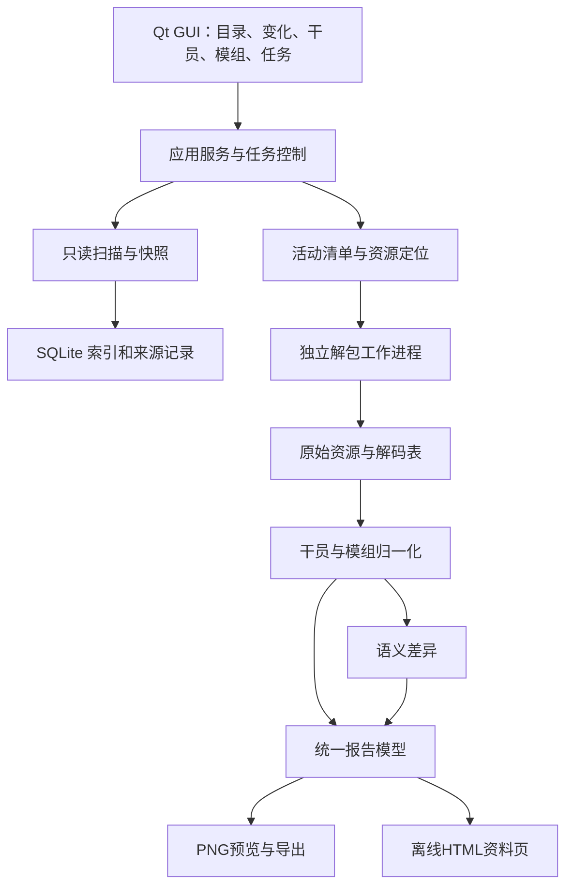

# 明日方舟 PC 资源解包与资料导出工具 — 完整开发计划

> 状态：Windows 0.1.26源码与本机已更新，自动预览见第14.29节；0.1.25，角色透明提取／表情制作见第14.28节；0.1.24，资源排序、时间对照与包内大小见第14.27节，当前页保持和内部读取隐藏见第14.26节，系统字体及同窗切换见第14.25节；GitHub公开发行仍为v0.1.20，见第14.23节。既有版本交付证据见各增量记录。
> 执行者入口：遵循用户的 `agent-dev-workflow`；实施时按依赖分批并行，主 agent 负责公共契约、集成和交付。可结合 `superpowers:subagent-driven-development` 或 `superpowers:executing-plans` 逐项执行。复选框仅在对应证据取得后勾选。

**目标：** 用户选择 PC 游戏目录后，可以理解目录用途、浏览资源、识别文件变化、按资源类型解包，并将新增干员的完整资料和新增／变更模组导出为中文PNG及可离线浏览的HTML资料页。

**架构：** 原生桌面 GUI 调用独立的扫描、资源解析、数据归一化与报告服务；扫描快照、资源生效层和业务实体变化分别建模。解包引擎在独立工作进程中运行，游戏目录作为只读输入，所有输出进入用户选择的独立目录。

**技术栈：** Python 3.12 x64；PySide6 Qt Widgets；UnityPy 与固定版本的 Ark-Unpacker／Ark-FBS-Py 适配；SQLite；Pillow 中文长图排版；PyInstaller 目录式便携包。实际依赖精确版本已由 M0 样本验证锁定，不使用无约束的 latest。

**设计规格：** 本文第 1–10 节；实施任务为第 11 节。目录事实以 [游戏目录说明](docs/GAME_DIRECTORY_GUIDE.md) 为唯一正文，不另建重复总计划。

## 1. 任务范围与完成标准

用户最初要求先编写完整计划书，已完成规划、目录盘点和上游研究；随后明确授权持续开发全部功能和 Windows 程序交付。以下功能全部进入首个完整交付范围，实际证据见第13节与 [验收摘要](docs/ACCEPTANCE.md)。完整M9日志及样本留在本机，不随源码上传。

| ID | 用户能力 | 交付要求 | 实施任务 | 当前状态 |
| --- | --- | --- | --- | --- |
| F01 | 选择游戏目录并识别布局 | 文件夹选择器、路径校验、记住最近位置，兼容只含一层资源的输入 | M1、M3 | 已实现，真实Qt流程通过 |
| F02 | 理解各目录用途 | 资源管理器中显示功能标签、说明、推荐处理方式；未知目录明确标记 | M1、M3 | 已实现，目录文档与GUI一致 |
| F03 | 最近 N 小时更新列表 | 默认 24 小时，可修改；显示修改时间、首次发现时间及检测依据；可仅显示 `.ab` | M2、M3 | 已实现，时间窗口与GUI回归通过 |
| F04 | 检测新增／修改／删除 | 保存独立快照，比较文件与内容；首次扫描建立基线；失败扫描不冒充完整快照 | M2 | 已实现，模拟变化与本机扫描通过 |
| F05 | 资源管理器式浏览与选取解包 | 目录树、面包屑、排序、搜索、多选、递归选择、预览、任务队列、取消与失败重试 | M3、M4 | 已实现，持久任务／恢复独立复核通过 |
| F06 | 自动匹配解包方式 | 文件签名、对象类型与目录功能共同决定；支持匿名 `.bin`、数据、图片、音频、Spine 等 | M0、M4 | 真实12表、透明PNG、WAV、Spine、USM通过 |
| F07 | 新干员识别 | 对比完整、可比较的数据快照，按稳定角色 ID 识别新增；旧角色修改另列 | M5、M7 | 已实现，受控快照验证；未等待真实游戏更新 |
| F08 | 干员详细信息图片 | 满精英／满级／满潜／满信赖属性、潜能增量、天赋、所有专三技能、后勤、模组 | M6、M8 | 真实克莱门莎及代表角色通过 |
| F09 | 新模组／模组更新图片 | 按模组 ID 区分新增与已有修改；展示三级属性、特性／天赋当前效果，不附跨版本对照 | M6、M7、M8 | 已实现，真实三级模组与历史变化通过 |
| F10 | 完整桌面交付 | 双击可用的 Windows x64 程序、说明、许可证、日志、版本与来源清单 | M9 | 正式便携包、原生窗口、真实服务与ZIP摘要通过 |
| F11 | PRTS风格的HTML资料导出 | 与PNG共用数据，完整干员资料、目录跳转、表格与技能／模组分区；单文件可离线打开 | M8、M9 | 已实现，静态/转义/脚本检查通过；浏览器验收受限 |

### 1.1 首版明确支持

- 中文界面；Windows x64；优先验证本机 PC 客户端布局和 Unity 2021.3.39f1 样本。
- 游戏根目录、`Arknights_Data`、识别到的初始资源根或热更资源根；缺少另一层时提示当前覆盖范围。
- 原始文件浏览和当前生效资源浏览两种视图。用户可以有意解包历史底包，但报告默认使用可验证的当前资源。
- 单文件、多个文件、目录递归、选中变化、一键导出本次新增干员与模组；也允许手动导出现有干员。
- 默认离线完成扫描、解包、分析、导出；可导入历史快照／已解出的同服数据建立对照，不依赖在线数据库才能使用。
- 图片信息结构参考两张附件；文字、数值和版本来自解析结果，模板原创，不复制示例作者、群号、日期或水印。
- HTML参考PRTS干员资料页的信息层级和表格风格，作为首版必交付格式，与PNG并存；默认同时导出，可单独选择。

### 1.2 边界与默认决定

- “整理文件夹”落实为结构文档、软件内分类和用途标注，不移动或重命名实际游戏文件。
- 不包含资源回封、游戏文件替换、运行时注入、账号数据读取、自动下载游戏资源、战斗伤害模拟或基建排班求解。
- 附件中的“排班”结合图片语境按“排版／信息排列”理解；后勤技能会完整呈现，班表优化不属于当前功能。
- 从文件系统只能确定本机写入时间或两次观测之间的变化；不能据此断言服务器发布时刻或角色已开放获取。
- 数据包含但尚不可获取的角色单列“数据中新出现／未确认可获取”，与正式可获取干员区分。
- 视觉参考不是数据真值。已核对的 v078 参考表中，克莱门莎有两项后勤技能，附件一的“无基建技能”不可作为预期结果。

## 2. 已确认事实、资源复用与关键缺口

### 2.1 本地事实

- 项目目录本轮开始时为空；`git rev-parse --show-toplevel` 确认不在 Git 仓库内。没有现存程序、计划、工程命令或用户修改需要迁移，不为写计划强建仓库。
- 已只读盘点游戏根目录。详细统计、资源分类及采样路径见 [目录说明](docs/GAME_DIRECTORY_GUIDE.md)。本机为约 26.03 GiB 的物理文件集合，不能全量加载进 GUI 内存。
- 两层资源同时存在：`Arknights_Data/StreamingAssets/AB/Windows` 与 `Arknights_Data/PersistentData/Bundles`。
- 代表性 `.ab` 和 `anon/*.bin` 都有 UnityFS 头，版本为 Unity 2021.3.39f1；`.idx` 属于另一类数据，不能按 UnityFS 包直接读取。
- 当前活动清单中的部分资源未安装，部分底包版本已陈旧；匿名包的 `md5` 字段存在 4 位短值。不能一律以该字段当完整 MD5，也不能一律在热更缺失时静默回退底包。
- 2026-10-19 18:38:55 +08:00 的 24 小时窗口内，两层资源无最近写入项；全树变化集中在日志和 SDK 状态。此结论仅适用于该次观测。

### 2.2 已检查的复用资源

| 资源 | 采用方式 | 限制与理由 |
| --- | --- | --- |
| [Ark-Unpacker 固定提交](https://github.com/isHarryh/Ark-Unpacker/tree/4a4b9efc6be4690b68b70b4a16578950baa066d3) | 参考并适配其 AB 解压、导出、文本解码、透明通道合并与 Spine 分拣 | BSD-3-Clause；不是现成 GUI，也未实现本项目的快照和干员／模组领域层 |
| [Ark-FBS-Py 固定提交](https://github.com/isHarryh/Ark-FBS-Py/tree/161d5e229916d7193364983396076556fbeaa549) | 固定生成的表结构与 ResourceManifest 结构，记录与引擎的配套关系 | schema 随游戏更新漂移；本地实际解码仍需验收 |
| [UnityPy](https://github.com/K0lb3/UnityPy) | Unity 对象枚举、容器路径、图片／文本等导出底层 | 采用上游配套版本起步，原生依赖与自定义压缩须一起验证 |
| 既有 RIIC 项目 `scripts/import-gamedata.mjs` | 参考 `building_data.chars → buffChar → buffData → buffs` 和精英／等级阶段选择 | 已重新阅读源码；不会直接调用会写回 RIIC 项目的脚本，其输出仅覆盖后勤，不能作为完整角色数据源 |
| 既有固定 v078 原始表与来源清单 | 用作离线字段研究和已知样本核对 | 固定提交 `17759cc8cdf37388414145d16262a3a06f3ab25e`；不是本轮 PC 解包结果，也不宣称其为当前在线最新 |
| [Qt for Python](https://doc.qt.io/qtforpython-6/) 与 [PyInstaller](https://pyinstaller.org/en/stable/operating-mode.html) | 原生模型视图、字体排版、便携打包 | 需验证打包后的插件、中文字体和子进程，不能只验证源码启动 |

本次只读检查了相关字段与源码，没有运行既有 RIIC 导入脚本，也没有修改另一个项目。后勤效率与排班算法不复用；以后若增加机制计算，再启用 `arknights-riic-mechanics` 及相应验证。

上游程序声明版本为5.2.0，固定提交的依赖候选包括UnityPy 1.25.3、flatbuffers 25.12.19、Pillow 11.3.0、NumPy 2.2.6、PyCryptodome 3.23.0、bson 0.5.10、lz4 4.4.5、spine-asset 1.1.1、WannaCRI 0.3.3、ffmpeg-python 0.2.0、fmod-toolkit 0.1.3。上游Python约束为`>=3.10,<3.13`，但Spine代码使用`StrEnum`，因此本方案起步选3.12而非直接复用本机3.13；以[固定依赖声明](https://github.com/isHarryh/Ark-Unpacker/blob/4a4b9efc6be4690b68b70b4a16578950baa066d3/pyproject.toml)和[锁文件](https://github.com/isHarryh/Ark-Unpacker/blob/4a4b9efc6be4690b68b70b4a16578950baa066d3/poetry.lock)为核验入口。

发行前还需核对实际纳入的组件：Ark-Unpacker的BSD不自动覆盖其他仓库；本次固定Ark-FBS-Py及其schema来源未见明确LICENSE，schema再分发条件需解决。`fmod-toolkit`包的MIT不等于附带FMOD DLL的许可；FFmpeg须按实际构建记录许可。M0登记每个运行组件的来源与许可，M9只纳入已明确可随包交付的组件；对尚未明确的组件先验证本机方案，选择获准的来源或独立适配后再定发行清单，不把缺失依赖隐瞒为全功能包。PySide6/Qt随包材料也按实际使用模块核对。

核对入口：[Ark-Unpacker许可证](https://github.com/isHarryh/Ark-Unpacker/blob/4a4b9efc6be4690b68b70b4a16578950baa066d3/LICENSE)、[fmod-toolkit 0.1.3说明](https://pypi.org/project/fmod-toolkit/0.1.3/)、[FMOD官方条款](https://www.fmod.com/legal)、[FFmpeg构建与许可说明](https://ffmpeg.org/legal.html)。这里记录组件来源核对任务，不将某个Python包的许可推定到其捆绑二进制。

### 2.3 必须先闭环的技术问题

1. **表在哪里：** 从 `.idx` 或 AB 容器名称恢复 `character_table`、`skill_table`、`building_data`、`uniequip_table`、`battle_equip_table` 与匿名包的关系。
2. **怎样可靠解码：** 验证 PC 样本的特殊压缩、TextAsset 字节、AES／BSON／FlatBuffers 分支，固定引擎与 schema 版本。
3. **什么才是当前有效数据：** 核验活动清单、局部下载清单、底包和热更的关系；拒绝混用陈旧核心表生成“当前版本”报告。
4. **语义与渲染：** 潜能序号、信赖内部等级、天赋替换、模组阶段与富文本占位符必须有可追溯样本，不能靠替换字符串猜结果。

前 3 项为 M0 的准入条件。若失败，继续浏览器／扫描等独立工作，同时记录具体不支持的包和原因；不能将其他能力完成写成“完整解包与资料导出已完成”。

## 3. 技术选型与运行结构

### 3.1 GUI 方案比较

| 方案 | 优点 | 主要成本 | 决定 |
| --- | --- | --- | --- |
| Python + PySide6 Widgets | 与解包生态同语言；目录树、表格、进度、中文排版可直接实现 | 需处理原生依赖和 Qt 打包体积 | 采用 |
| C# WPF + Python 工作进程 | Windows 交互成熟 | 同时维护两套模型、协议与打包链 | 当前不采用 |
| Electron／网页 GUI + Python 服务 | 前端展示灵活 | 增加浏览器运行时与本地服务边界，本任务无需网络页面 | 当前不采用 |

选择 PySide6 的目的是尽快形成可维护的完整 Windows 工具。首版不引入插件商店、通用工作流引擎或后台服务。

### 3.2 执行与依赖方向



- GUI 只消费服务结果，不直接执行文件遍历、UnityPy 或数值公式。
- 扫描与哈希为后台任务；SQLite 写入由单一存储服务串行处理。
- 解包隔离到工作进程，任务私有 request.json／result.json 与 events.jsonl 传递结构化请求／事件，日志单独保存；兼容 Windows windowed 程序 stdout/stderr 均为 None，不依赖控制台流。大图和表数据通过受控文件传递。
- 任务状态统一为 `queued/running/cancelling/succeeded/partial/failed/cancelled`；成功数量、失败数量、跳过原因分别展示。
- 首版采用单调度器串行执行（并发1），GUI持续响应，第三方解码在独立进程；以控制Unity贴图内存及可预测取消为本机实施决定，不提供未验证的并发1–4选项。
- 首版“暂停队列”定义为不开始下一个任务，当前批次继续；需要停止当前批次时取消，先协作退出、超时终止所属工作进程。既有成功文件保留，未完成文件不进入成功清单。

### 3.3 上游接入方式

采用“**固定引擎代码 + 薄适配层 + 独立进程**”。只复制／引入确需的模块及许可证，保存原始提交与修改记录，自己的业务代码不散落到上游目录中。

- M0 先用固定版上游的明确模式作对照，验证样本；生产接口提供结构化进度与逐文件结果。
- 若短期通过 CLI 做兼容后端，必须显式传 `--image/--text/--audio` 等所需开关，工作目录放任务私有目录。
- 不透传上游 `-d/-delete`（固定版本为单横线别名）。它会删除目标目录，GUI 总是创建新的任务目录，失败重试只处理本任务未成功的文件。
- 上游参数中出现 `--spine` 不等于 AB 模式会执行它；源码核对显示专门导出应走 `-m sp`。自动策略按真实调用链接入。
- `fb` 模式处理 AB 导出的文本／字节资产，不是把所有 `.bin` 都当 FlatBuffers；本机匿名 `.bin` 首先需要 AB 解析。
- UnityPy自定义压缩映射仅在worker中注册；固定上游将`CompressionFlags.LZHAM`接到`decompress_lz4ak`，不得将其未经核验地应用于所有Unity工程。GUI运行进程不依赖这一全局修改。
- 上游个别异常被记录后仍计入“已处理”，CLI最后可能退出0；成功必须依据逐对象／逐文件结果和实际产物验证，不能仅解析退出码或进度条。
- USM的现有单文件CLI路径可能收集到零任务；适配器直接调用经验证的单文件入口。FFmpeg／FFprobe能力检测只在私有工作目录中执行，避免其固定测试文件覆盖用户文件。
- RGB／Alpha优先使用Material引用等明确配对关系；只有名称或图像相似度时记录为推断配对，并保留原图用于复查。
- `.idx` 探测不能依赖文件名自动猜 schema。候选为 `CN.resource_manifest` 的显式根类型；解出结构后仍须校验所有 BundleIndex、逻辑路径及物理包存在性。
- 另一条可行验证路线：枚举匿名 AB 的 `container` 与 TextAsset 原始名称，识别带 hash 后缀的表名，再明确指定表 schema。两条路线以样本结果决定主路径和回退路径。

固定源依据：[解压与异常处理](https://github.com/isHarryh/Ark-Unpacker/blob/4a4b9efc6be4690b68b70b4a16578950baa066d3/src/ResolveAB.py)、[模式调度](https://github.com/isHarryh/Ark-Unpacker/blob/4a4b9efc6be4690b68b70b4a16578950baa066d3/Main.py)、[USM实现](https://github.com/isHarryh/Ark-Unpacker/blob/4a4b9efc6be4690b68b70b4a16578950baa066d3/src/ResolveUSM.py)。

## 4. 游戏目录识别、资源管理器和解包策略

### 4.1 源识别与生效层

每个安装位置建立独立 `profile_id`，绑定规范化真实根路径、平台、语言／区服信息及当前清单标识。根目录移动可显式重定位；不自动把不同目录、区服或版本的历史混合。

文件键保留原始路径用于显示，另建立符合目标文件系统大小写规则的比较键；路径规范化、Unicode名称和Windows长路径需要测试，不能将名称清洗用于修改输入路径。检测不到区服时记录未知，历史基线导入必须显示这一限制。

“当前生效资源”以活动清单中的逻辑资源键建立映射，而不是先把热更内容物理复制覆盖到底包：

1. 找到最新可解析且稳定的活动清单，保存原始版本标识与摘要。
2. 搜索热更和底包候选，按大小、可用完整摘要及物理签名验证。
3. 同一逻辑资源优先选择与活动清单匹配的已安装候选；保留候选来源和被遮蔽版本供浏览。
4. 所需版本不存在时区分“未安装的可选资源”“仅有旧版”“文件不完整／读取失败”“暂不支持验证”；不静默把旧版当当前版本。
5. 若摘要为 4 位短值，保存为 `short_token`，不得套用标准 MD5 校验。以已验证的清单语义、大小、物理来源和本地 SHA-256 补充证据；无法确认时保留未验证状态。
6. 没有完整清单的独立目录仍可手动浏览／解包，但标记版本覆盖未知；业务报告记录限制，不能冒充完整当前安装。

具体目录与处理建议见 [目录映射](docs/GAME_DIRECTORY_GUIDE.md)。目录标签是推荐依据，文件签名和实际对象类型才决定解包器。

### 4.2 界面布局

```text
┌ 游戏目录 [选择…]   [扫描/重新扫描]   时间范围 [24 小时]  [仅 .ab] ┐
│ 资源浏览 | 更新记录 | 干员资料 | 模组更新 | 导出任务 | 设置       │
├────────────────┬─────────────────────────┬───────────────────┤
│ 目录树          │ 面包屑、搜索、筛选       │ 所选对象详情       │
│ 当前生效资源    │ 名称 / 功能 / 类型      │ 功能说明、来源层   │
│ 初始资源        │ 大小 / 修改时间 / 状态  │ 版本、校验、预览   │
│ 热更资源        │ 多选、排序、右键菜单    │ 推荐解包方式       │
│ 其他游戏目录    │                         │ [加入解包队列]     │
├────────────────┴─────────────────────────┴───────────────────┤
│ 扫描/解析进度、失败与跳过数、输出位置、取消/重试                 │
└─────────────────────────────────────────────────────────────┘
```

- 目录树使用懒加载模型；大列表分页／分批装载，不为每项创建重量控件。
- 树节点和文件行带中文用途标签，选中后显示完整说明、推断依据和适用的导出类型；未知目录显示“尚未分类”。
- `.ab` 过滤不隐藏目录层级，大小写不敏感；仅控制文件显示，不影响索引、清单、匿名包和依赖文件的解析。
- 双击文件查看对象列表；图片显示缩略图，文本显示限长预览与完整导出入口。可选整包或内部对象解包；AB 内对象列表为二级能力，M4 接入。
- 多选支持 Ctrl／Shift、全选当前筛选结果、选择子目录；“所选”与“所有结果”的数量明确显示。
- 任务开始前显示策略、文件数量和输出位置；可以切换原始导出／处理后导出，失败不影响其他文件继续处理。
- 干员／模组页独立于 `.ab` 文件筛选，避免用户开启过滤后无法找到逻辑资料。

### 4.3 自动处理流水线

| 资源判定 | 默认流水线 | 结果 |
| --- | --- | --- |
| UnityFS `.ab` 或 `.bin` | 包头探测 → 相容解压 → 对象枚举 → 按选择导出 | 对象清单、原始资源与来源清单 |
| 立绘／头像／图标 | Texture2D／Sprite → PNG；确认配对时合并 RGB／Alpha | 透明 PNG；缺配对则保存原图并说明 |
| 战斗／基建小人、动态立绘 | 专用 Spine 收集 → 骨骼、atlas、贴图一起输出 | 完整资源组与缺失依赖列表 |
| 游戏数据／剧情文本 | 提取原始 TextAsset 字节 → 格式探测 → AES／BSON／JSON／FlatBuffers 适配 | JSON／TXT 和原始字节，可定位失败 |
| 音效／语音／音乐 | AudioClip → 支持的解码导出 | WAV 或可用原始音频，标明格式 |
| 视频 | 真正 USM 文件才进入专用 demux 流程；其他格式按识别结果处理 | 视频／音频分轨与原始文件；外部依赖明确列出 |
| Mesh／未知 Unity 类型 | 按用户选择导出 OBJ／TypeTree／可得原始字节 | 可查看的结果或明确不支持说明 |
| SDK、DLL、日志和账号配置 | 只显示目录用途及普通文件信息 | 不纳入资源解包任务 |

Spine 首版要求正确导出完整文件组，不包含内置动画播放器；视频首版要求可识别、按上游支持范围导出，不承诺转码所有私有格式。任何未知格式都保留诊断，不能生成空文件并计为成功。

## 5. 最近 N 小时、文件快照与语义更新

### 5.1 两个时间维度必须分开

**最近写入视图：** 以扫描开始的固定 UTC 时间 `scan_started_at` 为右边界，筛选 `scan_started_at - N小时 <= mtime <= scan_started_at`。默认 N=24，允许正数小数；无效／非有限／非正数拒绝。内部存 UTC 和纳秒时间戳，界面按系统时区显示偏移。本机验收使用 Asia/Shanghai。

**内容变化视图：** 比较两次完整扫描，记录首次观察到变化的时间和覆盖区间。即使文件保留旧 mtime，只要清单或内容摘要变化也能进入这里；明确显示“本次检测到，实际写入时间未知”。

默认更新页同时提供“最近写入”和“相对基线变化”分组。用户可选“任一命中”或交集过滤，不把旧文件首次被看到称为刚发布。

### 5.2 首次扫描与之后扫描

- 首次扫描：全目录元数据与资源清单入库，核心数据相关包建立可验证摘要；界面可列出最近 24h 文件，但新增／修改状态为“首次发现，历史未知”。生成第一个完整数据快照后才具备后续自动识别能力。
- 默认快速扫描：重新枚举元数据、清单；对元数据变化、清单变化、核心数据、未完成校验和新文件计算流式 SHA-256。只用元数据跳过的文件标记“元数据未变”，不能声称逐字节相同。
- 严格扫描：对全部选定范围重新流式计算摘要，用于识别大小和时间均保留的修改。进度包含读取字节数，可取消；不使用抽样哈希冒充完整摘要。
- `added`：旧完整清单无该物理键、新清单有；`modified`：内容摘要不同；`metadata_only`：元数据变但完整摘要相同；`removed`：完整新扫描中确实缺失。
- 重命名先表现为新增／删除，可基于完整摘要显示关联建议，不因此改变原始事件；逻辑层额外记录资源来源切换。
- 同时保存物理变化和生效资源变化：旧底包变化但被热更遮蔽，不应触发当前角色资料改变。
- 扫描前后比较文件大小／时间和清单摘要；读到更新中的文件标记 `unstable`，有限重试，整批不晋升为完整业务快照。
- 权限错误、读取失败和半途取消生成部分结果；未扫描到的路径不能推断为删除。部分扫描不替换最后成功基线。

### 5.3 自动触发与留存

选择目录后自动扫描；下次打开软件自动检查已选目录。软件运行期间可开启目录变动监听，防抖后重新核对清单和变化文件；监听只作为提示，最终仍以重扫为准，不建立系统计划任务。

扫描记录和实体快照分开存储，语义基线默认为上次**完整成功**的数据快照，并允许选择历史对照或固定基线。每次差异和导出绑定两端快照，不因下一次扫描而丢失本次更新名单。

缓存可按大小上限清理重建；用户导出文件、固定基线和历史报告不自动删除。删除历史快照由用户在界面显式操作；若被报告引用，先说明关联。

### 5.4 新干员与新模组判定

- 干员按 `char_id`／形态键比较；模块按 `equip_id` 比较，不以 AB 文件名、最后一条记录、名字变化或最高编号判断新增。
- 归一化的业务记录使用稳定序列化摘要，区分新增、删除、属性变化、技能／天赋／后勤／模组变化和仅文案变化。JSON 键顺序变化不产生业务更新。
- 角色依赖的共享技能、职业特性、术语、后勤 buff 和模组变化，会通过反向引用索引使相关角色重新计算；不只比较 `character_table` 本身。
- 皮肤、语音和头像变化单独分类，不当作新干员；召唤物、陷阱、敌方和临时剧情记录不进入默认可获取干员名单，但保留可查询原始记录。
- 有形态／职业切换的记录通过 `char_patch_table` 等实际结构关联，保留独立形态资料，不能误报为新角色；别名和获取状态变化另列。
- 模组 `INITIAL` 证章与实际可升级模组区分；特殊／仅特定玩法生效模组标出适用条件。
- 当前快照缺核心表、缺引用或版本不一致时阻止“已确认新增”的结论。允许导出明确标注缺项的草稿，不能输出看似完整的正式报告。
- 首次安装时可导入用户已有的同服历史快照进行比较。外部数据必须展示来源、版本及缺项，不自动替换本地解析结果。

## 6. 核心数据模型、计算与文本解释

### 6.1 表与字段职责

以下名称为已核对的提取表结构入口；本地 PC 表可能带 hash 后缀，M0 建立逻辑名映射。解码不是全目录先全部导出再分析，而是只读取核心表及其依赖。

| 表 | 使用内容 |
| --- | --- |
| `character_table` | ID、职业、特性、精英阶段、属性关键帧、信赖关键帧、潜能、天赋候选、技能引用 |
| `skill_table` | 技能各等级、SP 类型／消耗／初始值、持续时间、触发方式、描述、blackboard |
| `building_data` | `chars.buffChar[].buffData[]` 的阶段选择、`buffs` 的名称／房间／说明 |
| `uniequip_table` | 模组 ID、所属干员、X／Y／其他类型、名称、解锁条件、证章／正式模组分类 |
| `battle_equip_table` | 各 `equipLevel` 的属性、特性覆盖／追加、天赋替换、潜能条件、召唤物属性 |
| `favor_table` | 信赖点数、显示百分比与内部阶段映射，避免直接把内部 level 当百分比 |
| `gamedata_const` 与相关字典 | 术语、类型／枚举展示映射；按实际依赖补充 |
| `char_patch_table`、相关角色字典 | 形态与职业切换、特殊角色关联，按本版实际字段解析 |
| `skin_table`、`range_table`、资源容器索引 | 头像／立绘与攻击范围的可选展示，不作为核心数值成立的前提 |
| `data_version`、资源清单 | 游戏数据版本、资源版本与来源证据 |

每个字段保存至少一个 `SourceRef`：源逻辑包、来源层、原始对象名／path ID、表名、JSON Pointer、输入摘要及解码器版本。用户点击数值可查看来源，JSON sidecar 能复查计算。

不能直接假定上游解码JSON与常见GameData镜像完全同构。固定版FBO导出按getter命名字段，存在PascalCase／camelCase差异，空向量可能变成null，显式null字段可能被省略。`table_decoder.py`须在getter／向量读取层保留原始字段存在性和长度证据，输出`DecodedTable`（表内容、字段证据、原始字节来源）；`normalize.py`再按各表的明确映射消费。不能先丢失信息再试图从上游JSON恢复，也不使用简单首字母小写规则处理所有键，不把因解码器丢失的数组解释为角色没有技能。原本已是JSON的TextAsset直接校验透传，不因上游批解码跳过而丢弃。M0/M5同时验收表结构、必要记录、向量边界和业务引用，而不是仅检查JSON能读取。

### 6.2 满级、满潜、满信赖面板

默认导出当前数据允许的最高精英阶段与该阶段最高等级。不是所有干员都固定“精二 90”，低星、特殊形态按实际上限处理。

1. 在目标阶段取合法属性关键帧；最高等级直接命中上限帧，不进行跨精英阶段插值。
2. 信赖显示为该版本满信赖值，属性按 `favor_table` 映射并截取属性关键帧上限；已核对样本的上限属性帧内部 level=50，不等于显示信赖 50%。
3. 潜能从零基内部 rank 转为用户显示等级；样本 `maxPotentialLevel=5` 对应潜能 6，不能把内部值直接印为潜能 5。
4. 依次应用已达到的属性修饰，依据 `attributeType`、`formulaItem`、数值和条件。简单加法的常见情形为 `面板 = 阶段满级基础 + 信赖 + 潜能属性修饰`；遇到非加法或动态修饰必须按已核验语义处理，不把所有项直接相加。
5. 主面板默认“无模组”；模组属性另列。用户若选择计入模组，只能选择一个，标题显示模组名和等级；不把 X／Y 等多模组同时相加。
6. 有条件触发的天赋、技能、战场／队伍增益不混入静态面板。明确属于面板的特殊恒定修饰按证据规则处理，并给来源说明。

输出至少包含：生命上限、攻击、防御、法抗、初始部署费用、再部署时间、阻挡数、基础攻击间隔；同时可显示基础攻速，避免把攻速与间隔混淆。部署费用不混入再次部署倍率。若补充理论攻击间隔，须明确标识计算口径，不冒充实战逐帧结果。

所有属性保留“基础、信赖、潜能、所选模组、最终值”分项。潜能造成的费用降低和再部署缩短同样标注。内部不提前四舍五入，显示层按属性规则格式化，避免浮点尾数。

**已核对参考样本，仅用于测试，不是本机当前 PC 解包证明：**

| 克莱门莎，固定 v078 | 应有结果 |
| --- | --- |
| 阶段／等级 | PHASE_2 / 90 |
| 攻击 | 920 基础 + 110 信赖 + 35 潜能 = 1065 |
| 生命／防御／法抗 | 2720 / 371 / 10 |
| 部署费用 | 23 - 1 - 1 = 21 |
| 再部署／阻挡／基础间隔 | 70 秒 / 2 / 1.2 秒 |
| 后勤 | 谈判技巧、合作原则；不能因截图缺失而输出“无” |

样本来源：[固定角色表](https://raw.githubusercontent.com/Kengxxiao/ArknightsGameData/17759cc8cdf37388414145d16262a3a06f3ab25e/zh_CN/gamedata/excel/character_table.json)、[固定后勤表](https://raw.githubusercontent.com/Kengxxiao/ArknightsGameData/17759cc8cdf37388414145d16262a3a06f3ab25e/zh_CN/gamedata/excel/building_data.json)。已读取本机缓存角色表的SHA-256为`e523c7c83c36e2d76697121079e17d0282da1a94d59a55e1cc55616edf0b41c4`，与其既有来源清单相符；本轮另定向读取了同提交的技能、信赖、模组元信息与战斗模组表以核对字段。

### 6.3 天赋、技能和后勤

**天赋：** 按角色形态、精英阶段、等级和 `requiredPotentialRank` 选择合法候选；同一天赋槽按显式阶段与 rank 排序，不能简单取数组最后一项。分别构建满潜与无潜能增强的基准候选，结合 blackboard 差异和原文潜能标记生成增量。已有 `（+15%）` 等标记不可重复附加；概率／倍率差异区分百分点和相对增幅。隐藏实现记录不直接当成额外可见天赋。

**技能：** 按干员技能栏次序输出一／二／三技能，支持实际只有零／一／二技能。专精 3 由技能等级及专精结构确认，常见十级列表的第十项作为已验证映射；不能无条件把任意最后一项标为专三。不支持专精的技能显示实际最高等级并说明。包含名称、技力回复类型、触发方式、初始 SP、消耗 SP、持续／弹药／充能类型、完整说明和必要条件。持续时间为 0 不自动解释为“无限持续”。

**后勤：** 按用户2026-10-23补充要求，遍历 `buffChar` 各槽的全部 `buffData`，按解锁精英／等级排列并取 `buffs` 名称、房间、完整描述和解锁条件，不按当前培养阶段筛掉早期或未解锁版本。报告同时展示全部阶段，注明升级后的技能会替换同一位置的旧技能；JSON保留槽关系和原始ID。缺引用时保留该阶段及未确认提示，只有完整数据确证没有条目才显示“无后勤技能”。

### 6.4 富文本与 blackboard

建立一个共享解释器供技能、天赋、特性和模组使用：保留段落，识别颜色／强调标签、术语引用、占位符和格式说明。支持实际样本中的 `{key}`、`{key:0%}`、小数格式以及包含点、`@` 等字符的合法键；格式语法从样本补齐，不执行表达式 `eval`。

- 从对应层级的 blackboard 取数，保留 `valueStr`；明确局部／继承层的查找次序，避免同名键串用。
- 字面量百分比与格式化占位符分别处理；倍率 2.9 应按模板显示 290%，不是所有数值都乘 100。
- 术语引用可展开为正文或脚注；不直接用一个全标签正则删除语义。
- 无法解释的占位符保留可见原文、诊断位置与原始 blackboard。不能静默替换成 0、空串或编造自然语言。
- “未使用的 blackboard 字段”可在诊断附页展示，不等于“描述未填充失败”。附件一的原始字典不作为默认主图内容。
- 正式图片要求全部必需信息已解析；有关键未解析项时只能通过“导出带诊断草稿”明确输出，图上显示缺项标记。

### 6.5 模组解释与差异

- 以 `equip_id` 关联 `uniequip_table` 和 `battle_equip_table`，读取所属干员、模组名与类型，过滤证章；不能由文件名猜 X／Y。
- 默认报告三级模组最终效果，同时保留一级／二级／三级详情。某阶段缺失时如实标明，不将二级伪装成三级。
- 每个阶段的 `attributeBlackboard` 按该阶段语义读取，不把三个阶段的总属性再次求和。
- 解析 `parts` 中 `TRAIT`、`TALENT`、`TALENT_DATA_ONLY` 等已核验类型；分别处理特性追加、特性替换、天赋新增／替换、隐藏实现条目、召唤物和玩法条件。
- 兼容原始字段名，例如已有结构的 `overrideDescripton` 拼写；`description` 为空时检查 `upgradeDescription` 和继承关系，而非立即输出空白。
- 在最高养成与满潜条件下选择对应候选，并同时保留潜能提升量；角色自身和召唤物属性分区，玩法专用效果显示作用范围。
- 新模组报告给完整最终效果；已有模组变更报告给旧值 → 新值、增量、文案变化和基准版本。必须区分“潜能提升”“模组等级提升”“跨版本调整”三种差异。
- 原始记录有变化但当前展示未变化的项目标记为“原始字段变化”，保留诊断，不夸大为实战增强／削弱。

## 7. 图片、HTML、预览和导出文件规范

### 7.1 干员长图

默认单干员一张深灰底、浅色文字的纵向长图，宽 1200 px，可改 960／1440／自定义；正文默认 28 px，行距约 1.45，外边距 48 px，潜能增量用可辨识强调色和文字双重标注。深浅主题均可切换。字体使用系统中文字体回退链；发行包若附带字体，单独附字体许可证，不打包系统专有字体。

信息排列：

1. 数据来源、游戏数据／资源版本、生成时间和养成口径。
2. 干员名、ID、职业／分支、特性；头像／立绘可选。
3. 属性与信赖／潜能分项，部署费用、再部署、阻挡和攻击间隔。
4. 依次排列所有专三技能。
5. 天赋及潜能提升。
6. 后勤技能、设施和解锁条件。
7. 潜能条目清单。
8. 所有实际模组的三级说明；无模组或缺数据分别表达。
9. 诊断摘要、来源标识与可选自定义署名。

如果采用“天赋在技能前”的阅读顺序，提供模板设置；默认以附件一的信息组织为主。数据项齐全优先于完全复刻截图行距。

### 7.2 模组更新图

参考附件二的连续卡片形式：每个模组包含“干员名 + 类型 + 模组名”、三级增加属性、特性变化、天赋变化、满潜增量；已有模组修改时追加前后对照。支持单模组图、选中模组合集和本次更新总览。

不将所有模组强塞进无限高位图。渲染器根据内存和最大高度自动分段，默认单页上限 16000 px，在语义块／行边界分页，连续页带标题和页码，不截断技能段落尾行。

### 7.3 PRTS风格的离线HTML资料页

**用户追加决定（2026-10-19）：** 干员资料增加HTML导出，风格贴近PRTS。该项进入F11及M8/M9，不以“以后扩展”处理。

已读取 [PRTS阿米娅资料页](https://prts.wiki/w/%E9%98%BF%E7%B1%B3%E5%A8%85) 的内容结构：属性表、天赋条件、潜能条目、按技能划分的等级／技力表、模组和后勤分区。页面正在提供皮肤切换，故本方案参考资料组织方式并明确自己的模板规范，不将某次站点皮肤当永久样式或照搬整站。当前已确认结构，浏览器渲染截图未取得；实际模板视觉效果在M8中验收。

**默认视觉规范：** 白色内容背景、浅灰页面底和表头、深色标题文字、细表格边框、蓝色链接／强调；职业／稀有度可作为小面积标识色。桌面宽屏采用左侧资料目录、右侧正文，内容区域最大宽度约1280px；窄屏改为单列，目录可收起。干员概要由名字、ID、职业标识、可选头像／立绘和养成口径组成。属性表使用“项目／最终值／基础／信赖／潜能／模组”列，直接看清增量。具体颜色和间距为本工具模板决定，不声称是PRTS原CSS数值。

**内容与交互：**

- 目录锚点覆盖概览、属性、特性、天赋、潜能、技能、后勤、模组、来源与诊断；标签跳转可复制链接。
- 全部技能默认展示专三资料，以独立卡片或页签切换；不存在专三时显示实际最高等级。天赋和后勤用条件／说明表，潜能提升保持独立标识。
- 模组按X／Y等实际类型分块，默认三级；可展开已解析的一级／二级详情。已有模组更新显示前后值与版本，保留新增模组清单；复用同一HTML组件导出模组合集。
- HTML与PNG的最高养成、无模组／单模组选择、潜能增量和缺项状态完全一致。首版HTML是本次资料快照，不额外复制一个独立的浏览器养成计算器。
- 提供页面内搜索（姓名／模块标题／正文）、目录定位、展开／收起和打印样式。交互只操作已有内容；脚本禁用时仍可读全部核心资料，打印时展开所需区块，避免只印当前页签。
- 批量导出为每名干员独立HTML，加一个本地`index.html`目录页，列名字、职业、版本与新增／变更状态；链接使用相对路径，移动整个导出目录后仍有效。

**离线和实现约束：** 默认单干员一个自包含`.html`文件，CSS、少量交互JS及选用的本地图片嵌入文件；系统中文字体回退，默认头像，立绘可选以控制体积。无需启动服务器，不通过`fetch`加载同目录JSON，也不引用在线CDN、PRTS脚本、远程图片或字体。原始数值来自本地解码的`ReportDocument`，数据来源不伪装为PRTS；PRTS只作为设计参考，额外站点链接由用户主动点击打开。

HTML模板自行实现，不使用PRTS站点标识、导航广告或其他无关页面内容。游戏文本经白名单富文本转换与转义后输出，原始字符串不得直接拼入脚本／事件属性；嵌入JSON需处理`</script>`等边界。缺图用占位图，不能让HTML显示成损坏链接。Edge／Chrome以`file://`打开和离线断网是必做验收，窄屏与打印预览一并检查。

### 7.4 统一报告模型与落盘

- 使用统一、与显示格式无关的`ReportDocument`构建PNG与HTML。Qt `QTextDocument/QPainter/QImage`负责PNG测量与绘制，HTML使用独立模板输出相同字段；不从PNG截图反推网页，也不在两套模板内分别计算数值。
- PNG与HTML均为首版必交付格式；GUI允许“PNG／HTML／两者”，默认两者。同目录默认保存JSON sidecar和可复制纯文本。PDF不是首版必交付项，HTML打印由浏览器处理。
- PNG在Qt内预览；HTML提供“浏览器预览”打开本任务临时导出文件，不为预览强引入QtWebEngine。浏览器与GUI可并排核对。
- 导出保留版本、来源摘要、模板版本、缺项状态；不把软件版本、客户端版本、资源清单版本和表版本混为一个字段。
- 文件名建议 `干员名_charId_数据版本_养成口径.png/.html`，图片多页追加 `_p01`；模组合集 `modules_旧版本_to_新版本_p01.png`及相应HTML。名称净化Windows保留字／非法字符，重名以稳定ID和序号区分，批量HTML目录页始终链接实际落盘名。
- 导出至 `<用户目录>/<任务ID>/assets|tables|reports|manifest.json`。文件先写临时后原子替换到本任务新文件；默认不覆盖已有用户导出。
- 只创建本工具管理的输出，不写入游戏输入根及其子目录；识别 junction／符号链接的真实目标，拒绝通过链接落回输入目录。
- 路径校验、磁盘不足、超长名称、单图内存限制和失败重试都在用户看到具体错误与已成功结果的前提下处理。

## 8. 模块结构、公共接口与持久化

### 8.1 拟议源码结构

此树是实施目标，不代表这些文件已经存在。按任务创建，避免先建立空模块。

```text
src/arknights_unpacker/
├─ __main__.py, bootstrap.py          程序入口、服务装配、工作进程入口
├─ contracts.py                     跨模块类型、事件与协议版本
├─ library/
│  ├─ discover.py                   游戏根和资源层识别
│  ├─ scan.py, changes.py            元数据/内容扫描及文件差异
│  ├─ manifests.py, resolver.py      清单语义与当前资源选择
│  ├─ classifications.py           目录用途分类
│  └─ store.py                     SQLite、迁移与快照事务
├─ extraction/
│  ├─ probe.py, engine.py           格式探测与解包接口
│  ├─ ark_adapter.py               固定上游适配、对象导出
│  ├─ worker.py, controller.py      进程协议、队列、取消
│  ├─ locator.py                   idx/容器到逻辑资源映射
│  └─ table_decoder.py             TextAsset与表解码
├─ gamedata/
│  ├─ repository.py, normalize.py   表加载、引用检查与归一化
│  ├─ attributes.py, candidates.py 属性计算与阶段/潜能选择
│  ├─ descriptions.py             富文本、术语和blackboard
│  ├─ operators.py, modules.py      干员/模组领域资料
│  └─ diff.py                     实体差异和反向依赖
├─ reports/
│  ├─ model.py, compose.py          报告模型与内容编排
│  ├─ render.py                   文本测量、布局、分页和PNG
│  ├─ html_render.py              PRTS风格HTML、离线图片与批量目录页
│  └─ export.py                   清单、命名和安全落盘
└─ ui/
   ├─ main_window.py, models.py     主窗口与懒加载模型
   ├─ explorer.py, updates.py       资源与更新页
   ├─ operator_view.py, module_view.py
   ├─ jobs.py, settings.py          任务状态和配置
   └─ report_preview.py           统一报告预览
resources/folder_rules.json         版本化中文目录分类
resources/report_styles.json        图文样式和默认值
resources/html/                     自有HTML模板、CSS及少量交互JS
vendor/                             必需上游代码、schema和许可证
tests/{unit,integration,gui}/        算法、真实样本与GUI验收
tests/fixtures/                     小型合成/可合法随代码保存的夹具
scripts/{dev.ps1,verify.ps1,build.ps1} 稳定工程命令
packaging/ArknightsUnpacker.spec     目录式发行定义
pyproject.toml, uv.lock              精确依赖与工具配置
artifacts/                          本地验证证据，按任务归档
build/, dist/                       构建中间物与候选便携包
```

完整游戏包和原始大表不提交到源码仓库，也不随软件发行；本机真实样本路径用配置指定。图片素材是运行时用户输入，不将其他创作者截图当模板资源打包。

### 8.2 首批冻结的契约

公共类型由主 agent 单独维护；各模块只依赖这些契约，不跨目录调用对方内部 helper。实际定义时为枚举和可空字段补清楚 schema；协议初始版本为 1。

| 类型 | 核心内容 |
| --- | --- |
| `GameInstallation` | profile_id、根、平台／locale、source_roots、覆盖与诊断 |
| `SourceRef` | 逻辑／物理路径、来源层、object_name/path_id、表与JSON Pointer、hash、decoder_version |
| `FileRecord` | source_root_id + 相对路径键、size、mtime_ns、sha256、hash状态、功能标签、扫描错误 |
| `ScanSnapshot` | snapshot_id、起止时间、范围、完整性、资源清单摘要与文件记录 |
| `ResolvedResource` | logical_key、候选来源、选定实体、active/stale/missing/optional/unknown状态、依赖 |
| `ExtractionRequest/Result` | request_id、资源／对象选择、策略、输出根；逐文件结果、诊断、产物来源 |
| `GameDataSnapshot` | 数据版本、资源版本、schema版本、所需表摘要、覆盖状态、实体与反向引用 |
| `DecodedTable` | 表内容、getter层字段存在性／向量长度证据、schema、原始字节与SourceRef |
| `BuildSpec` | 形态、精英、等级、潜能、信赖、可选单个模组和等级；支持MAX语义 |
| `OperatorProfile/ModuleProfile` | 归一化值、条件、分项、文本、来源及解析诊断 |
| `EntityChangeSet` | 两端快照、新增/修改/删除实体、字段变化、依赖变化和不确定项 |
| `ReportDocument/ReportArtifact` | 格式无关的内容块、样式／元数据；PNG／HTML／文本／JSON路径、分页与状态 |
| `ExportFormat` | 枚举PNG、HTML、JSON、TXT；导出控制器对每种格式分别记录结果 |

拟定服务接口：

```python
discover_installation(root: Path) -> GameInstallation
scan_installation(source: GameInstallation, options: ScanOptions,
                  emit: ProgressSink, cancel: CancelToken) -> ScanSnapshot
compare_files(old: ScanSnapshot, new: ScanSnapshot) -> FileChangeSet
resolve_resources(snapshot: ScanSnapshot) -> ResourceCatalog
locate_tables(catalog: ResourceCatalog, names: set[str]) -> TableSourceSet
run_extraction(request: ExtractionRequest, emit: ProgressSink,
               cancel: CancelToken) -> ExtractionResult
load_gamedata(sources: TableSourceSet) -> GameDataSnapshot
build_operator(data: GameDataSnapshot, char_id: str,
               spec: BuildSpec) -> OperatorProfile
build_module(data: GameDataSnapshot, equip_id: str,
             spec: BuildSpec) -> ModuleProfile
compare_entities(old: GameDataSnapshot,
                 new: GameDataSnapshot) -> EntityChangeSet
compose_report(selection: ReportSelection, options: ReportOptions) -> ReportDocument
export_report(document: ReportDocument, target: Path,
              formats: set[ExportFormat]) -> list[ReportArtifact]
```

参数与结果辅助类型统一在 `contracts.py`（报告块在 `reports/model.py`）定义。`ProgressSink` 只接收序列化事件；不把 Qt 控件、数据库连接或 UnityPy 对象跨进程传递。

### 8.3 存储与恢复

默认运行数据位于 `%LOCALAPPDATA%/ArknightsUnpacker/`，与游戏根及程序安装目录分离：配置、`catalog.sqlite3`、核心表缓存、缩略图、任务日志。用户可选择独立数据根，迁移先验证读写并保留原数据。

实际存储采用 SQLite 的 scans／data_snapshots 完整JSON负载，包含安装profile、文件、清单、来源与实体索引；独立安装使用组合键隔离，不为相同内容建重复的关系表。语义变化可从持久化前后快照重新计算。任务及产物由应用数据下任务私有JSON保存，避免序列化Python回调；恢复只接受白名单操作。首版优先清晰正确，不提前实现复杂压缩存储。

数据库有 `schema_version`，迁移事务化并备份旧文件；取消／崩溃后的 `running` 任务恢复为“已中断”，提供检查完成文件与继续未完成项，不自动重复导出。缓存键包含输入内容摘要、解码器/schema版本、归一化版本或模板版本，不能升级解析器后沿用旧结果。

## 9. 验收策略与质量界限

### 9.1 必须覆盖的高风险场景

1. 首次扫描和保留时间戳的更新：不得把全部旧角色报新，也不得把 mtime 当全部证据。
2. 热更缺包、旧底包、短摘要和可选语音：分类正确，核心数据不静默降级。
3. 扫描中更新／权限失败／取消：不误判删除、不晋升不完整基线。
4. 潜能与模组条件、特殊角色、富文本未解析：不重复加成，不把缺项写成无。
5. 中文长文本、图片超高、Windows 文件名与路径冲突：不截字、不覆盖输入或既有结果。

### 9.2 分层证据

- 单元测试：合成夹具验证窗口边界、哈希判断、候选选择、数值分项、diff和分页算法。
- 固定参考样本：v078 克莱门莎数值、两项后勤、专三文本；至少一名低星、一个形态切换角色、一个天赋潜能增强角色、一组三级模组覆盖／追加／隐藏条目。
- 本机真实数据：从当前目录选取表、头像／立绘、Spine、语音、普通 TextAsset 和匿名包，走“定位 → 解码 → 归一化 → 导图”，记录各阶段来源和hash。
- GUI 自动化与人工复核：选择中文／空格路径、筛选、多选、预览、取消、错误、重试、退出恢复；真实查看图像，不能只判断 PNG 文件存在。
- HTML浏览器验收：离线`file://`打开、桌面／窄屏、目录／页签／折叠／搜索、无JS可读、打印、批量相对链接和文本转义；核对HTML/PNG/JSON同一组关键数值与描述，不以HTML语法通过替代真实浏览器检查。
- 发行包验证：在无开发环境依赖的目标条件下，双击便携包重复完整最小流程；源码通过不能代替打包程序验证。
- 新增识别使用可控前后数据集验证，并标明“模拟版本差分”；没有真实跨更新快照时不宣称已经现场识别过一次游戏更新。

### 9.3 性能验收目标

下列是待验证目标，不是本轮实测成绩。测试记录硬件、文件数量、是否暖缓存和输入字节量：

- 以当前约 1.7 万文件为基线，常规元数据扫描目标 30 秒内；完整摘要单独统计吞吐和时间，不与元数据扫描混算。
- 扫描／解包期间 GUI 持续响应；可见进度通常每 0.2–1 秒刷新，取消请求界面反馈目标 1 秒内。
- 单任务按文件释放解析对象，首版同时处理1个包；不能随着已处理文件数持续积累所有贴图。
- 预览默认限长与缩略图，完整内容按需读取；长图分段渲染，达到内存预算时提前分页。
- 大包无法立即中断时显示“正在取消”，超时后终止所属工作进程；不宣称固定秒数内所有第三方解码都可无损退出。

## 10. 实施分工与依赖

当前为个人模式：主 agent 统筹；没有共同维护者或已有远端。并行是本任务内部委派，不创建用户侧新聊天。主 agent 独占主计划、公共契约、依赖／锁文件、入口装配、数据库迁移序列和构建／交付。

| 批次 | 工作包 | 独占写入与输入 | 依赖及输出 |
| --- | --- | --- | --- |
| 本轮调研 | `game_layout` + `upstream_audit` | 只读目录与固定上游，无源码写入 | 已实际并行；主 agent 整合计划 |
| A | M0 兼容验证 + M1/M2 扫描实现 | 引擎样本与 library 子模块分工；公共类型由主 agent 先落定 | 可同时进行；M0 决定数据链后续 |
| B | M3 浏览器 + M4 解包队列 | ui/models/explorer 与 extraction/controller 等分开 | 消费A的固定契约 |
| C | M5/M6 数据语义 + M8 报告渲染 | gamedata 与 reports 分开；渲染先用固定 ReportDocument 夹具 | 数据语义最终接入真实资料 |
| D | M7 语义更新 + GUI业务页集成 | diff 与业务页独立；主 agent 集成 | 依赖归一化模型与报告接口 |
| E | M9 全链验证／打包 | 主 agent 串行生成候选，未编写相关模块的 agent 审查 | 固定候选后验收 |

实际派工时补具体 agent 与输出目录，避免提前虚构执行者。数据集、测试报告和临时输出按任务隔离；不允许多个 agent 同时修改契约、锁文件或同一数据库。并行解码受磁盘／内存限制时降低工作进程数，不为并行凑无用模块。

## 11. 实施里程碑与实际验收

实施后的权威文件入口见 [结构索引](PROJECT_STRUCTURE.md)。原设计测试已按模块重组为 tests/app、engine、library、gamedata、reports、gui、integration，不再使用拟议 tests/unit 文件名。以下状态取代规划阶段尚未执行的任务框；设计、口径和高风险要求仍保留于第1–10节。

### M0：本机核心数据链 — 完成

- [x] 锁定Python3.12.14、依赖与上游／schema来源，保留许可证实际状态。
- [x] IDX显式根解码、逻辑表与匿名包定位，完整解码五类核心表及依赖共12张表。
- [x] getter层保存空向量／缺失／null证据；PC building适配已知字段并记录未知槽。
- [x] 实际解码字节绑定候选SHA及可用完整MD5；变化窗口拒绝整组，短token不冒充摘要。
- [x] 真实78.2.0完整表集和32项引擎回归通过；样本与来源见 artifacts/M0。

### M1：目录与资源来源 — 完成

- [x] 游戏根／Arknights_Data／单层目录识别，中文用途规则、双层活动清单与IDX解析。
- [x] 区分当前候选、短token未验证、旧底包、可选未安装资源；不静默降级核心表。
- [x] 真实目录盘点与来源证据、路径保护及 library 回归通过。

### M2：文件快照与变化 — 完成

- [x] 默认24h可修改、首次观测、前后文件变化、快速元数据与严格内容校验。
- [x] SQLite事务／备份迁移、安装隔离、部分观测不覆盖完整基线、取消状态明确。
- [x] 本机二次快速5.38秒，普通AB内容读取为0；严格取消验证不冒充全库摘要通过。

### M3：GUI资源管理器 — 完成

- [x] 六页工作台、用途目录树、面包屑、排序、多选、搜索、AB大小写过滤与对象预览。
- [x] 后台任务与主线程隔离，真实Qt选择／解包／资料／预览和重启历史流程通过。
- [x] 排序保持记录身份，切干员不残留别人的模组，未知比较有明确状态和诊断。

### M4：实际解包与持久队列 — 完成

- [x] PNG及显式Alpha配对、TextAsset、音频、Spine完整组、IDX和USM真实样本通过。
- [x] 每任务独立批次，唯一文件、不覆盖旧清单；损坏包、取消、失败与跳过分别记录。
- [x] windowed独立worker文件IPC；暂停后续任务、取消／重试、白名单任务历史与手动恢复。
- [x] 对象／组完成检查点与文件大小校验；重启不自动执行，仅续未完成项，旧格式保守兼容。

### M5：一致快照与索引 — 完成

- [x] 归一化、形态归属、共享引用反向索引、来源与完整性；合法空与无法解析分开。
- [x] 本机434项资料／513正式模组均能构建，旧固定参考与本轮真实来源分开。

### M6：属性与完整资料 — 完成

- [x] 合法最高养成、信赖、潜能分项、天赋与潜能差额、所有可专三技能、后勤、三级模组。
- [x] 单模组面板、阶段总属性、可见升级、隐藏实现／召唤物／玩法范围与未知描述诊断。
- [x] 固定与真实代表角色／模组回归、领域独立复核通过；不宣称游戏内逐项核对。

### M7：实体新增／变化 — 完成

- [x] 首次未知，完整同服基线按稳定ID比较新增／修改／形态及共享依赖变化。
- [x] 同安装unknown带提示可比，跨来源unknown和已知不同服拒认；历史快照可导出／导入。
- [x] 受控前后快照与GUI新增导出测试通过，真实跨游戏升级尚未观察。

### M8：PNG与PRTS风格HTML — 实现完成，浏览器效果待实测

- [x] 同一语义资料生成PNG／HTML／JSON／TXT；主文中文可读，完整技术证据只保留JSON。
- [x] PNG分页／缩放／滚动预览、独立干员文件、模组合集、批次索引和结果清单。
- [x] HTML内嵌资源、锚点／搜索／折叠／打印入口，转义、静态链接与Node语法检查。
- [x] 取消保留并持久化成功产物，重启可重开；恢复实际执行前绑定原快照与安装。
- [ ] 实际浏览器离线／窄屏／无JS／打印：file://被工具策略拒绝，未尝试绕过。

### M9：Windows便携交付 — 完成，保留上述验证边界

- [x] 脚本入口、精确锁、正式PyInstaller目录包、中文说明与第三方材料。
- [x] 128项统一回归及当前源码真实Qt流程通过，独立审查问题全部关闭。
- [x] 正式EXE原生窗口与真实服务链通过，包括核心表、资源及PNG／HTML导出。
- [x] 143源输入／504程序文件SHA、完整ZIP逐项SHA与CRC核验；源码及构建期间无输入漂移。
- [x] 唯一计划、实际结构、使用说明、目录文档和 [验收摘要](docs/ACCEPTANCE.md) 已更新。

## 12. 交付、维护与本轮记录

### 12.1 最终程序交付清单

- Windows x64 便携程序及运行依赖，可双击启动，无需用户安装Python。
- 完整源码、精确依赖锁与构建入口；使用指南、目录说明、已知限制。
- 干员／模组PNG与PRTS风格HTML示例报告和对应脱敏来源清单；实际测试报告与制品SHA-256。
- 上游与第三方许可证、使用到的代码／schema提交清单。
- 配置、数据库和缓存位置说明，备份／迁移／恢复入口。升级只替换程序文件，不覆盖用户输出和历史基线。

初次本机构建时尚无Git或远端，按本机便携方式交付。用户后续明确要求推送GitHub并创建Release，按第13.4节执行；采用 `test` 开发验证、`main` 稳定交付，未从本机验收推定公开发布授权。

### 12.2 游戏更新后的维护策略

保留版本化的目录规则、解码器与schema兼容记录。新格式／新枚举出现时给出具体未支持项，保存最小诊断；增加代表样本回归后再升级适配，不为“兼容”静默忽略字段。每个里程碑核对实际项目结构、依赖方向与废弃文件，按影响维护唯一计划及使用说明。

### 12.3 规划阶段历史记录（后续实施见第13节）

- [x] 阅读用户工作流与相关规划指导，确认空项目和无Git状态。
- [x] 两个只读子任务实际并行：`game_layout` 调查目录／清单／包头；`upstream_audit` 固定上游代码和解包路线。
- [x] 主 agent 检查已有后勤导入资源，核对固定参考表的字段与克莱门莎样本；未调用会写回其他项目的导入命令。
- [x] 形成唯一完整计划与实际游戏目录说明。
- [x] 根据用户追加要求，将PRTS风格离线HTML纳入F11、统一报告模型、M8及M9验收；原有PNG要求保留。
- [x] 自审F01–F11与M0–M9覆盖、导出接口及未实现状态；UTF-8、Markdown代码块、全部本地文档链接和统计加总检查通过。两名调研agent分别复核上游事实与目录数据，已修正删除参数别名和解码信息保留的接口缺口。
- [x] 规划交付后已按用户后续授权执行M0–M9，实际结果见第13节及最终验收。

规划阶段的证据只覆盖文件元数据、部分清单／包头／摘要、上游静态调用链和参考表字段。没有解密本机核心表、没有批量解包、没有生成正式干员报告，也没有验证真实游戏中的数值表现。下一项工程工作是 M0 的核心数据链样本验证，同时可推进 M1/M2 的独立扫描实现。

## 13. 实施与交付记录（2026-10-19）

用户已授权按计划持续完成全部程序与Windows便携交付，包含PNG及PRTS风格离线HTML。上节为计划阶段的历史记录，不再代表当前实施范围。

实际分工：`pc_engine`完成M0/M4；`library_scan`完成M1/M2；`gamedata_domain`完成M5–M7；`report_export`完成M8；`desktop_ui`完成GUI；主agent完成公共契约、AppServices、进程隔离、环境、集成、审查和M9。共享类型位于`src/arknights_unpacker/contracts.py`，各写入范围互斥。实际结果与交付证据已补齐如下；恢复记录位于`.work/development/progress.md`，不以源码存在代替验收。

### 13.1 已取得的实现证据

| 范围 | 已完成事实 | 证据入口 |
| --- | --- | --- |
| M0 | 本机真实IDX含15,383包／196,352资源；12张表含五类核心表；78.2.0一致表集；短token不冒充MD5；摘要绑定实际解码字节 | `artifacts/M0/engine-report.md` |
| M1/M2 | 16,878文件／13,942AB；独立profile与完整／部分快照；二次快速扫描5.38秒；严格取消保留不完整状态 | `artifacts/M1M2/report.md` |
| M3/M4 | 原生六页Qt、实际源文件／对象选择；PNG透明合并、WAV、Spine完整组、USM IVF/SFA与可选MKV；任务私有文件IPC | `artifacts/M9/source-gui-release/receipt.json`、`source-services/verification.json` |
| M5/M6 | 实际434项干员资料、513模组均能构建；克莱门莎ATK1065、费用21、3专三与2后勤；令/夕/麦哲伦等模组回归 | `artifacts/M5M7/report.md` |
| M7 | 新增／修改／形态／共享引用语义变化；首次未知；同安装unknown警告可比，跨来源unknown拒认；模拟更新与真实来源分开 | `tests/gamedata/`、`artifacts/review-domain/report.md` |
| M8 | PNG／HTML／JSON／TXT同源、中文玩家正文、完整JSON字段证据、分页预览、取消和草稿；PRTS风格HTML静态／脚本检查 | `artifacts/M8/report.md`、`artifacts/review-reports-ui/report.md` |
| 稳定IO复核 | 同内容多安装、部分结果不覆盖完整基线、Arknights_Data归一化、空区服、解包批次隔离、运行目录拒写输入 | `artifacts/review-io/report.md` |
| 引擎复核 | 等长替包并恢复mtime时拒绝整组；图片模式透明、Alpha/Material/AtlasData选择对应完整组；32引擎测试 | `artifacts/review-engine/report.md` |

当前实际入口与拟议文件名不同：M0/M4为 `extraction/{manifest,unity,decoder,tables,images,spine,usm,engine}.py`；进程在根 `jobs.py`；M1/M2测试在 `tests/library`，M0/M4在 `tests/engine`，M5–M7在 `tests/gamedata`，M8在 `tests/reports`，GUI在 `tests/gui`，真实Qt流程为 `tests/integration/test_live_workbench.py`。拟议 tests/unit 命令不再作为运行入口。

主agent真实Qt流程已完成扫描、过滤选包、实际解包、数据解析、角色／模组资料、PNG／HTML导出与预览，并关闭重建窗口读取7项历史任务与既有PNG；最终候选41.16秒，事件循环1877次定时脉冲，未启动浏览器。最终恢复修复后 `scripts/verify.ps1` 为128 passed／1 deselected。此前125项是修前候选记录，保存在 `verify-before-recovery-fixes.log`，不得当作最终来源。

任务恢复另经13项专门测试与独立审查：活动／排队态重启标中断且不自动执行；仅读取自身解包批次和校验保留文件大小；普通对象／Spine组完成事件；报告取消保留已成功产物并能重开；恢复报告实际执行前再次验证快照与原安装。R6取消产物丢记录与R7排队期间来源变化均已实证修复，GUI+reports独立复核43 passed。最终功能代码已冻结，构建中只读源码并校验构建前后摘要不变。

### 13.2 保留的证据边界

- 新干员／新模组识别已用受控前后快照和GUI调用链验证；本轮没有等待一次真实游戏升级，不把模拟事件写成已观测服务器更新。
- PC building新增5个根字段只保存未知槽位证据；已知后勤字段可解，不宣称所有未来表结构通用。
- 浏览器工具明确拒绝 `file://` URL，未用本地HTTP或其他浏览器绕过；HTML转义、资源内嵌、锚点与JS语法已查，真实浏览器交互、窄屏、无JS显示与打印仍未实测。
- 实际包解码、资料数值与导出不等于逐角色在游戏画面／战斗中核对，也不代表全26GiB所有资源均已导出。
- 公开再分发许可未确立的schema/FMOD材料如实登记；当前交付限定本机便携使用与验收，不含公开发布动作。

最终固定候选、统一测试、便携包启动／真实服务运行、文件清单和残留限制见 [验收摘要](docs/ACCEPTANCE.md)；完整本机证据位于忽略的 `artifacts/M9/`，不得以构建成功代替运行验收。

### 13.3 固定交付物

正式程序为 `dist/0.1.0/ArknightsUnpacker/ArknightsUnpacker.exe`，ZIP为 `dist/ArknightsUnpacker-0.1.0-win64.zip`（73,538,541字节）。构建任务 `20261019-195541-707f818e`，143个源输入与504个程序文件摘要验证，ZIP所有条目逐项SHA及CRC通过。正式EXE真实生产服务45.67秒通过，原生Windows窗口6页签正常启动；源码真实Qt全流程及7项历史重开也通过。具体SHA与覆盖见 [验收摘要](docs/ACCEPTANCE.md)。构建时无Git，不追溯改写ZIP中的来源元数据；后续源码提交通过输入摘要核对与该制品的关系。

### 13.4 GitHub源码与Release交付

2026-10-19用户明确授权推送GitHub并创建Release。目标为私有仓库 [Panda-Panta/ArknightsUnpacker](https://github.com/Panda-Panta/ArknightsUnpacker)，稳定分支 `main`、开发分支 `test`、发布标签 `v0.1.0`。不修改可见性为公开，不自动建立CI或推定第三方公开再分发许可。

源码提交包含工程、锁文件、固定vendor及来源披露、测试、计划与文档；不提交 `.venv/`、`.tools/`、`.work/`、`artifacts/`、`dist/`、运行数据库、账号配置和原始解包输出。真实派生测试fixture与schema保留其来源／未知许可说明，不改称项目自有或已获公开许可。`.gitattributes`保留原始字节，防止Git换行转换破坏构建输入摘要关联。

Release附现有已验收ZIP和 `.zip.sha256`；上传前再次核验ZIP、EXE与143个构建输入。构建来源保持真实的Git初始化前工作区摘要记录，不把新提交伪称为原构建时提交。上传后分别读取GitHub分支／tag、Release状态／附件大小／摘要，核验远端结果；本次同步记录留在本机 `.work/github-push/`。

## 14. 使用反馈修复：持久结果与图片导出（2026-10-20）

### 14.1 范围与设计

用户反馈的六项均纳入本轮：恢复扫描／解析／查看状态；统一界面；图片原始像素；程序目录旁保存与比较结果；更新文件可批选导图；单图平铺、多图分包目录。沿用现有服务、SQLite 和 Qt 工作队列，在 `test` 开发；不改游戏文件或覆盖用户导出。

已确认：数据库已保存扫描与资料，但 AppServices 初始化内存为空且窗口启动只重扫，不读取历史数据；样式表指定浅色却未固定 Qt 基础 palette，原生控件可能混入系统深色；engine.save 总为每包建目录。游戏图片保存现有代码未调用界面缩放，需增加原始尺寸回归及清楚的保存入口，防止把预览像素误作导出像素。

- 默认数据目录改为程序目录旁 `data/`（源码运行时为源码根），不受启动工作目录影响；显式 `--data-dir` 继续有效。旧 LOCALAPPDATA 数据可非破坏迁入，保留原文件；不能写入时显示准确错误，不默默另存到临时位置。
- `AppServices.restore(root, emit, cancel)` 在后台恢复对应安装最后一次扫描、文件变化、解析快照与实体变化，返回 `snapshot/changes/catalog/gamedata/entity_changes`；启动先恢复，扫描由用户操作或已启用的监测触发，新的扫描与最后完整基线比较。保留取消、部分结果不晋升完整基线、安装隔离和旧数据库兼容。
- 统一浅色 PRTS 工作台：完整 Qt palette、各控件和弹窗颜色、清晰层级与状态，不改导出 HTML 的既有风格。预览缩放只作用于显示；资源图片按解码原始宽高，资料长图宽度仅是资料排版设置。
- 更新列表保留整行多选，增加 AB 筛选、搜索、全选、选择数和“导出所选包内图片”，沿用同一后台解包服务，拒绝已删除或不属于当前安装的来源。
- 图片解包在已隔离的任务根中，单图源文件不建包目录，多图源文件才建包目录；Spine 等需相对引用的组仍完整保存。命名冲突唯一化、不覆盖、对象完成检查点与清单路径必须准确。

### 14.2 实际工作包与写入归属

第一批并行：`feedback_persistence` 独占 paths/application/library.store 及新增持久化测试；`feedback_images` 独占 extraction.engine/images 及图片布局测试；`feedback_theme` 独占 ui.styles/settings/entity_view/report_preview 和主题／原始文件保存测试。主 agent 独占 main_window、updates、共享契约、项目版本／锁文件、集成测试、计划、用户文档及构建交付。各包不操作 Git 或改别人文件，临时输出分别放 `.work/feedback-20261020/<包>/`。

复用入口：`scripts/verify.ps1`、`scripts/build.ps1`、既有 tests/gui/app/engine 和显式本机 `tests/integration/test_live_workbench.py`；游戏作为只读样本。重要变更完毕交由未编写该部分的 agent 审查。验收重点：完整关闭并重启（不可再次解析也能查看）、修改后再扫发现变化、跨安装不串数据、暗色系统基础 palette 下界面仍统一、预览缩放后保存文件像素不变、更新列表多选真实包导图、单图/多图布局及清单/恢复一致。

### 14.3 状态与交付

当前状态：三包并行实现与集成已完成。`scripts/verify.ps1` 190 passed／1 deselected（31.17秒），源码真实 Windows Qt 流程 1 passed（69.36秒）：批选真实单／多图包、原始像素与缩放后原文件复制、PNG／HTML资料、关闭并新服务／窗口恢复相同扫描／数据ID、434／513项资料、所选模组和11项历史。独立审查实证修复迁入强杀、跨安装旧详情、恢复中关窗覆盖状态，另有快速关窗回归；见 [当前验收](docs/ACCEPTANCE.md)。

真实单图包发现 Sprite 与 Texture 为同一幅1600×900图；引擎新增本地引用／全幅／无旋转等预筛与RGBA摘要确认，只在自动整包时去重，显式对象选择与裁切图保留，完成检查点包含别名对象ID。目录在写文件和发送进度前决定，失败或取消不事后移动既有产物。新 SVG 主题图标随已有 resources 收集；程序构建来源现记录真实 Git commit／tree／dirty 状态和输入摘要。

复用的真实Qt测试第一轮在最后页签断言失败：导出会主动切换“导出任务”，测试却预期“模组更新”；修正为核对关闭前实际页签后完整重跑通过。一次快速关窗测试出现 Windows 原子替换访问错误，独立重跑通过；关闭时已合并成单次配置保存，相关8项再次通过，不将单次访问失败称为稳定复现。

0.1.1 正式构建和冻结验收已完成：候选 `32a935c7fe3259a0157ead65768b2fd99f2d8c61`，构建任务 `20261020-094705-ff405ce6`，146 个源输入均与干净提交一致；507 个程序文件与 ZIP 逐项 SHA／CRC 核对。冻结服务链46.38秒通过，默认程序旁data与实际Windows窗口重启5.22秒通过，相同快照／资料数及克莱门莎选择恢复、无重扫重解析，SVG图标可渲染且已查看截图。详见 [验收摘要](docs/ACCEPTANCE.md)。后补文档不改变构建输入，区分制品来源提交与最终文档提交。

本机正式程序为 `dist/0.1.1/ArknightsUnpacker/ArknightsUnpacker.exe`；ZIP为 `dist/ArknightsUnpacker-0.1.1-win64.zip`（73,577,456字节），SHA-256 `01708a508578dbf51264f1d0c23c9b1749eeb5867e43ab4fba9a0262efd402d3`。交付沿用私有 GitHub main/test 及 [v0.1.1 Release](https://github.com/Panda-Panta/ArknightsUnpacker/releases/tag/v0.1.1)，保留0.1.0、不改旧附件；远端refs、上传附件大小及GitHub摘要另核并保留本机收据。用户data、原始游戏和导出样本不进入源码／程序ZIP。

### 14.4 D:\Tools 程序同步（2026-10-20）

用户明确要求同步到 D:\Tools，已核实具体目标为 `D:\Tools\ArknightsUnpacker`，当前0.1.0；旁边的 `Arknights Unpack` 是另一工具。来源为已发布且运行验证的0.1.1目录包，远端main/test/tag为 `3cd1fda35578d60932c16865e5531c108f662709`，构建来源仍为32a935c，不修改已发布制品。

本轮仅安装同步：主agent唯一写入Tools；`feedback_images` 只读核验源507文件／146输入与提交，`feedback_persistence` 并行只读盘点目标及旧用户数据并保存摘要。工程暂无安装同步入口，按已有file-manifest与SHA256SUMS生成差异预览，备份旧托管文件后按清单更新，不镜像删除、不覆盖用户data或输出。操作脚本／预览／备份与结果置于 `.work/tools-sync-20261020/`；程序源码未变，无需重建或重发Release。

同步已完成：只读预览确认替换8项、新增3个SVG、删除0项、496项未变。旧0.1.0的504个文件已复制到 `.work/tools-sync-20261020/backup-0.1.0/` 并逐项核验；安装后507项大小／SHA全部与0.1.1发布包匹配。目标EXE SHA-256为 `55fe2fb79fbb8fc693da822d257361d691433a0996d2147bc356902181fae266`。未知文件和用户导出不参与覆盖，邻近工具未操作。

实际 `D:\Tools\ArknightsUnpacker\ArknightsUnpacker.exe` 在Windows原生Qt平台默认启动11.34秒、关闭后重启6.47秒，均退出0；截图已查看，浅色palette及3个SVG正常。从旧AppData非破坏迁入并恢复16,886个文件的历史扫描、434项干员／513项模组，前后scan_id／gamedata_id一致；旧库3个扫描及1个资料快照的payload完整保留，未重扫重解析。程序当前数据位置为 `D:\Tools\ArknightsUnpacker\data`，其中自动保留旧schema2的数据库升级备份；原AppData的85个文件均无增删且大小／SHA不变。运行后再次验证507项安装文件匹配，无遗留程序进程。证据：`sync-preview.json`、`backup-verified.json`、`sync-result.json`、`installed-verification.json` 和两次原生窗口截图，均在上述工作目录。只补本次交付日志，结构索引与程序源码无需改变。

### 14.5 默认输出改为程序旁 exports（2026-10-20）

用户要求默认输出与程序放在同一文件夹的 `exports/`，不存在自动创建。已查到 AppServices 默认写入 Documents/ArknightsExports，SettingsView 还有 data/exports 回退。统一由 paths 的程序位置计算 data 与 exports，独立于工作目录、PyInstaller的_internal及显式--data-dir；旧文档默认配置迁为新默认，其他自定义目录保留，旧导出文件不移动。创建默认目录前沿用游戏路径保护，失败显示实际输出路径。

本轮沿用个人main/test交付及D:\Tools\ArknightsUnpacker，版本0.1.2；复用scripts/verify.ps1、build.ps1、清单同步和原生EXE启动验证。主agent独占paths/application/界面入口/版本/计划/验收/构建/Git及安装；feedback_persistence并行独占tests/app/test_output_defaults.py；github_docs并行独占用户指南、README、便携说明及结构索引。独立产物在 `.work/output-defaults-20261020/`。检查新默认与旧默认迁移、目录创建和已有文件、自定义路径、换cwd及打包路径；安装保护data和既有导出，再从实际EXE核对启动／重启和资料恢复。

源码实现及两包集成完成；AppServices新增可选output_root让原有CLI覆盖先于默认目录创建，不因默认目录不可写阻止合法自定义输出。服务／GUI85项通过；最终默认路径13项及启动提示1项通过，独立只读核对无阻塞发现；README、用户指南、便携说明、结构索引及忽略规则已更新。当前Tools0.1.1共507托管文件均匹配，37个未托管用户文件及旧AppData85个文件基线已保存；构建前固定干净候选，后续只补冻结／安装／远端结果。

0.1.2已构建并安装：候选 `5faade8be701cc26b9e16ff2a4e6e674dc939f00`，构建任务 `20261020-121824-5fe3b1bd`，146输入与干净提交一致；507文件／ZIP逐项摘要与CRC通过，独立冻结GUI4.27秒确认从无关工作目录仍创建EXE旁exports。候选已普通快进推送main/test后才同步Tools：507旧文件备份核验，更新8项，其余499项一致，未增删程序文件。实际Tools GUI默认启动6.75秒、重启5.84秒，默认路径及设置均为 `D:\Tools\ArknightsUnpacker\exports`，目录由EXE创建；保存3次扫描／1次资料快照、434／513项资料且未重扫重解析，其他设置不变。同步时37个用户文件和旧AppData85个文件均保留，原生GUI运行演进后再次核验受保护文件及507程序项。备份／预览／运行收据在该任务目录；完整摘要见docs/ACCEPTANCE.md。ZIP73,579,521字节，SHA `fdc25f08c4f3570557e77537aaa11088e11b55e5322cefa3cfb71097fea160c6`，沿用私有GitHub v0.1.2发布新附件，实际远端refs与附件摘要由verify_remote.py另核；不改旧Release。当前仅补验收与交付记录，不重建相同程序。

### 14.6 HTML 交互与现行PRTS布局（2026-10-20）

用户指出HTML像旧版PRTS，顶部搜索／折叠／技能与模组按钮没有实际作用。以当前0.1.2的干员资料快照生成丰川祥子HTML，在真实Edge155离线file页面复现：模组子块被逐一放进顶栏，重复“阶段属性”及“天赋：None”；JS无异常，展开／收起会作用于下方报告，旧回归未覆盖浏览器。内置浏览器工具无法初始化沙箱，改用本机自带Playwright与Edge，不因此省略真实验证。复现入口 `.work/html-report-20261020/reproduce.cjs`，原始HTML／截图／收据与隔离数据库均留该目录；不修改用户导出或原始游戏。

本轮按现行 https://prts.wiki/w/Saki 的干员内容结构及新皮肤核对视觉（参考信息不替代本机数据），改为概览／属性／天赋／技能／后勤／潜能／模组的资料页，技能选择就近显示，模组按实际模组及其1—3级组织，不把子属性和天赋当成顶层模组。Block增加entry_id、entry_title、stage默认字段，保持PNG／TXT读取与数值不变；未命名天赋使用明确中文回退，不能写成None。搜索有命中反馈及清除、选择后定位正文、展开／收起有反馈；打印展示全内容并在结束后恢复筛选。离线、无JS阅读、窄屏、键盘及HTML转义仍保持。

主agent独占html_render.py／resources/html同步、版本、主计划、集成与构建／安装／Git；feedback_persistence独占reports/model.py及新增语义分组回归；desktop_ui独占浏览器验证脚本与新增HTML标记测试，同时只读采集现行PRTS视觉。共享契约由主agent发布后并行，产物分别放 `.work/html-report-20261020/semantic/` 与 `browser/`。复用scripts/verify.ps1／build.ps1及上一轮清单同步；按0.1.3交付到既有私有GitHub和D:\Tools\ArknightsUnpacker，保护正在使用的data／exports及旧报告，实际安装／重启与新HTML浏览器验证均取得后才标完成。

实现及源码验收完成：新HTML模板2.0.0采用实际skin-arknights内容层次和视觉参考，真实资源模板／CSS／JS成为运行入口并内联，不再维护无效副本。语义分组模型有先失败回归；纯空天赋占位不再制造假卡，原JSON保留。最终reports20项通过，reports+GUI67项通过；真实丰川HTML离线Edge9项通过，覆盖父模组完整效果、等级、搜索／恢复、折叠、键盘、390窄屏、打印状态与无JS，网络请求和脚本错误为0；打印的物理／原生对话框边界如实保留。github_docs并行更新README、使用指南、便携说明与结构索引；desktop_ui实际只新增长期浏览器脚本，不为凑目录另加浅层字符串测试。独立只读审查确认23个语义块与HTML正文逐项对应，模组父层级、1—3级和字段完整；现有静态报告不覆盖，需重新导出才能使用新界面。

0.1.3正式构建与Tools安装已完成：干净候选 `9af79e1d646532b5bee43e027eaf649b3541c507`，任务 `20261020-130102-935c34cd`，147源输入／507程序项及ZIP逐项核验。冻结EXE原生启动4.06秒，实际服务链50.58秒完成扫描、434／513资料与PNG／HTML及资源导出，其真实干员页／模组页另经离线Edge行为检查通过。main／test候选推送后安装：507旧程序项完整备份到本任务目录的 `backup-0.1.2/`，更新11项、496项不变；138个用户／旧AppData文件同步不变。Tools原生启动5.45秒、重启5.19秒恢复原3次扫描／1次资料快照与434／513项资料，无重扫重解析，其他设置及旧报告保留；运行后507项程序及GUI正常演进外86个文件再次核验。新版丰川示例非覆盖写入Tools exports的 `HTML示例_v0.1.3/`，交付路径再次通过浏览器检查。ZIP73,586,051字节，SHA `7ac8c9bdc591163dbeae5836286f07fcdf7a9a288072f91bc5e1b55d28e294d5`；完整EXE摘要与证据入口见docs/ACCEPTANCE.md。仅补主计划和验收记录，147项构建输入保持；私有GitHub新v0.1.3附件及main／test／tag由verify_remote.py另核写release-result.json，不更改旧Release。

### 14.7 新增模组合并导出（2026-10-20）

用户要求本次新增模组可合成为一张图片或一个HTML。已核对现有导出：HTML原本将所选模组合到modules.html，PNG虽同一合集但按max_page_height分页。保留现有模组领域数值、1—3级内容及单文件离线HTML；模组PNG默认改为单张自适应高度长图，设置提供分页选择；干员独立报告分页不变。“一键导出本次新增”使用明确合集标题及新增范围；仍允许手动多选模组合并导出。根据后续追加要求，模组列表提供逐项复选框、全选当前筛选及清空勾选；勾选按稳定ID跨排序／筛选保留，提示隐藏项，手动导出／预览优先全部勾选，无勾选兼容原选中行；切换安装／重载列表清空，新增按钮独立导出全部已确认新增。干员加入时间问题独立核对来源，本轮不把本机发现时间伪作实装日期。

共享契约ReportOptions新增module_image_layout，single／paged，默认single，旧保存请求缺字段时兼容默认。主agent独占contracts／compose／export／main_window／集成与文档版本交付；feedback_images独占reports/render.py及新增长图回归；feedback_theme独占ui/settings.py、ui/entity_view.py及新增GUI选项测试；feedback_persistence只读核对干员时间来源。独立产物在 `.work/module-merge-20261020/`。复用verify.ps1、build.ps1、verify-html.cjs及既有清单同步；在test验证后晋升main，按0.1.4交付既有私有GitHub及D:\Tools\ArknightsUnpacker，保留data／exports／旧报告。验收重点为多模组且超过旧分页高度时恰好一个完整PNG、HTML同页全部模组及切换、分页选项、单干员分页兼容、取消／失败清单、设置重启恢复与正式EXE实际输出。

实现与源码验收完成：模组合集单张长图及分页、局部稳定ID勾选、精确新增范围和标题均已集成；github_docs并行更新四份使用文档，主核对最终按钮文案。统一回归237 passed／1 deselected（46.73秒）；原生Windows Qt在隔离的保存快照中实际2模组合并为1张1200×5230PNG和1HTML，Edge离线检查通过。独立报告审查26项回归及2探针通过（旧任务缺新字段恢复、混合导出与变化范围）；独立GUI审查12项通过（排序／隐藏勾选／全选清空／跨安装快照重置），无确认阻塞缺陷。干员时间只读研究确认本地缺统一实装字段，可由官方公告补充区服首发日期，未将其写成已实现能力。固定0.1.4干净候选后进入正式构建、冻结输出、安装及远端核验，后续只补本节及验收记录。

0.1.4构建、冻结输出与Tools安装完成：干净候选 `e197598d4ecf329446cdbda08805e670cae637ca`，任务 `20261020-135128-6207a32b`，147源输入／507程序项／ZIP逐项校验。冻结Windows Qt启动4.41秒，真实服务58.36秒完成16,886文件扫描、434／513资料及资源导出；实际4模组合为一张1200×10669PNG和一个HTML，两个实际HTML经Edge离线验证。候选普通快进main后同步Tools；首轮预检在替换前发现用户设置／导出变化，保留原收据并按当前状态重盘，不恢复已移除输出。507旧程序先备份验证，替换8项、499项不变，当时152用户／旧AppData文件同步不变。安装EXE启动4.97秒、重启4.98秒，原3扫描／1资料快照payload及434／513资料、现存exports和既有设置保留；运行后程序清单及保护文件另核。备份在本任务backup-0.1.3，完整证据与摘要见docs/ACCEPTANCE.md；ZIP73,595,216字节，SHA `0ff36a5923045494ad6c35944769d71b4e0e22ff0725aaf7c919b2cd3868ce55`。只补主计划／验收不重建相同输入，私有GitHub v0.1.4的refs和附件由verify_remote.py核验并保留旧版；不额外写入用户刚清理的示例输出。

### 14.8 接续模块化改善与模组效果对照（2026-10-20，已实现并安装）

接续聊天 `01a153bc-becc-7642-b1da-c174a18d9608` 中用户“现在可以进行改善”及模组提升不直观的要求。以另一 AI 已提交的界面美化及版本 0.1.5 为基线（`55f51d4`，test/main，初始工作区干净），保留当前样式、资料计算、已有快照与导出行为。复用 `.work/architecture-audit-20261020/architecture-findings.json` 的页面固定下标、HTML 提前依赖及干员/模组循环依赖证据；本轮沿用个人模式、既有私有 GitHub main/test 和 `D:\Tools\ArknightsUnpacker` 交付授权，不重复开发已发布的 0.1.4 功能。

实现目标：页面用稳定 ID 装配并各自负责状态/刷新，移除可选页面及插入新页面不破坏其余页面和任务标签；旧数字 tab 状态可读取。报告按所选格式加载对应渲染器，经统一分派保留进度、取消、部分失败清单及文件名。共享构建状态/来源函数独立于干员与模组实现。模组阶段增加基于同一培养条件的未装备/装备后属性对照、较前一级的增量，以及原特性/天赋与当前效果的文字对照；潜能、条件及召唤物效果分列，不把条件战斗效果计入常驻面板。报告语义块统一供应 GUI 预览、PNG、HTML、TXT，JSON 兼容保留旧字段和完整证据；旧资料无新对照字段时仍可展示原内容。

边界与分工：主 agent 独占 gamedata（含公共构建模块）、reports/model.py 及相关新测试、文档/结构/版本/打包、集成、Git 与安装。`page_composition` 独占 ui/main_window.py、页面装配/控制模块和新增页面回归；`export_dispatch` 独占 reports/export.py、导出器模块与新增隔离回归。两包同批实施，不改 contracts.py 与对方文件；共享 BuildSpec/ReportDocument/Block 契约保留。新语义只由主 agent 在 gamedata 计算，各渲染器不重算游戏数值。独立工作及验证证据放 `.work/modularity-20261020/`。

资源与验收：复用 scripts/verify.ps1、scripts/build.ps1、scripts/verify-html.cjs、既有固定参考/本机模组样例及清单式备份同步脚本；补失败后通过的页面插入/移除/旧状态、HTML 缺省依赖隔离、真实模组各级属性与文字对照检查。完成受影响回归与统一检查后独立审查，固定候选再构建 0.1.6，验证冻结 EXE、真实数据生成的 PNG/离线 HTML 和安装启动/重启；保护游戏原文件、data、exports 与自定义设置。实际结果与证据缺口在本节和 docs/ACCEPTANCE.md 补记，不把源码测试写成安装或真实游戏验证。

接管后补充核对：另一 AI 已将来源 55f51d4 的 0.1.5 构建并安装到 Tools，dist/0.1.5 与相应 ZIP 均存在，未有 GitHub v0.1.5 Release。因此本轮使用 0.1.6，不覆盖或重标记该既有制品。模组对照为派生展示数据，不参与实体业务差分，避免把原天赋文案勘误误判成模组更新；该场景已先复现后修正。

实现与源码验证：两个独立工作包已集成，主 agent 完成共享数据及模组对照。最终统一检查 275 passed／1 local deselected（42.83秒）。只读真实快照遍历434干员／513模组、3371属性行、63条件阶段及137召唤物效果；能天使／令／夕实际四格式报告及两个HTML各9项离线Edge行为通过。页面独立审查75项及16缺页组合通过。领域独立审查发现9处前级说明被同编号实现条目覆盖，补回归后修正并在513模组复核为0，另3处跨target延续及统一语义块正确；领域／报告78项通过。浏览器发现既有美化CSS使无脚本按钮错误显示，已最小修复并复测。PROJECT_STRUCTURE、使用指南、README和便携说明已更新；经验归入现有结构/使用文档，不另建重复 skill。正式产物、安装、远端及保留记录见下文和docs/ACCEPTANCE.md。

正式0.1.6交付：干净来源 `6a852f4cfe45ba98eeb8b230692720b803d68cdf`，构建 `20261020-164912-d58d8877`，151输入／507程序项／ZIP逐项核对；EXE原生启动3.89秒，实际服务42.75秒完成16,886文件扫描、434／513资料与资源提取，4模组导出1张1200×14359 PNG及1 HTML。实际EXE输出的干员／模组HTML另经离线Edge通过；无模组干员的额外断言范围已更正，复用原结果检查，未重复扫描。候选按既定方式快进main／test后安装：备份核验504旧0.1.5程序项，再替换52、新增3、删除0、452不变，175用户／旧AppData文件同步不变。Tools启动5.34秒、重启5.03秒保留原3扫描／1数据payload和434／513资料，无重扫重解析，1根查看状态迁为稳定ID且筛选／选中／其余设置保留；程序及86保护文件复核。保留旧0.1.5包、必要回退备份、当前验收样本与收据；未操作原始游戏或用户清理过的输出。ZIP73,615,063字节、SHA `58f00745a36a70d0defcce6e850c1b1da391ad2864d94fd43eef672bc508a5e3`，完整证据与EXE摘要见docs/ACCEPTANCE.md。后补本文与验收记录不改变构建输入；私有v0.1.6远端refs／附件由verify_remote.py最终核验。

### 14.9 PNG／HTML 共用亮色与暗色样式（2026-10-20，已实现并安装）

用户要求统一 PNG 和 HTML 导出样式，并明确两种格式均需支持亮色／暗色模式。以干净 test/main `00d3307` 为基线，范围限定现有报告流程：沿用 PRTS 黑色页眉、青色分区和资料卡片，统一调色、字体层级、边框、表格与分区顺序；PNG 为静态完整内容，HTML 保留目录、搜索、技能／模组等级选择与打印。现有 report_theme 的 dark/light 值及用户选择保留，同一设置同时控制两种格式及批次目录。数值、原始图片、旧报告、快照和单张／分页行为保持。

根因已核对：PNG 在 render.py 硬编码双调色板，HTML CSS 固定亮色且忽略 ReportOptions.theme；resources/report_styles.json 仅为参考，无共同运行入口。采用资源 JSON 作为真实共享样式源，新增 reports/style.py 提供 theme_colors(theme)、theme_css(theme)、typography() 及 REPORT_GROUPS/ordered_groups(document) 小接口；两个渲染器仍各自实现输出，继续保留独立格式依赖，不增加浏览器运行依赖。

分工：主 agent 独占共享 JSON/style.py、设置文案及其新回归、版本、主计划/结构/使用说明、集成与交付。png_style 独占 reports/render.py 与新增 PNG 样式回归；html_style 独占 reports/html_render.py、resources/html/、exporters.py 的主题传递及新增 HTML 样式回归。共享接口先固定，两包同批实施；不改 gamedata 与语义数据。复用固定/真实快照、scripts/verify.ps1、verify-html.cjs、build.ps1 及0.1.6清单同步验收，证据放 .work/report-style-20261020/。

验收：两种主题下生成同样真实干员与模组的 PNG/HTML，检查实际颜色、分区、长文/表格完整和分页、离线交互、390窄屏、无JS及打印；覆盖混合批次目录与旧主题选择恢复。实施前失败后通过，独立审查及统一回归通过后固定0.1.7候选，检查正式EXE实际输出与Tools安装/重启，沿用既有私有GitHub发布及D:\Tools交付授权，备份并保留data/exports/设置。

实现已集成，统一验证295 passed／1 local deselected（52.30秒）。共享样式资源成为实际运行入口且列为构建必要资源，PNG保持Pillow独立渲染；HTML与批次目录读取同一选项，打印用共享亮色变量。新增PNG／HTML用例先失败后通过，设置真实保存／新服务恢复light/dark均通过。只读真实78.2.0快照的83语义块在固定生成时间后两主题一致，能天使PNG 1200×11527、三模组合集1200×12297；实际4HTML各10项离线Edge、2批次目录检查通过并已查看截图，含打印亮色与返回屏幕主题恢复。HTML独立审查24项通过且各主题115个真实语义块完整；PNG独立审查64项及12探针通过，四张真实PNG重渲染逐像素一致，23,504源字符／656单元格绘制及多组边界检查完整、未越界或遮挡页脚，无阻塞发现。README／使用指南／便携说明／结构索引均已更新，详细结果见docs/ACCEPTANCE.md。证据在本任务目录；原生打印对话框／物理纸张不在验证范围。下一步固定候选并完成正式EXE、Tools和私有Release。

正式0.1.7构建与Tools安装完成：干净来源 `ee09e7b79a91b085be877ddaeea1712c192db93a`，任务 `20261020-173009-466cac36`，152输入／507程序项／ZIP逐项核验；原生Windows Qt启动4.00秒。实际EXE一次扫描／解析后分别导出dark/light，两种主题的4模组合集均为一张1200×17128 PNG，干员页／模组页各10项离线Edge及批次目录检查通过。首次扩展资源提取中1次PNG原子替换遭WinError5，保留失败现场；在独立目录有限复验通过，完整服务98.31秒、16,889文件、434／513资料及资源提取均成功，未修改提取代码或宣称偶发拒绝访问已根治。

已核实原聊天真人授权“推送至Github／上传完成并创建Release”和“同步到D:\Tools中的程序文件夹”，继续同一私有仓库／目标；候选普通快进main/test后同步。507旧0.1.6托管文件完整备份核验，替换11、零新增／删除、496不变，200用户／旧AppData文件同步时不变。Tools启动5.30秒／重启4.97秒，434／513资料及原3扫描／1数据payload不变，无重扫重解析；旧dark设置、查看状态与其余设置保留，507程序项及GUI正常演进外92保护文件再次核验。备份为本任务backup-0.1.6。ZIP73,624,363字节、SHA `203799bb6a282bc45382bb8aa18a60f371f621022719aa0b47c393737c2feaba`；EXE摘要与证据见docs/ACCEPTANCE.md。已按真实路径清理本任务3个已淘汰中间目录／25文件32,544,564字节；保留当前及旧制品、必要回退、实际样本／收据及失败现场，不递归处理含链接的pytest夹具。交付后只补本计划／验收，不改变152程序输入；私有v0.1.7的refs／附件由verify_remote.py核验，旧发布保留。

### 14.10 模组按类别横向对照与紧凑排列（2026-10-20，已实现并安装）

用户明确否定逐级重复说明，要求未装备／1级／2级／3级按属性类别集中对照，HTML取消模组等级选择并紧凑排列。基线为干净test/main `004bf6e`（0.1.7）；本轮改变报告呈现，不重算游戏数值或修改快照。单个模组保留一次简介与培养／适用条件，属性按项目一行显示未装备及各级装备后值（附本级总加成）；特性、天赋、潜能、召唤物与条件按相同作用域合并横向表。相同效果用明确“同未装备／同1级”等引用缩短，未知与未解锁不能伪作无效果；不同召唤物／条件／潜能分支不得错误合并。JSON保留完整原记录与证据，预览／PNG／HTML／TXT共用新语义块；旧报告不覆盖。

共享契约仍为Block的rows／columns／cells，新增可选kind（默认空）标记module-info、module-attributes、module-effects、module-potential、module-summons、module-conditions等，entry_id／entry_title保持稳定；新横向块stage统一None，不再按级生成块。用户追加要求干员技能等也全部直接展示并紧凑排列：HTML技能与模组全部连续展示，可提供就近目录跳转，不再通过技能、模组或等级页签隐藏正文，所有报告元素同步压缩间距。亮／暗主题、原生PNG完整单张／分页／取消／像素上限继续保留。

主agent独占model.py／语义回归、共享资源／版本、浏览器验证脚本、bootstrap、文档／结构、集成、Git及交付。html_style独占html_render.py、resources/html、test_html_style.py及新增HTML横向回归；png_style独占render.py、test_png_style.py及新增PNG横向回归。两包按上述固定Block契约同批实施，不改领域构建器。复用0.1.7真实只读快照与报告、verify.ps1、verify-html.cjs、build.ps1及清单备份同步工具，证据在.work/module-matrix-20261020/。先验证旧版冗余与新期望失败，再核对真实多模组横表、各级值、原始效果、缺级／潜能／条件／召唤物、不同主题、窄屏／无JS／打印、PNG完整性及明显高度下降；独立审查与统一检查后固定0.1.8，实际EXE导出、Tools安装重启及既有私有Release依次交付。按用户既有授权执行，不新增例行审批。

实现已集成：完整verify.ps1为311 passed／1 local deselected（55.94秒）。分类横表与全部技能／模组连续展示完成，字号保留、共享行高1.4，主题／单图／分页／80M／取消行为继续。真实同条件能天使PNG 11527→6579、三模组12297→4684（约43%／62%），两主题32语义块内容相同；四实际HTML各10项离线Edge及两个目录通过。首次父模组标题搜索高亮遗漏已在真实Edge复现后修复并保留红／绿证据；旧逐级测试改按分类契约，跨列长单元格改按实际列重建完整性。独立全量审查513模组及3371属性、1038天赋、58召唤物、673潜能、低培养／缺项／旧资料通过。布局独立审查16项PNG探针及28项浏览器检查通过，27,852源字符／1,982单元格绘制完整；四页长ID搜索提示曾撑宽窄屏，补换行后514→390px，保留失败证据，修后reports全部80 passed（15.33秒）。无未解决阻塞发现。README／使用指南／便携说明／结构索引已更新，细节与边界见docs/ACCEPTANCE.md。固定候选与正式交付结果如下。

正式0.1.8来源为干净提交 `8cc22e391780e48ab0dca22865e664907deb7838`，构建 `20261020-182420-9e203bf6`，152输入／507程序项及ZIP逐项摘要和CRC通过；原生Windows Qt启动4.00秒。实际冻结EXE服务45.34秒完成16,891文件扫描、434／513资料及资源导出，两主题四模组均1张1200×6567 PNG、能天使均1200×8306；四实际HTML各10项离线Edge及两目录检查通过，无需提取重试。此隔离验收扫描不改变Tools旧数据库，也不冒称观察到服务器更新。

候选普通快进推送既有私有main/test后安装：507旧0.1.7程序完整备份核验，替换12、495不变、零新增／删除，230用户／旧AppData文件同步时不变。Tools原生启动5.30秒／重启4.94秒，原3扫描／1资料payload、434／513资料、dark主题与查看状态及其余设置保留，未重扫重解析；507程序项与GUI正常演进外102保护文件再次核验，截图已查看。备份为本任务backup-0.1.7。ZIP73,628,739字节，SHA `9296b8aab5a081c1b389772a914780cb3c40d0c7c404e5ba405d692977c9e1a2`，EXE摘要见docs/ACCEPTANCE.md。安全清理本构建两个实际存在中间目录／17文件26,383,176字节，1521项来源／安装／回退文件及ZIP再次核验；pyinstaller-cache本就不存在，不宣称已删除。旧制品、必要回退、实际样本及失败证据均保留。交付后只补主计划／验收，不改152构建输入；私有v0.1.8的远端refs／新附件及旧Release保留由verify_remote.py最终核验。

### 14.11 任务记录与预览缓存自动回收（2026-10-20，已实现并安装）

用户反馈导出任务清单、对象预览临时文件持续累积，并已选择“保留最近20条成功任务，自动清理更旧记录”。干净test/main基线为 `e3cab96`（0.1.8）。最小复现已取得：200条成功记录及200个事件文件连续重启仍全保留；真实Qt主窗口创建对象预览后关闭窗口，临时文本仍存在。已确认队列从未修剪，preview/previews仅创建，窗口与后台生产任务之间没有归属／释放关系；不是解码结果本身的问题。

自动回收仅限制成功记录数量，保留失败、取消、中断、部分完成及仍被恢复链引用的祖先；启动与任务完成后修剪，并提供“清理成功任务”。只删相应queue元数据，不删正式产物。预览由显式缓存lease绑定窗口和后台任务，关窗且生产结束后回收；提前关窗不再复活窗口或删除仍在写入的目录。预览HTML显式交给外部浏览器后留到本程序退出，避免尚未加载就删。缓存与原图保存目录分离，未知归属／在用实例／链接目标保留，旧目录需有应用标记或历史请求的正向归属证据才回收；正式exports、游戏、设置及扫描／资料快照保持。

主agent持有main_window、application/paths/jobs（若需）、bootstrap验收入口、版本／锁文件、文档、集成、Git及交付；task_cleanup独占ui/jobs.py、job_history.py及队列／历史测试；preview_cleanup独占新增ui/preview_cache.py、report_preview.py及预览生命周期／缓存测试，两包并行实施后根装配。共享接口为JobQueue.settled(job)、clear_successful()/forget_finished(ids)，PreviewCache.allocate(objects/reports)、cleanup_stale(history_root)/shutdown与lease.finish/release/on_cleaned/defer_until_exit；对话框仅显式绑定lease后才释放，不从任意产物路径猜所有权。现有verify.ps1、build.ps1、原生Qt夹具、上轮manifest同步／打包脚本复用；无专用生命周期入口，补最小业务接口，不加归档系统或新依赖。证据独立于上一轮，放 `.work/task-cleanup-20261020/`。

验收包含成功20上限及重启、祖先与非成功保留、手动清理、元数据和正式产物区分；对象／资料预览关闭、替换、保存副本、提前关窗、失败取消、退出／下次启动、在用／未知／链接目录保留。重要改动由非作者审查，统一验证后固定0.1.9，核对实际冻结EXE、既有私有main/test/Release和Tools安装重启；沿用已明确授权，不新增例行审批。行为上允许删除已确认归属的旧预览与旧成功元数据，其余用户文件继续保留，安装验证须准确区分本次预期清理与误删。

源码集成与审查完成：最终verify.ps1为353 passed／1 local deselected（86.96秒）；前轮350／352是对应增补前候选记录，均保留。任务包23项、缓存／对话框包21项、新根集成与关联回归已通过；两位独立审查者分别核对存储39项及UI生命周期／真实服务配置读写，修复并复验历史报告成功信号在关窗后开窗、快照保存入缓存、部分解析误作成功、正式报告另存原图入其他缓存四个边界。原图与快照均拒写保留的两个预览根，失败／部分解析诊断保留。旧重复预览新开窗口断言按聚焦原窗口的新契约更新，不扩大lease持有接口。

实际Windows Qt与生产Unity worker已验证：仅读取Tools库备份恢复434／513资料，阿米娅Texture2D对象512×512实际预览，25%缩放后保存副本字节SHA一致，关闭即删除对象临时目录；真实能天使PNG／HTML／JSON／TXT四产物预览关闭后全部缓存回收。原游戏AB与原Tools数据库SHA、隔离库3扫描／1资料快照数量不变，正式输出设置与副本保留，截图已查看；未重新扫描或解析原库。证据为本任务live/receipt.json／截图、source-final-candidate.xml、各包RESULT及review-storage／review-ui。正式交付结果如下。

0.1.9干净来源 `c3b7c923131199baec8f19894bc91ab6040a7a52`，构建 `20261020-192811-033c6695`，153输入／507程序项及ZIP逐项摘要与CRC通过。正式EXE原生启动3.98秒；另以45条旧格式种子记录验证启动清理（4.03秒），保留20成功及失败／部分解析／中断，回收对象／资料两类旧缓存和带标记孤立缓存，未知文件／正式哨兵保留，旧预览输出设置恢复。此为真实冻结GUI＋受控旧状态，不冒称种子文件来自Unity。

正式EXE生产服务首次1个PNG原子替换遇WinError5，保留failure.json／部分结果／worker现场；在全新隔离目录有限复验118.77秒通过，16,891文件扫描、434／513资料、两主题报告、图片／Spine／音频／视频流均完成，4份实际HTML各10项离线Edge及两批次目录通过。没有修改提取IO或宣称偶发访问拒绝已根治。候选普通快进私有main/test后安装：507旧0.1.8程序完整备份核验，替换8、499不变、零新增／删除，229用户／旧AppData文件在同步时保持。

Tools实际原生启动6.92秒／重启5.86秒，成功记录127→20；先备份核验136个queue／预览相关文件，原127成功中111条旧ID被清理，另有4个正常恢复／查看任务进入最近记录。正式exports、主题／查看／其他设置及3扫描／1资料payload、434／513资料保留，无重扫重解析；507程序项及GUI正常演进外91文件再核，截图已查看。实际安装启动前没有预览文件，不虚称清掉旧用户预览。回退为本任务backup-0.1.8，元数据备份runtime-cleanup-backup；收据见docs/ACCEPTANCE.md。ZIP73,650,233字节、SHA `db1f5712c7fe97c85d7fc623847b2881bef5f7bb6eb88eee993fdb0870dd09cf`。已核对绝对路径后清理本构建pyinstaller／tmp两目录17文件26,449,069字节，153输入／1521程序文件及ZIP保持；不存在的pyinstaller-cache不记删除。保留旧制品、必要回退、用户文件及失败证据；后补本文／验收不改构建输入，私有v0.1.9 refs／附件和旧发布由verify_remote.py最终核验。

### 14.12 桌面工作台、资料精简与完整后勤阶段（2026-10-23，已交付）

范围：用户确认同时优化桌面软件与导出的HTML。沿用个人开发模式、干净test基线94f4bdd和PySide6／内联HTML架构；只调整表现与界面交互，不更改游戏数据计算、解析、选择身份、输出格式或旧报告。目标是更清楚的常用操作层级、空状态引导、紧凑而可读的列表／资料、长页面定位和窄窗口可用性。保持全部技能／模组连续展示、暗／亮主题、离线／无脚本／打印、历史恢复与用户设置兼容。

观察与方案：现有桌面顶部长期展示低频基线工具，实体页未加载／无筛选结果都呈现空表，长按钮行在小窗口挤压；设置表单横跨窗口且保存按钮在长滚动末尾。HTML仍有虚构的ONLINE／OS版本装饰，长文阅读导航和窄屏横表可改善。采用浅灰蓝工作台、白色内容面、青色主操作与深色文字（canvas #f2f5f8、paper #ffffff、ink #1c2834、muted #586c7d、accent #0093a2、border #c5d3de），中文正文使用Microsoft YaHei UI，标题Segoe UI Semibold，路径／辅助标识Consolas。标志特征为“来源→浏览→导出”的清晰工作台层级，减少无语义装饰；保留六页稳定ID和页签，不引入侧栏重构或新运行依赖。HTML沿用reports/style.py共用主题，完善真实的本地档案标识、阅读导航与表格提示。

资源复用：已核对ui/pages.py稳定ID装配、styles.py全局Qt主题、现有GUI／报告测试、scripts/verify.ps1、scripts/verify-html.cjs、scripts/build.ps1、resources/html运行资产及真实快照留存。原生截图使用隔离AppServices与Qt grab；浏览器复用Edge／Playwright离线验收。证据与一次性脚本放.work/ui-refresh-20261023/，原用户库仅作只读备份，源码验收不改写原库或exports。领域skill为agent-dev-workflow及frontend-design；无需基建数值skill。

分工与依赖：主agent独占main_window.py、styles.py、settings.py、pages.py（如有装配需要）、共享文档、版本、集成和交付。entity_ui独占entity_view.py及独立GUI行为回归；resource_ui独占explorer.py／updates.py及独立GUI回归；html_ui独占resources/html/、reports/html_render.py及HTML行为测试。三包同批实施，均保留原公开属性／信号。共享Qt样式角色约定：QLabel[role=pageTitle/sectionTitle/emptyTitle]、QLabel[muted=true]、QFrame[role=surface]、QPushButton[primary=true]，由主agent实现；各包不得改共享样式或Git。

验收：真实Qt构造六页，检查1450×930及1050×700布局、搜索清除、空／无结果／有数据、模组跨筛选勾选、页签恢复、设置保存；按影响跑现有GUI和报告测试及完整verify.ps1。HTML用真实只读快照重新生成暗／亮干员与模组合集，Edge离线检查桌面／390px、搜索／跳转／折叠、打印恢复及无脚本，截图人工复核。独立审查后固定候选，按既有交付规则核对main/test、便携包及Tools目标；远端／安装是否有当前可核实授权分别记录，不将历史笔记视为新的发布指令。

源码验收：桌面六页的层级／空状态／小窗布局、固定设置保存与任务空闲提示已完成，HTML模板升至2.3.0（软件0.1.10）。三个独立工作包完成并互审，另有主壳层只读审查；未发现未关闭阻塞。完整verify.ps1为375 passed、1 skipped（本环境无法建立目录联接）、1 local deselected，73.51秒。随后仅补700px小窗隐藏重复页标题，相关20项回归及700／799／800／930高度独立探针通过。独立全GUI出现一次未修改存储路径的WinError5，单项复跑通过；保留现场，不推断已根治。

原生Windows Qt以Tools库的隔离副本恢复434干员／513模组，1450×930与1050×700六页截图和设置展开场景已查看，原库SHA不变。真实78.2.0能天使和三模组分别导出暗／亮HTML，固定时间后的32语义块一致；四份实际报告各10项离线Edge、两份索引检查、两主题各9项新增可用性检查通过，390px截图已查看。补充独立HTML审查3项浏览器探针通过；覆盖无JS、搜索清除／折叠恢复、目录焦点与位置、横表键盘滚动／固定项目列及打印媒体恢复，不代表物理打印机。源码证据统一放本任务目录，正式EXE／安装／发布结果待下文登记。

交付授权已在原聊天01a153bc-becc-7642-b1da-c174a18d9608核实真人消息“推送至Github”“上传完成并创建Release”“同步到D:\Tools中的程序文件夹”；沿用同一私有仓库Panda-Panta/ArknightsUnpacker及D:\Tools\ArknightsUnpacker，不改变可见性。远端main/test初始均94f4bdd，main无保护要求；主agent串行固定候选、构建、普通快进、清单备份同步及实际启动核验。

用户追加并确认范围：PNG／HTML／TXT只保留游戏内相关资料，JSON继续完整保存字段与排错信息。本任务继续合入0.1.10，不另行发布前一候选。精简共享model.py的可读语义层，删除可见ID、表／路径／摘要、模板口径、诊断与原始参数；保留游戏属性／技能／天赋／后勤／潜能、模组三阶段效果、召唤物与限定／解锁条件及简短未确认提示。领域模型、ReportDocument与JSON不删字段、不重新算数值；导航内部entry_id继续稳定。entity_ui独占model.py及语义回归，主agent协调style／HTML头部页脚、PNG验收与文档；resource_ui完成后只读审查。验收用前一冻结EXE实际完整JSON重渲染，逐结构核对JSON不变，比较正文长度、查看PNG和HTML并跑新旧报告回归。

首个65bbd28冻结候选的实际服务已完成（43.98秒，16,908文件、434／513资料及解包类型通过），但完整干员报告多出更新对照后，390px目录因继承align-self:start撑宽整页至400px。初期源样本未覆盖11分区目录，故之前通过不能覆盖此场景；html_ui已取得单变量红／绿证据，移动目录align-self:stretch后回到390px，四份原冻结正文仅替换CSS的离线浏览器套件全通过。原候选未晋升、未安装，移入本任务superseded-65bbd28保留，初始失败与修复证据在browser/frozen-exe及html-frozen-fix。后续重建还要纳入用户新精简需求。

用户再追加职业分支专项检查和“干员所有阶段的所有后勤技能”。新branch_audit已确认实际78.2.0的434干员／72分支名称完整，但build_operator漏联uniequip_table.subProfDict；该agent独占operators.py的summary段及新分支测试，补本地化名称并保留原始ID。后勤现有实现每槽只选当前最高已解锁版本，与新要求不符；主agent在分支补丁冻结后接手同文件后勤段，改为保存全部阶段及等级解锁条目，保留槽关系、完整说明和设施，不改生产／排班数值。entity_ui独占共用可读层适配与报告回归；resource_ui独立审查。验收需对照真实building_data全部buffData逐项检查434档案，覆盖同槽升级、同名不同条件、低星等级解锁、形态继承与缺失引用，并验证GUI和四格式；已有快照可直接重新构建，旧静态产物需重新导出。JSON完整要求指不裁减字段，新档案会增加分支名称和完整后勤阶段。

追加范围已实现：真实434/72分支全部匹配来源，后勤从764/933条补齐为933/933条，167份缺早期阶段的档案修复；条件、同名阶段、形态与缺失引用均有回归。原生Qt实际预览及两主题新资料验证通过，旧完整JSON重渲染结构不变。完整verify为412 passed／1 skipped／1 local deselected（142.48秒）；最后独立审查补齐混合数值与隐藏范围变化提示后，报告完整切片99 passed（23.75秒）。其他审查发现的潜能去重、未知字段与标题显示均修复，4组培养配置的非后勤/分支字段与基线等值。证据和不同时间的原库摘要见docs/ACCEPTANCE.md；产品源码已冻结，正式构建、运行与安装结果如下。

正式0.1.10来源为干净提交 `a8e8afa18923db98884cbf4d18fbb1016ca06cba`，构建 `20261023-215700-5255f959`，153源输入与提交逐项一致，507程序文件及ZIP逐项SHA／CRC通过。EXE原生首次启动5.64秒；实际冻结服务81.73秒完成16,908文件扫描、434干员／513模组与各解包类型，两主题JSON／TXT确认中文分支、完整后勤阶段及原始字段，四份实际HTML各10项离线Edge及两目录检查通过，390px与桌面截图已查看。证据为package-receipt.json、frozen-verification.json、frozen-services-and-html.json、browser/frozen-exe-final/、index-frozen.json。

已将候选普通快进至既有私有main/test并同步 `D:\Tools\ArknightsUnpacker`：先完整备份核验507旧0.1.9程序文件，替换35、472不变，零新增／删除，同步时29用户文件摘要保持。安装EXE启动9.55秒、重启8.62秒均通过；原3扫描／1资料payload、434／513资料、主题与查看／其他设置保留，无重扫重解析。启动前另备份21项queue元数据；正常恢复／查看产生新成功任务后按既有20条上限替换4条旧成功记录，非成功任务与正式导出保留，未有预览缓存需要删除。GUI正常演进之外6项用户文件和507程序文件再次核验。证据为sync-preview.json、sync-result.json、runtime-cleanup-backup.json、installed-verification.json；回退为backup-0.1.9/。

ZIP `ArknightsUnpacker-0.1.10-win64.zip` 为73,672,204字节，SHA-256 `db38d9beb2bbaf923b5cccf7c3e8b7f8da6e77ee48da30ae9ce179ac5a0c39fe`；EXE SHA-256 `4a9f96bbee76bb648edee6ae0093a597c5dde1240628a9f061bf13425b433a79`。私有 [v0.1.10 Release](https://github.com/Panda-Panta/ArknightsUnpacker/releases/tag/v0.1.10) 的远端main/test/tag、两附件大小／GitHub摘要及旧0.1.9发布保持已核验。tag指向制品来源提交，后补README／本计划／验收记录不改153构建输入，最终refs由verify_remote.py再核验并写release-result.json。

验证绝对路径、链接边界与清单后清理本构建17项中间文件（26,503,126字节），另清理未发布旧候选包及其缓存526项（284,639,887字节）；两次均核对当前制品／安装／回退1521程序项及发布ZIP不变。保留初次失败正文、截图、收据与隔离运行快照，保留正式旧发布、用户文件与必要回退；清单在cleanup-{preflight,result}.json与superseded-cleanup-{preflight,result}.json。

### 14.13 实体变化判定、当前资料导出与更新记录筛选（2026-11-01，已交付）

目标：按用户后续要求，干员页只保留“只看新增”并忽略旧变化筛选状态；模组保留新增／变化，排除仅展示时间改变的条目。所有新导出的资料只包含当前角色和模组参数，移除跨版本变化前后对照；更新记录增加按用途分类的文件类型下拉框（包含剧情插图），以及默认勾选的“排除已删除文件”。保留模组未装备／各等级的当前效果与属性、首次历史未知和不兼容快照保护、现有文件时间／基线范围与搜索／仅.ab组合筛选。旧报告、资料快照和游戏文件不迁改，历史变化结果在原基线下重新判定并缓存规则版本，设置兼容恢复。

基线／资源：个人模式，共享干净test提交70cf856；复用gamedata/diff.py、ui/updates.py、ui/pages.py、reports的compose_report/model语义入口、folder_rules.json分类、tests/gamedata与tests/gui／reports及scripts/verify.ps1、build.ps1。根因待复现，优先用相同内容但不同来源／版本的快照及真实历史副本核对，不预设“所有变化均为误报”。证据和临时产物独立放.work/entity-update-filters-20261101/。

并行批次：entity_diff负责gamedata差分及独立回归，调查旧快照／已存变化恢复的影响并向主agent交接；update_filters负责updates.py、仅UpdatesPage状态及独立GUI回归；主agent负责报告组装／导出回归、AppServices与公共装配（若需要）、文档、集成验证及交付。各包独占文件，不递归派工，不自行操作Git或安装。

验收：真实构建入口比较相同内容、单个干员／共享技能／模组变化、新增／删除与不兼容快照；Qt筛选须与真实差分一致。导出的JSON／TXT／HTML／PNG共享当前资料，均不带跨版本before／after段落，模组三阶段照常保留。更新记录验证类型、删除开关默认值／切换、组合条件、清除和旧状态恢复。完成相关回归、完整工程检查及独立审查；按既有已核实交付目标串行固定候选、构建和同步，程序与用户数据的验证分别记录。

根因与边界：Tools库的隔离副本确认78.2.0→79.0.0原存440干员／12模组差分；440干员包含6新增、434已有原始或语义变化，428项仅原始变化（含stunImmune等真实未展示参数），不能一律当作误报删除。模块4项仅uniEquipShowEnd展示截止时间变化，不应当作当前参数变化。仅忽略已实证的干员sortIndex与模组uniEquipShowEnd，保留获取／解锁条件、低等级技能和未展示玩法字段。当前应筛得6新增干员与8新增模组，源库副本取证期间摘要未变。

性能与恢复：旧比较先as_jsonable深拷贝所有来源，再过滤来源，真实440干员对照耗时54.454秒。实体包补等值的提前业务投影；主agent为EntityChangeSet添加comparison_version（旧值默认0，新规则1），restore仅在旧规则且原基线可读时重算并保存变化结果，后续直接恢复；显式基线与自动基线含义不变，快照payload不重写。首次完整套件发现1项旧JSON变化断言需随新需求更新，另1项未修改JobHistory原子替换偶发WinError5；保留现场后作定向复核，不声称已修复无关IO。

源码结果：最终实际源码全量历史差分3.664秒，与旧差分仅排除4个ShowEnd-only模组后完整结构逐值相等，摘要97a3ccc340922725d36313b5d946c63379ebb4b47a349252305613e02d0d9853。独立审查发现旧库无result_state时缓存缺口，已通过既有save_data_changes补齐并先红后绿；快照payload、自动／显式基线语义保留。独立领域70项、审查领域35项、缓存3项及新增GUI／导出回归通过。最终verify.ps1为444 passed／1失败／1 local deselected（70.67秒）；唯一失败的旧图片atlas用例因PNG原子替换WinError5，保留extraction-result.json并在新目录单项复核1 passed（0.32秒），未改提取引擎或声称根治偶发IO。首次JobHistory失败也有限复核通过。

真实Windows Qt及生产服务从同一原Tools库副本恢复79.0.0，首次重算并恢复6.563秒，干员仅新增显示6／440，模组变化显示8／521；实际剧情插图排除删除后64条、取消排除70条。1050×700截图已查看；四格式实际导出1新增干员与2新增模组，JSON逐字段等于当前领域模型、各三级保留且不含跨版本变化集。原库SHA256为13b5f03ef1430ddba4493480f497adfeecfca57a7bbb4c209d4c671c44cf737c，验收前后不变；副本扫描／资料payload不变，未重扫或解码游戏。首个验收脚本未先处理Qt启动事件，造成空列表断言失败，改正等待入口后通过，不作为产品缺陷。证据为real-source-final/receipt.json及三页截图、entity-diff/{real-diff,projection-performance}-receipt.json、source-final-verification.log、review-root/。

正式交付：干净源码01f4b41fc046fc292fbea23fce89539b17bcac6f，构建20261101-114633-84980d84；153源输入与提交逐项一致，507程序项及ZIP完整SHA／CRC核验。冻结EXE首次4.11秒；真实历史首次8.92秒／重启4.74秒，6／8新增与快照payload保留。实际冻结服务44.09秒完成17,079文件扫描、79.0.0的440干员／521模组及图片／Spine／音频／视频流；暗／亮四格式均无跨版本对照，四份HTML各10项离线Edge检查通过。

候选普通快进至既有私有main/test后同步D:\Tools\ArknightsUnpacker：完整备份核验507旧0.1.10程序项，替换32、475不变、无新增／删除，同步时118用户文件摘要保留。实际安装启动9.80秒、重启4.67秒，6新增干员／8新增模组、默认删除排除与类型列表通过；5扫描／2资料快照payload、主题与其余设置、原导出及非成功任务保留，查看状态仅兼容新筛选。启动前另备份22个数据库／设置／queue相关文件；正常恢复／查看产生4条成功任务，按既有20条上限回收4条旧成功记录，预览目录未有可回收项。507程序项及正常GUI演进之外96保护文件再次核验，安装截图已查看。必要回退位于backup-0.1.10/及runtime-cleanup-backup/。

ZIP ArknightsUnpacker-0.1.11-win64.zip为73,675,290字节，SHA256 ecef4ac475a4f2e2f6f4f7195222b6ec48a067a5f4e2152ad8ff28bd0178f8bf；EXE SHA256 69d7d6ef40bae5bd41c1090182e35689d2f0990da84113c8b0b5cc8a83f08598。已在同一私有仓库发布v0.1.11及ZIP／校验附件，旧发布保留；后补本计划／验收／README不改153项程序构建输入，最终refs及附件摘要由verify_remote.py写release-result.json。交付脚本复用本项目上一轮已核验的清单、打包、同步与原生验收入口，仅适配任务路径及当前断言；本机脚本与证据留在忽略目录，不新建重复通用工具或领域skill。

已核对真实绝对路径及链接边界，清理本构建pyinstaller／tmp两个中间目录共17文件、26,514,439字节；源制品／实际安装／回退1521程序项及发布ZIP再次核验不变。保留原失败正文、有效样本、当前与旧版本制品及必要回退，不处理其他构建或用户文件。回退0.1.10需同时恢复启动前备份的比较缓存字段，不能仅覆盖EXE；原扫描／资料快照正文未迁改。此处仅记录交付事实，无新增需要写入个人记忆或领域skill的操作知识。

### 14.14 干员详情移除全部跨版本更新段落（2026-11-01，已交付）

用户明确干员的“属性更新”“后勤技能更新”“XX更新”等不要保留。根因已定位：0.1.11只在正式导出入口去掉历史变化，EntityView.set_profile仍把diff_html追加到当前资料，共享semantic_blocks也仍能为旧文档构造干员更新段落。目标为干员详情和可读资料只显示当前属性、技能、后勤等参数，不产生任何跨版本更新标题、旧值或更新前／后内容；保留当前后勤解锁阶段、模组各等级参数、干员仅新增及更新文件筛选，不改历史库、比较判定或游戏数据。

沿用个人模式、共享干净test基线9e94d8a。复用ui/entity_view.py、ui/report_preview.py、reports/model.py、已有GUI／玩家资料／当前导出回归和上一轮打包清单工具。并行：update_filters独占详情装配与GUI回归，entity_diff独占共享语义层与报告回归；主agent负责文档／版本、集成、真实历史副本及冻结／安装验收、Git与交付。临时证据为.work/operator-current-only-20261101/。先对属性／后勤／技能等旧变化创建红测，再核对当前参数保留；旧文档不改写、UI之外的模组变化详情保持既有范围。该补充并入0.1.12，按已授权目标更新同一私有仓库与D:\Tools\ArknightsUnpacker，不重复广泛解包验收。

实现／源码证据：详情装配只在模组页追加diff_html，已删除干员只提示当前不存在；共享语义层对含干员资料的文档不构造任何历史段落，并阻止仅有干员历史元数据生成“XX更新”。干员及关联模组历史在TXT／HTML／PNG布局中与纯当前资料逐值等价，当前属性、全部技能／后勤阶段与模组未装备／三级值保留，未改比较规则或缓存。两实现包真实并行后互审无阻塞；UI红测4失败后相关41项通过，报告红测4失败后全部104项通过。主agent完整verify.ps1为452 passed／1 local deselected（96.36秒），仅有pytest缓存写入警告。证据为source-verification.log及ui-tests/、reports-tests/；正式制品与安装结果待下文记录。

正式0.1.12来源为干净提交63ca8a7a159ebc2f47ee016a0a71adb56b26cc56，构建20261101-121140-72824fd2；153源输入与提交、507程序项及ZIP逐项SHA／CRC通过。冻结空库原生启动4.33秒；实际冻结EXE从真实79.0.0历史副本选中新增干员冻河，9.78秒完成恢复与详情读取，1815字符当前正文含属性／技能／后勤，无属性更新、后勤技能更新等任意跨版本标题或更新前／后内容；新增6／8及副本扫描／资料payload不变，截图已查看。本次未重扫或重新解码游戏，未复用上一版44秒解包验收冒充新运行。

已普通快进同步同一私有main/test及D:\Tools\ArknightsUnpacker。507旧0.1.11程序项完整备份，替换8、499不变、无新增／删除；同步时118用户文件摘要保持。安装版启动5.56秒、重启5.17秒均通过，原5扫描／2资料快照payload、6新增干员／8新增模组、配置及原导出保持。启动前另备份22项数据库／设置／queue；正常查看产生4条成功任务，按旧20条上限回收4条旧成功记录，无预览需要回收；其余96保护文件与507程序项复核。证据为frozen-operator-verification.json、installed-verification.json和sync-result.json；回退为backup-0.1.11/与runtime-cleanup-backup/。

已发布私有v0.1.12及ZIP／校验附件；ZIP为73,675,669字节，SHA256 5be395012552cdc1d6b246f99c3866bad81e37152304abaf5f2bedcdf4468c91，EXE SHA256 5ba8830f5fee8919378853f02415c55b02c2ad47873070ceea93c33091180566。清理本构建pyinstaller／tmp两个目录共17文件26,514,838字节，153输入、1521来源／安装／回退程序项及ZIP保持。当前／旧版本与必要回退、证据保留，未动其他构建／用户文件。仅后补本计划、验收与README，不改程序输入；最终refs与附件摘要由verify_remote.py登记release-result.json。复用上一轮工具，无新增领域流程或记忆更新。

### 14.15 模组详情也仅保留当前资料（2026-11-01，已交付）

用户进一步要求模组“XX更新”也不保留，现干员与模组统一只展示当前资料。删除模组详情追加历史的装配及共享语义层剩余跨版本历史段落；已删除条目只说明当前资料不存在。当前模组属性、未装备／各等级效果、召唤物、适用与解锁条件继续保留，模组新增／变化筛选及原历史快照和比较数据不改写。旧静态导出不迁改，新预览／导出均不构造“XX更新”。

沿用个人模式与共享干净test基线59e458b；复用EntityView／profile_html／semantic_blocks及现有UI／报告回归，打包与清单备份工具沿用14.14。并行：update_filters独占UI装配、历史预览入口与GUI回归；entity_diff独占共享报告语义、已无消费者的历史渲染辅助函数及报告回归；主agent负责公共文档／版本、集成、实际冻结版新增模组详情与安装验证、Git和交付。临时证据为.work/module-current-only-20261101/。先红后绿，核对完整当前模组与无历史版本逐值一致，不用单纯改标题隐藏旧值；固定0.1.13后按既有授权交付同一私有仓库和D:\Tools\ArknightsUnpacker，不重跑无关的游戏解包验收。

实现与源码验收：EntityView统一只渲染profile_html，删除无消费者的diff_html／changes_html；删除条目只提示当前不存在并禁预览／导出。semantic_blocks全部历史生成分支、3个历史专用helper和更新分组均删除，当前属性／效果／召唤物／潜能／条件与未装备／各级值的生成路径保留。UI红测2失败后相关41项通过，报告红测5失败后全部105项通过；两包互审无阻塞。主agent完整verify.ps1为453 passed／1 local deselected（90.30秒），有1条pytest缓存写入警告，未改游戏数据或比较缓存。证据为source-verification.log及ui-tests/、reports-tests/；制品与安装结果后补。

正式0.1.13来源为干净提交96ddb04c70de71067ad247e5f580f3fa8428dc6e，构建20261101-122532-8f517316；153源输入与提交、507程序项及ZIP逐项SHA／CRC通过。冻结空库原生启动4.80秒；实际EXE从真实79.0.0历史副本选中新增模组号角特限证章，14.86秒恢复与读取详情，758字符当前正文保留未装备／1／2／3级，无模组阶段更新、属性更新或更新前／后内容；新增6／8和副本扫描／资料payload保持，截图已查看。本次未重扫或重新解码游戏，未把旧版本的资源／浏览器验收计为新执行。

已普通快进同步同一私有main/test并更新D:\Tools\ArknightsUnpacker：完整备份507旧0.1.12程序项，替换8、499不变、无新增／删除；同步时118用户文件摘要保持。安装版启动7.88秒、重启7.72秒均通过，原5扫描／2资料快照payload、6新增干员／8新增模组、设置与原导出保持。另备份22项数据库／设置／queue，正常恢复／查看产生6条新成功任务并按原20上限回收6条旧成功记录，非成功保留、无预览回收；其余96保护文件与507程序项再核。证据为frozen-module-verification.json、installed-verification.json、sync-result.json；回退为backup-0.1.12/与runtime-cleanup-backup/。

已发布私有v0.1.13与ZIP／校验附件。ZIP为73,672,034字节、SHA256 b293d54952b3c433a39964954f3706899b56fa76900596bf3fe88b487458e61e；EXE SHA256 22de25d8f3a8a041f8cd5fb0982e5d1d3f86b83163a7b71cba10d4c90af50ba2。按真实路径清理本构建pyinstaller／tmp共17文件26,503,078字节，1521项来源／安装／回退程序文件与ZIP再次核验不变；原用户文件、其他构建与旧发布保留。后补计划／验收／README不改153项程序输入，最终refs及附件摘要由verify_remote.py记录release-result.json。本轮复用既有工具，无新增领域流程或记忆更新。

### 14.16 资源浏览按文件类型筛选（2026-11-01，已交付）

在资源浏览页增加与更新记录同口径的“文件类型”下拉框，默认全部类型，包含剧情插图等用途标签；原始文件与当前生效资源均按各自已有category字段过滤，支持与搜索／仅.ab／目录范围及包含子目录组合。复用library.classifications.category_labels及观测到的自定义类别，不另建分类表或更改解包器；全选当前结果与选中预览／解包只使用可见记录。清除筛选恢复全部类型并保留目录与子目录范围；显式“整个目录递归解包”仍按原约定处理整个目录。查看状态按标签保存，旧状态缺字段默认全部类型，重新扫描和恢复保持选择。

沿用个人模式与共享干净test基线39c91ff。并行：update_filters独占explorer.py下拉框、刷新／空状态及GUI组合筛选回归；entity_diff独占pages.py的ExplorerPage状态保存恢复及独立状态回归；接口固定为view.file_type（QComboBox，itemData为用途标签或None）。主agent负责版本／文档、集成、真实保存快照的冻结筛选／重启与安装验证、Git和交付。复用0.1.13清单／打包／备份工具，证据为.work/explorer-file-types-20261101/；以0.1.14交付同一私有仓库与D:\Tools\ArknightsUnpacker，保护数据／设置／原导出，不重跑无关游戏解析或资源提取。

实现与源码验收：新下拉框独立第二行，两个来源均按已有category叠加筛选；规则／snapshot／catalog类别和当前选择合并，切换来源与重新载入不丢选择。状态按标签保存，旧／缺字段默认全部，自定义类别可恢复；清除只重置类型／关键词／AB，选中动作据可见模型取路径，显式整目录保持旧合同。UI先12项红测后相关44项通过，补强旧生效视图范围边界后单项1通过；状态先12项红测后相关32项通过，含真实AppServices／MainWindow写settings后重启且禁止重扫／解码。两包互审无阻塞。主agent完整verify.ps1为477 passed／1 local deselected（102.45秒），仅pytest缓存写入警告；后续冻结／安装结果单独登记。

正式0.1.14来源为干净提交ad8f53a7a988ed860c7fb9db0afda267794bd219，构建20261101-130134-1473b204；153源输入与提交、507程序项及ZIP逐项SHA／CRC通过。冻结空库原生启动4.34秒；真实保存快照在“原始文件＋包含子目录”下按剧情插图筛出318项，等于独立从扫描记录category计数的318；首次15.75秒、重启7.06秒，类型及318项结果保持，扫描／资料payload不变，截图已查看。未重扫或重新解码原游戏；生效视图和组合动作由Qt回归覆盖，不把旧版本提取／浏览器证明计为新执行。

已普通快进同步同一私有main/test并更新D:\Tools\ArknightsUnpacker。完整备份507旧0.1.13程序项，替换8、499不变、无新增／删除；同步时118用户文件摘要保持。首次检查发现旧进程9024，替换前复核已退出且无活动任务，未发送关闭或强制终止请求，见graceful-close.json。安装版启动6.81秒、重启6.44秒通过，5扫描／2资料payload、既有实体结果、原查看／其他设置与导出保留，旧状态新增file_type默认None。另备份22项数据库／设置／queue，正常恢复／查看按20上限替换6条旧成功记录，非成功保留、无预览回收；其余96保护文件及507程序项复核。回退为backup-0.1.13/和runtime-cleanup-backup/，证据为frozen-explorer-verification.json、installed-verification.json、sync-result.json。

已发布私有v0.1.14及ZIP／校验附件。ZIP为73,672,129字节，SHA256 d1548477556dc85fbf99367899eaddb8070572af9d61483488f8f4048b510861；EXE SHA256 a1d417462d5f6caefa76a659bcac7ab942d84cb80981566bb6e2fa64547a71b6。清理本构建pyinstaller／tmp共17文件26,508,709字节，1521项来源／安装／回退程序文件与ZIP再核不变；其他构建、旧发布、必要回退与用户文件保留。后补计划／验收／README不改153项程序输入，最终refs及附件摘要由verify_remote.py记录release-result.json。沿用既有工具，无新增领域流程或记忆更新。


### 14.17 文件类型筛选直接显示全库结果（2026-11-01，已交付）

用户提出资源浏览在筛选后直接跨目录显示全部匹配结果。现有refresh先按folder／recursive裁剪，导致选择类型后仍需寻找目录。新合同：选择具体file_type时，在当前来源视图的全部已索引记录中筛选，忽略folder与recursive；搜索和仅AB仍叠加。界面明确全库范围并暂时禁用目录导航／递归控件，保留原folder／recursive值；切回全部类型或清除筛选恢复原目录范围。无新增持久化字段，不改扫描、分类、比较、解包器或用户游戏文件；显式目录解包接口保持既有合同。

沿用个人模式与共享干净test基线9eeea61。并行：update_filters独占ui/explorer.py及tests/gui/test_explorer_file_types.py，负责全库筛选、范围提示和UI行为回归；entity_diff独占tests/gui/test_explorer_file_type_state.py，负责带窄目录／非递归的真实保存恢复回归；主agent负责版本／文档、集成、真实快照冻结EXE及安装验证、Git和交付。复用现有category标签、ExplorerPage状态、scripts/verify.ps1／build.ps1及.work/explorer-file-types-20261101/清单交付工具；本次证据隔离于.work/explorer-global-filter-20261101/，适配为0.1.15。先证明原实现漏结果再验证修复及清除恢复，按既有授权更新同一私有main/test及D:\Tools\ArknightsUnpacker，保护历史、配置和原导出。


实现与源码证据：具体类型在raw汇总全部目录记录、active遍历全部catalog，不再用folder前缀裁剪；关键词／AB仍相交。复用breadcrumb标明当前来源全库，控件仅切换enabled不写原folder／recursive。删除ExplorerPage.restore_state在refresh之后重复覆写breadcrumb的旧装配，保证重启提示一致；未增加状态字段。UI红测8失败后专项17项、相关GUI29项通过；状态先复现窄目录漏结果，再单独复现重启路径覆盖，最终12项通过，含真实MainWindow保存／重启／取消类型全链。两包只读互审无阻塞。完整scripts/verify.ps1为481 passed、1 skipped（主机不支持junction创建）、1 local deselected（221.85秒），另有既有pytest缓存权限警告；日志source-verification.log。不因本轮UI改动补跑未受影响的游戏解码／浏览器，冻结与安装验收后补。


0.1.15干净来源1d7744f0debdfc6c084f883c1b28a03e0afdcf82，构建20261101-164024-4bbc5afa；153源输入与提交、507程序项及ZIP逐项SHA／CRC通过。冻结空库原生启动5.44秒；真实保存快照停在无剧情插图的背景目录且recursive=False，首次18.33秒、重启10.25秒均得到全库318项剧情插图，与独立扫描category计数一致；导航禁用、全库提示与原folder／False保持。将隔离副本保存状态恢复为全部类型后9.81秒显示原目录100项，导航恢复。三次扫描／资料payload不变，原生截图已查看；未重扫／解码游戏。

已普通快进同步既有私有main/test并更新D:\Tools\ArknightsUnpacker：旧0.1.14的507程序项完整备份核验，替换8、499不变、无新增／删除；同步时118用户文件摘要保留，目标无占用进程。安装启动11.77秒、重启8.69秒通过，原5扫描／2资料payload、6新增干员／8新增模组、全部其他设置及原导出保持。启动前另备份22项数据库／设置／queue；正常查看按既有20条上限替换6条旧成功记录，非成功保留，无预览回收，其余96保护文件及507程序项复核。回退为backup-0.1.14/和runtime-cleanup-backup/；收据frozen-explorer-verification.json、installed-verification.json、sync-result.json。

本机ZIP为73,674,637字节，SHA256 0a1c6d8883bfd303b83da02243e3ce3990cddf16ce095d5b90284f4ea72eb949；EXE SHA256 50c1fee50410a536c8b9100a11c5245c3790775d52e2df93eb39fcc5510e3ae0。已清理本构建pyinstaller／tmp共17文件26,510,602字节，1521项来源／安装／回退程序文件及ZIP再核不变；其他构建、旧版与用户文件保留。

远端发行续作：创建／推送v0.1.15持久标签并上传ZIP与校验附件的命令在CreateProcess之前被自动审批拒绝，理由为当时只明确请求功能和本机更新，尚未明确授权远端发行附件；拒绝时未换路径绕过。源码main/test已同步，本机已更新，0.1.14发行附件仍保留。用户随后明确回复“是的”，同意创建标签并上传已验证的ZIP与校验文件；本次沿用既有Git／gh完成私有v0.1.15发布，注解标签指向构建来源1d7744f，远端两附件大小／SHA均与本机一致，旧0.1.14附件未变。verify_remote.py已核对153源输入、main/test、标签与附件并写release-result.json。此次仅补发行与文档，没有重建或重复启动程序。后补仅计划／README／验收记录，不改153程序输入，无需重建。继续复用既有工具与操作说明，无新增领域流程或记忆更新。


### 14.18 右侧自动多媒体预览（2026-11-01，源码与本机已交付，远端发行待授权）

用户要求检测到可预览资源后自动预览图片、视频、音频等，并进一步明确使用截图右侧的文件信息区域，集成显示。现有ObjectsDialog需手动点预览，只显示首个提取产物，音视频落入UTF-8文本分支，图片在下方被150–320高度限制。采用左侧对象列表＋右侧可伸缩预览面板，文件名／尺寸放简短状态栏；读取对象后选中首个可预览对象并自动解码，切换单个对象后防抖更新，可关闭自动预览。图片默认适应可用区域并保留原图保存；音视频使用现有PySide6 QtMultimedia，提供播放／暂停／进度／音量，默认不自动播放；文本／JSON可读显示，未知二进制显示有界十六进制，不把音视频当乱码。多产物可切换且优先解码格式；Spine组成文件可查看纹理／结构，不把结构查看声称为完整动画播放。保留手动预览、选择解包、游戏目录写保护和临时预览租约；选择变化或关闭后旧任务不得覆盖当前预览、重新打开窗口或删除在用文件。

方案取舍：增加底部图片区仍难兼顾音视频和宽高；独立预览窗口已被用户明确修正；右侧统一面板直接复用现有对象选择／任务／缓存入口，符合当前要求且无需外部浏览器或新增播放框架。Qt6.8官方QMediaPlayer／QVideoWidget说明与本机已安装QtMultimedia已核对；现有FFmpeg／FFprobe为可用的可选USM封装工具，不新增全局工具安装。沿用个人模式和共享干净test基线f91b7d1。复用ui/report_preview.py、main_window.py、preview_cache.py、extraction/engine.py／usm.py及既有预览生命周期测试、scripts/verify.ps1／build.ps1；原始证据隔离.work/resource-preview-20261101/。

分工并行：entity_diff独占新增ui/resource_preview.py与其面板测试，负责图片／文本／二进制／音视频播放器；update_filters独占report_preview.py的ObjectsDialog及对象自动预览／旧预览生命周期测试，负责右侧装配、防抖、代次和租约；preview_sources独占extraction/engine.py及新增源文件回归，负责USM／独立媒体对象识别、选择解码和可靠产物。主agent负责MainWindow预览请求合并／当前代次校验、浏览文件可预览判定、打包依赖／版本／文档、集成与实际冻结／安装验收、Git及交付。接口为ResourcePreviewWidget.show_files(outputs)/show_file(path)/clear()/shutdown()及ObjectsDialog.preview_generation、show_files(outputs, preview_lease=None, generation=None)、preview_failed(message, generation=None)；保持原extract_requested三参数信号。工程入口和真实游戏样本沿用既有记录，先取得失败证据，再按类型和关闭／切换生命周期验证；默认0.1.16候选，沿用已确认的私有仓库与D:\Tools\ArknightsUnpacker交付目标，保护历史／设置／导出。


实现／源码证据：右侧ResourcePreviewWidget已装配，单对象自动预览、250ms防抖、代次拒收过期结果、每窗口单个在途＋最新待处理请求均落地。解码预览按对象类型强制auto且remember_output=False，正式导出设置独立；JSON／媒体源可直接浏览，视频类型新增默认勾选并以extraction_video保存，旧选择保留。新共享映射位于library/preview_types.py，GUI不导入整个extraction包。面板10项offscreen及10项原生Windows通过，暂停→seek→立即clear→source空→删文件两平台各5次通过；ObjectsDialog新7项红后相关28项通过，源处理新31项及引擎全集90项通过，主窗自动／合并／关闭／设置4项通过，各包互审无阻塞。

真实媒体曾复现Qt6.8.3/PySide6.8.3直接stop卡住，按官方setSource空URL的停止契约清源，未增加延迟、线程或修改租约。已核对官方PYSIDE-3478修复efa7c27d8448d9054432bfa62f0b714f701e67d7与6.8.3绑定中setSource允许释放GIL的差异；该解释与双平台矩阵一致，不冒称取得C++完整线程栈。未升级依赖；打包补QtMultimedia／Widgets、Addons声明及FFmpeg DLL的LGPL2.1原文，DLL许可接口和文件来源均已记录。官方依据：https://github.com/pyside/pyside-setup/commit/efa7c27d8448d9054432bfa62f0b714f701e67d7 。

原生源码用真实71_i01.ab完整显示1600×900图片（7.19秒），真实AudioClip静音播放、暂停seek／关闭通过（9.78秒），真实USM优先可播放MKV并收到12个1920×1080视频帧（9.09秒）；缓存释放和源文件摘要保持，图片截图已查看。文本初次夹具误放在当前游戏根之外，被已有输入保护正确拒绝；改用隔离的合法目录夹具后3.56秒通过，未修改保护代码或用户游戏文件。首轮完整verify为532通过、1旧用例失败、1junction跳过、1local未选（184.50秒）；失败因旧断言把JSON视为不可解包，按新增直接文本支持更新预期和精确路径后，统一verify定向6项通过。完整最终检查及冻结／安装结果后补；临时证据、失败日志均留本任务目录。


最终验证：第二轮受限offscreen完整检查在WAV加载发生0xc0000008退出。独立串行对照两组均为受限offscreen全文件失败、相同源码非受限offscreen全10项通过；Windows平台在两权限均10项通过，单独受限音频也通过。证据只将问题缩小到受限offscreen＋前置窗口生命周期组合，未确定内部HANDLE根因、未宣称修复，也未为此修改候选。非受限环境统一scripts/verify.ps1最终534 passed／1 local deselected（183.05秒），仅既有pytest缓存权限警告；日志source-final-native-verification.log、viewer-tests/crash-followup-summary.json，保留前述失败和对照。真实EXE的Windows验证独立于offscreen回归。

正式候选干净来源c0306013781302368334843597ef4915854de47e，构建20261101-173245-a702e1fb，157源输入与提交逐项一致；548程序项及ZIP逐项SHA／CRC通过。冻结实际EXE的图片／AudioClip／USM／文本分别9.88／10.89／9.76／3.19秒，视频得到13个有效1920×1080帧；默认不自动播放、静音播放／暂停seek／立即关闭、媒体源与缓存释放、输入摘要均通过。没有重扫或解析全体游戏数据，音频静音不代表物理听音。

候选普通快进同步私有main/test后更新D:\Tools\ArknightsUnpacker：507旧0.1.15程序项完整备份，新增41（媒体库／插件及声明）、替换11、496不变、无删除，同步时140用户文件摘要保持。实际安装启动12.69秒、重启10.03秒通过，原5扫描／2资料payload及6新增干员／8新增模组保留；原四类解包选择／模式保持，新增视频选项默认True并单独保存。启动前备份20项运行元数据；正常查看按既有20上限替换4条旧成功记录，非成功保留，无预览回收，其余120保护文件和548程序项再核。另用安装EXE和隔离数据分别7.69／8.72／7.45／2.50秒完成图片／音频／视频／文本预览，视频12帧；暂停seek关闭与缓存释放均通过。备份为backup-0.1.15/与runtime-cleanup-backup/，收据installed-verification.json、native/frozen/summary.json、native/installed/summary.json。

ZIP ArknightsUnpacker-0.1.16-win64.zip为83,009,917字节，SHA256 120a2ee0f8209c9df8e69afa98f197d430f4dbdebd12bc413658e9fd7a3ab465；EXE SHA256 c50d8577b7afb5fecc5deed7d69874743ca947be4b56adc1653e1d97593458a7。按真实路径清理本构建pyinstaller／tmp共17文件26,614,848字节，1603项来源／安装／回退程序文件及ZIP再核保持；其他版本、失败证据与用户文件保留。

远端附件待授权：创建／推送v0.1.16标签和上传ZIP／校验的命令在CreateProcess之前被自动审批拒绝，原因是此前明确同意仅覆盖v0.1.15，本轮未明确授权0.1.16发行；未换路径绕过。源码main/test和本机交付已完成，旧0.1.15附件保留；待用户同意后继续。后补仅计划／README／验收，不改157程序输入；verify_remote.py --pending-release只读核对最终分支、输入一致性、v0.1.16标签／发行缺席与旧附件。继续复用既有交付工具，无新增需要写入个人记忆的内容。


### 14.19 干员详情目录、后勤提示精简与模组仅新增（2026-11-01，源码与本机已交付）

用户要求干员单项资料增加目录导航，明确只加页面右侧详情，不改点击预览后的PNG窗口；删除多余“后勤技能说明”；模组只保留“只看新增”。已定位通用后勤提示来自reports/model.py在存在slot时额外生成的“后勤技能／说明：升级后的技能替换同一位置的旧技能。”；只删此额外Block，保留实际后勤名称／说明／设施／解锁条件与缺失提示。干员右侧用常驻紧凑目录下拉和返回顶部，按实际资料章节生成锚点，换角色／空状态清空导航；模组隐藏并停用only_changes，旧字段恢复时忽略、重新保存不保留，only_new及跨筛选勾选／导出保持。

沿用个人模式、共享干净test基线2c34643。并行：entity_diff独占新增ui/profile_navigation.py及report_preview.py的profile_html／blocks_html导航锚点与专属测试；update_filters独占ui/entity_view.py／pages.py的模组筛选与右侧导航装配及GUI／状态测试；preview_sources独占reports/model.py的后勤额外提示移除及报告回归。共享接口为ProfileNavigation(browser,parent=None)，set_profile(profile)负责填充目录并更新browser，clear()只重置导航；目录只在operators右侧装配，现有details QTextBrowser和PNG预览API保留。主agent负责版本／文档、集成、真实保存快照的原生／冻结／安装验收、Git和交付。复用语义Block、Qt内部锚点、scripts/verify.ps1／build.ps1及.work/resource-preview-20261101/清单交付工具，证据隔离.work/profile-navigation-20261101/，0.1.17候选。完整GUI检查使用已验证的非受限环境，旧媒体验证边界仍保留，不重跑无关游戏扫描／解码或音视频矩阵。当前没有0.1.16或0.1.17远端发行授权，沿用已明确边界仅同步源码main/test与D:\Tools\ArknightsUnpacker，本轮不尝试创建发行标签或附件。


实现与局部证据：报告层删2行额外后勤提示，原技能/slot/解锁/设施及缺失状态不改；报告红1失败后19项及全集106项通过。目录与最终semantic_blocks共用列表，序号锚点避开名称注入，同名条目独立定位；标题前缀重复另取得1失败后修正，导航最终8项及相关27项通过。模组旧changes可见/生效/恢复的3项红证据已修复，EntityView导航未装配也取得1项红证据，最终相关36项通过；only_new、跨筛选勾选与导出范围保持。各包互审无阻塞，用户明确的PNG预览窗范围保持。

原生源码使用隔离的真实79.0.0保存快照，选能天使并加载右侧目录；初版标题前缀精简前的两次原生检查均实际滚动到后勤y=2478、返回顶部0，521模组筛出8项新增，两项真后勤保留，旧only_changes从两页新保存状态移除，扫描／资料payload保持。此后仅精简目录重复前缀，正文及锚点未变；最终候选冻结／安装将再核对。主agent显式--profile-navigation-test只用于此原生验收，不在常规启动中操作筛选。最终工程检查、制品与本机结果如下；本次没有重扫游戏或重复无关音视频验收。


最终统一scripts/verify.ps1在既有非受限Qt环境为551 passed、1 local deselected（129.37秒），仅既有pytest缓存权限警告；日志source-verification.log。干净候选16733e91272a12fa7371778a0693368bb52f925a，构建20261101-184435-4fcbdb28，158源输入与提交、548程序项及ZIP逐项SHA／CRC通过。实际冻结EXE首次及重启均从真实保存快照选能天使，目录跳到后勤y=2478／顶部0，2项实际后勤保留；521模组仅新增筛出8项，旧only_changes从干员／模组保存状态移除，扫描／资料payload不变，截图已查看。

已普通快进同步既有私有main/test并更新D:\Tools\ArknightsUnpacker：548旧0.1.16程序项完整备份核验，替换8、540保持、无新增／删除，同步时211用户文件摘要保持。实际安装启动6.77秒、重启5.41秒，原5扫描／2资料payload、6新增干员／8新增模组、其他设置和原导出保持。启动前另备份2项数据库／设置；没有删除旧任务，新增6项正常查看成功记录，非成功历史保留、无预览回收，209其他保护文件和548程序项再核。安装EXE使用独立真实快照副本再次完成目录跳转／返回顶部和8新增筛选，两次通过；没有重扫、解码游戏或把旧媒体运行当作本次新证明。回退backup-0.1.16/及runtime-cleanup-backup/，证据frozen-profile-navigation-verification.json、installed-profile-navigation-verification.json、installed-verification.json和sync-result.json。

本机ZIP为83,015,285字节，SHA256 4e57369a048c7ddf9de9802b5cafc02697d605d2b1f7811adf7959ffffbfed66；EXE SHA256 825bdd5624bbb28452357eac55ed4af4f229bcee4c02121d347c8d9a254fce9e。仅清理本构建pyinstaller／tmp共17项文件26,634,288字节，1644项来源／安装／回退程序文件及ZIP再核不变；其他构建、旧版、必要备份和用户文件保留。沿用既有交付工具与流程文档，无新增领域流程或记忆更新。

本轮未尝试创建0.1.17标签或发行附件，最后已发布下载仍为v0.1.15；只读verify_remote.py --pending-release核对最终main/test、158程序输入及旧附件，收据release-result.json。后补仅计划／README／验收记录，不改构建输入，无需重建程序。

### 14.20 加载、资料优先与交互预览提速（2026-11-01，源码与本机已交付）

用户主要先检查新增干员／模组，同时要求提升启动、文件扫描和 .ab 图片等预览速度。沿用个人模式、现有 test 和程序架构；主 agent 负责 application.py、main_window.py 的检查方式与分阶段调度、集成、文档和交付。startup_perf 独占 ui/explorer.py 的启动瓶颈及专属回归；scan_perf 独占 library/scan.py、resolver.py、discover.py 及扫描回归；preview_perf 独占 jobs.py、__main__.py、extraction/engine.py、unity.py 及进程复用回归，三包实际并行。证据分存 .work/loading-performance-20261101/{startup,scanner,preview}/，不修改用户 data 或游戏文件。

已确认根因：真实 17,078 文件／15,623 资源恢复的 profiler 中 resolve_resources 为 20.39 秒／总计 21.67 秒，31,246 次相对路径计算占 13.97 秒；71_i01.ab 对象列表 worker 4.61 秒、单图 worker 4.70 秒，而热读取包仅 0.020 秒，重复进程启动与 UnityPy 导入是主因。相较增加全库线程或仅改目录顺序，先处理重复路径计算和解码启动才能减少已测等待。选择“干员／模组优先”（默认先读取核心表，资料可见后继续文件扫描）、“仅检查干员／模组”和“仅扫描资源文件”；已存在的解析核心数据按钮保留。核心解析不再为了展示资料而同步遍历全资源；资源目录通过文件扫描刷新。交互对象列表／临时预览按需复用一个可取消、可关闭的隔离进程；正式导出和核心表维持独立工作进程。游戏只读、完整摘要／来源／链接检查、首次历史未知、旧基线与设置、原图像素及预览代次／租约保持。

复用现有 .venv、tests、scripts/verify.ps1、scripts/build.ps1 以及已有原生预览验收入口；不升级库，不增加外部运行依赖。先测基线，再做新检查顺序、取消、不重复全库解析、旧扫描完整性、预览同图／切换／取消／关闭回归及真实副本前后对比；必要构建和安装分别记录。沿用既有私有 main/test 与 D:\Tools\ArknightsUnpacker 目标和数据保护规则，不创建远端发行标签或附件。本次不是新增后勤机制，不触发 RIIC 数学模型技能。

局部实现和真实证据：scanner 的 AB／BA 串行无 profiler 两轮完整文件记录及 catalog JSON SHA 均前后一致，17,081 文件 quick 均值15.622→5.211秒，15,623 资源 snapshot catalog 6.723→1.431秒、live catalog 115.143→9.688秒；library 30项通过。startup 同一保存副本 restore 6.35／7.78／6.87→2.11／2.74／2.79秒，原扫描／资料ID、6新增干员／8新增模组和完整 catalog SHA保持；当前资源重复搜索1.85–2.28→0.012–0.055秒，各结果SHA一致，首次基础行构造仍约2秒，相关GUI 37项通过。预览同一进程的71_i01首列表2.30秒、图0.879／0.387／0.439秒，阿米娅101对象列表0.326秒、图约0.303秒；6图与旧流程RGBA逐像素相同，另验证明确Material Alpha合成、两源SHA与关闭释放，相关50项通过。进程协议独立审查及16项回归通过，强制 idle 发布竞争没有重放已启动任务。

主窗顺序／data-only／文件模式、取消和不遍历全库先取得6失败1通过的红证据再通过；独立审查另复现并修复重复检查时旧job指针提前解锁，以及data-only换安装保留旧资源行的问题，补正式回归。同轮原生真实GUI资料440／521在文件扫描启动前显示，完整扫描17,081文件成功，UI计时1204次；该次核心阶段68.92秒、总79.20秒，尚有核心表等待，未用此证明核心解析已经足够快。追加 table_perf 独占 extraction/tables.py 和新匹配回归：cProfile定位200,122次名称匹配27.35秒／整组110.39秒，拟复用正则匹配器而不改变实际表解码或来源稳定性，证据在tables子目录。scan_perf负责该包独立审查。

初轮受限Windows Qt完整验证在媒体测试0xc0000008退出，保留source-verification.log；此前一次设置保存遭WinError5，单项重验通过，未为偶发环境异常修改原子写入。旧两处测试明确使用files_only验证原有手动核心解析流程，避免把新默认自动检查当成重复解析错误。最终统一检查改在项目先前已验证的非受限offscreen环境；实际原生源码／冻结／安装证据分别记录，不将环境退出说成产品根因已修复。

最终统一检查577 passed／1 local deselected（182.22秒）；table匹配与相关29项另通过。表定位ABBA为8.73／10.08→1.93／1.98秒，全部12表内容SHA一致，完整新读取30.72秒（不和旧profile整组计算比例）。表包独立审查20项、31,500边界匹配、真实归一化snapshot_id与sources完全一致，compare_entities为0干员／0模组变化；两项主窗修复另由原审查者复核11项通过，无阻塞发现。

干净候选f0661ee499780267a05327d7fceaff9f8919fb4a，构建20261101-210322-e6f77b81，158源输入与提交逐项一致，548程序项与ZIP逐项SHA／CRC通过。冻结实际EXE图片／音频／视频／文本分别4.81／7.02／6.72／1.88秒，视频13个1920×1080有效帧；非自动播放、静音播放／暂停seek／关闭释放、源摘要及预览回收通过。该计时包括整个显式原生验收流程，不能当作连续切换图片的服务耗时。此后没有重复全游戏解码。

候选普通快进同步既有私有main/test后，按预览备份548旧0.1.17程序项再更新D:\Tools\ArknightsUnpacker，替换8、540保持、无新增／删除；同步时221用户文件SHA保持。安装启动6.61秒／重启6.42秒，原5扫描／2资料payload、440／521资料、6新增干员／8新增模组、筛选／设置／exports保持；这是本轮实际启动验收，不能据源码restore局部结果宣称整机冷启动同比提速。另以安装EXE及隔离数据5.19秒完成真实1600×900图片自动预览与关闭回收。启动前备份12项运行元数据；未删除旧任务、无旧预览回收，209其他保护文件和548程序项再核。截图已查看；备份backup-0.1.17/及runtime-cleanup-backup/，收据sync-result.json、installed-verification.json、native/{frozen,installed}/summary.json。

ZIP83,024,512字节，SHA256 7f6bd6b8b2ae2261a764b58ec3443e5833160634ac8d5bada6041c3cc8fb04c9；EXE SHA256 703955a8a290faf9cdba607037cb50729bb46432524c08ac849a87fe300d1033。按既有核验脚本清理本构建中间文件，清单及保留文件复核见cleanup-result.json；旧构建、回退、用户文件及本次原始证据保留。复用既有清单交付工具并在本任务保存参数化副本，无新领域流程或个人记忆更新。后补仅本计划／README／验收，不改变158程序输入；最终verify_remote.py --pending-release只读核对main/test、输入一致性、新版发行缺席与旧0.1.15附件保持，不创建标签或上传附件。

### 14.21 更新记录页双击预览（2026-11-02，源码与本机已交付）

用户报告更新记录中双击文件无法预览。沿用个人模式、干净test基线2502c52、既有私有main/test与正式D:\Tools\ArknightsUnpacker交付目标。复用UpdatesView的资源／存在状态／根目录限制、ExplorerPage到MainWindow.objects的既有对象窗口／右侧自动预览链路，以及scripts/verify.ps1和build.ps1，不改变解码或存储格式。update_preview_regression独占tests/gui/test_update_preview.py，preview_path_investigation独立调查并补现有显式原生验收入口bootstrap.py/preview_smoke.py；主agent独占updates.py/pages.py的修复、版本／文档、集成与交付，两包实际并行。原始证据隔离.work/update-preview-20261102/。

根因已复现：UpdatesView没有双击处理或objects_requested信号，UpdatesPage也未连接MainWindow.objects。真实Qt鼠标双击经UpdatesPage的4项正向测试全失败，3项已删／非资源／越界拒绝测试通过（0.77秒）；此前两次测试临时目录设置错误已排除，不改产品逻辑。修复以实际点击行派发，避免多选／排序时取错文件；保留路径与资源校验。验收需双击后真实图片显示及关闭回收，不能仅用原本直接调用window.objects的烟测代替。本次0.1.19候选将完成相关GUI、统一检查与真实源码／冻结／安装预览；备份并保护设置、历史和导出，不新建发行标签或附件。结果待补。

源码结果：修复新8项及原筛选／导出合计19项通过；独立复核无阻塞。首次绿测把JSON误当非资源的1项失败，按既有正式文本支持改为正向，反例换为EXE，未更改产品类型规则。统一scripts/verify.ps1为600 passed、1 local deselected（123.47秒），仅既有pytest缓存权限警告。原生Windows在隔离data-dir从真实71_i01.ab更新记录行鼠标双击，打开对象窗口并自动显示1600×900图片，3.56秒；源SHA保持、窗口关闭回收成功，截图已查看。新增隐藏--preview-updates只用于显式验收，默认路径不变。安装盘点为548程序项、237目标用户文件及85旧数据文件；旧版进程36512仍运行，不直接关闭或覆盖运行程序，先完成可审阅候选及冻结验收。


最终交付：干净候选a66db521201a6d3f448741328818d43f731466aa，构建20261102-120824-e0b53d54，158程序输入与提交逐项一致，550程序项与ZIP逐项SHA／CRC通过。冻结EXE通过真实更新行双击预览3.14秒，安装EXE3.50秒；均为Windows、1600×900图片、源SHA保持、关闭缓存回收，截图已查看。既有私有main/test已普通快进到已验收候选，无新标签／发行附件。

安装前旧进程已自行退出，未执行任何关闭／终止命令；原先待确认的关闭动作不再需要。重核空闲后，先完整备份并核验548旧0.1.18程序项，再按清单新增QtTest验收库2项、替换7项、541保持、无删除。同步及安装实测后，237项目标用户文件和85项旧数据共322项SHA保持；实测明确指定隔离data-dir/output-dir，未启动用户原始数据的常规会话。备份在backup-0.1.18，结果sync-result.json、final-user-data-verification.json和native/{source,frozen,installed}/preview.json。

ZIP83,278,553字节，SHA256 99b42c11c89429fbbe60f40457a15935286be3abc376430a7097b14a64725cbd；EXE SHA256 d21c498768437058f86e9bb364fdfeddf179b8672c3b82e54253f17a9f2c9c51。本次仅清理当前构建的pyinstaller/tmp共17文件26,667,618字节，1648项程序／回退文件及ZIP再次核对保持；旧版、用户数据、必要备份、失败和验收证据保留。现有工作流与工具足够，无新增领域流程／个人记忆写入。后补仅本计划／README／验收，158程序输入不变；最终远端只读核对见release-result.json。


### 14.22 阿米娅纸箱主图标（2026-11-02，源码与本机已交付）

用户确认最后一版amiya-box-v6.png作为主图标，沿用图稿不再重绘或改变人设／比例。个人模式，test基线ef32e9b，既有私有main/test与D:\Tools\ArknightsUnpacker正式目录授权保持。icon_assets独占resources/ui/app-icon.png与.ico和必要机械转换工具，精确保留权威PNG并生成16／24／32／48／64／128／256透明ICO；icon_runtime独占bootstrap.py的Qt默认应用图标与显式原生烟测证据；主agent负责spec、清单、版本0.1.20、文档和交付，两包实际并行。临时和验证材料隔离.work/main-icon-20261102/，最终资源不引用忽略目录。

现有资源由spec.add_tree完整收集，EXE此前未指定icon，QApplication此前未设主图标。复用paths.resource_root、Pillow、PyInstaller、scripts/verify.ps1／build.ps1及上一轮清单／保护／回退工具，最小改动接入PNG到Qt和ICO到Windows EXE；构建清单要求两份资产。验收分别覆盖原图SHA、ICO多尺寸与透明、Qt实际应用／窗口图标、冻结EXE内嵌图标与本机安装运行，不以源码资产存在替代实际显示。用户设置／历史／导出不变，不建新标签或发布附件；当前目标程序未运行。结果待补。


资产与源码验证：正式PNG精确复制已确认v6，1,239,932字节，SHA256 3bb9404b42f6d960cd04c9839bebe085fb95857648e87634493787d9a0025acf；Pillow11.3.0机械转换ICO，117,498字节，SHA256 2fd1df00ae94e5d77722bcfe886446027c049b3d44f1ce22401d565b4455c4e3，七尺寸RGBA／透明完整，联系表已查看。没有裁切、重绘或像素清理。原生Windows源码app/window均继承同一PNG，实际32／48／256像素一致；未采用截到其他前台窗口的屏幕外框图片，已删除该图片并移除焦点／截屏辅助逻辑，最终验收只声明Qt窗口图标与PE资源边界，不把Windows缓存／任务栏当已实拍。PE核验直接比RT_GROUP_ICON／RT_ICON目录与payload：旧0.1.19实际EXE先取得不匹配红证据，最终候选将用同一CLI核验。

首轮统一检查599通过、1失败：test_preview_output_is_not_saved_but_formal_output_is[report-True]在临时settings.json的os.replace遇WinError5，6项单独复核通过。第二轮599通过、1失败：test_extraction_retry_only_selects_failed_objects的重试object_ids为{}，该用例未进入新增bootstrap图标路径；再次完整复核这两模块12项通过。两份原始失败日志保留，未据此擅改配置写入或任务重试逻辑，也未把第二次失败直接归因于文件权限。最终全套改用独立系统临时目录，结果待补。简单可逆图标变更不新增只镜像资源路径的测试，实际资源／Qt／EXE证据为验收依据。


临时目录复核：第三轮命令在先执行verify后才取GetTempPath，实际继承了该脚本改写后的工作TEMP，形成过长的嵌套路径；595通过／5失败中3项明确触发160字符输出保护，另两项为相关失败断言／子进程错误显示，不作为产品回归结论。此为主agent验收命令错误，已改用明确短路径.work/icon-test-20，保留source-isolated-verification.log，不修改既有路径保护。最终全量结果以source-shortpath-verification.log为准，不继续无差别重复。


最终源码检查：短路径统一scripts/verify.ps1为600 passed、1 local deselected（116.56秒），无警告；原命令／源码均保持，之前失败和修正经过如上保留。两工作包产出已集成，主agent核对bootstrap／spec／manifest实际diff，小尺寸联系表已查看，PE工具独立复核无阻塞。正式候选0.1.20准备构建并按同一PNG／ICO逐项核对冻结与安装；软件用户目录和游戏未为图标验收执行扫描／解码。


最终交付：干净候选74d355e629b266d90439856f44a868bd370d8601，构建20261102-124926-b69847c0，160程序输入与候选逐项一致，552程序项与ZIP逐项SHA／CRC通过。冻结与安装EXE的RT_GROUP_ICON／RT_ICON七尺寸目录／payload均与ICO完整bytes一致；各自原生Windows、隔离data-dir/output-dir实测app/window的32／48／256图标像素一致且源SHA保持，实际窗口256图已查看。无需重新生成图稿或游戏扫描。普通快进同步既有私有main/test，不建标签或上传发行附件。

按预览完整备份并核验550旧0.1.19程序项，更新D:\Tools\ArknightsUnpacker为0.1.20：新增PNG／ICO两资产、替换7、543保持、无删除；250目标用户文件与85旧数据文件共335项在同步及安装实测后SHA保持。没有启动原始用户数据的常规会话，用户已有查看状态保持；备份backup-0.1.19，收据sync-result.json、pe-icon-{frozen,installed}.json、{frozen,installed}-verification.json与final-user-data-verification.json。

ZIP84,564,534字节，SHA256 9f292c24732fb149992dd0f45aedba202e6bcaf01309b888eac93dfb1b44201e；EXE SHA256 d24ca459f73e799868c9e5ad7667910ffc87ce81ffe0cb9897ac8a0ac481983e。本构建中间目录按既有清单工具清理，清单与保留程序／回退／ZIP复核在cleanup-result.json；失败测试日志、原稿与必要备份保留。维护入口复用现有工具与主计划，没有新增领域skill或个人记忆写入。后补仅README／计划／验收，不改变160程序输入，最终只读远端核验见release-result.json。


### 14.23 0.1.20 Tools同步核对、Release与公开（2026-11-02，已完成）

用户明确要求同步Tools并创建Release，沿用现有私有仓库／D:\Tools\ArknightsUnpacker和已验收0.1.20制品，不改代码、不重复构建或业务全套。release_tools_check独立核对源与Tools全部程序清单及用户文件保持；release_archive_check独立核对ZIP／SHA／CRC／552程序项及160源输入；主agent负责发布说明、唯一Git／上传／发布协调和文档。原始证据隔离.work/release-0.1.20-20261102/。GitHub连接器缺创建Release／附件上传能力，使用已登录gh；标签将固定实际构建提交74d355e，先草稿上传并核验服务端digest后发布，不改变仓库可见性或旧发行附件。结果待补。


本轮结果：release_tools_check核对dist与D:\Tools\ArknightsUnpacker同为0.1.20，552程序项大小／SHA完全一致，差异0，故按幂等同步保留原文件、不重复覆盖或启停程序；250项非托管文件前后摘要一致。release_archive_check独立重核ZIP84,564,534字节、552程序项、160源输入、SHA清单与CRC通过。沿用已验收制品，没有重建或重跑业务测试；既有源码／冻结／安装运行证据仍见14.22。本次没有新的安装运行声明。

创建annotated v0.1.20标签固定构建提交74d355e629b266d90439856f44a868bd370d8601，先上传草稿并核验两附件服务端digest，再发布正式最新Release，ID431086815，发布时间2026-11-02 13:02（UTC+8）。ZIP SHA256 9f292c24732fb149992dd0f45aedba202e6bcaf01309b888eac93dfb1b44201e，sidecar SHA256 f597ac936982056e24d45214c4419634d4bdcf2321e110588b99182d7eae641e，均uploaded且大小一致；旧v0.1.15附件保留。入口：https://github.com/Panda-Panta/ArknightsUnpacker/releases/tag/v0.1.20 。

用户随后明确要求“变为公开”，覆盖原先仅私有分发范围。主agent定向检查当前tracked及敏感路径历史，未发现提交的data／exports／个人运行目录或常见密钥特征；这不是穷尽秘密审计。核对owner管理权限后，使用gh repo edit --visibility public --accept-visibility-change-consequences执行，实际private=false／visibility=public。匿名、无GitHub凭据访问仓库API和Release成功，两附件HEAD均HTTP200、Content-Length分别84,564,534／101；未借此声称未知第三方授权已经确立。public-access-verification.json记录边界，草稿按tag读取曾404，改按list／release ID核验，不重建或重传已成功附件。

README已更新公开0.1.20下载入口。后补仅README／主计划／验收，不改变160程序输入，无需重建或再次覆盖Tools；main/test按既定方式普通快进，最终Release／标签／可见性／旧附件及源一致性核对见本任务release-result.json。无新增领域流程或个人记忆写入；工具与原始证据留本任务目录，现有源码／安装回退材料保持。

### 14.24 天赋潜能、术语注释与自定义导出字体（2026-11-02，源码与本机已交付）

用户要求修复潜能增量中的“部分潜能效果未确认”，并将天赋特殊名词解释移到表格外。沿用个人模式、test基线c5e3e6b、现有main/test及本机交付路径；不创建发行标签或附件。potential_display独占candidates.py与model.py潜能函数，依官方候选前后描述和潜能注解提供证据或去重；talent_terms独占descriptions.py、operators.py、modules.py及必要原天赋比较，收集term_definitions；两包实际并行，主agent负责共用报告语义块、HTML／Qt表外显示、集成、版本／文档与交付。

根因：现有潜能显示依少量属性名匹配，无法识别塔露拉arcane_step等内部参数与克莱门莎t1_atk_scale，虽官方说明已有明确提升仍产生通用未确认提示；术语解析在替换游戏TERM标签时直接附括号。采用原始术语标签提取，保留完整定义与天赋普通条件括号，不用括号位置猜定义；仍无描述证据的潜能保留未知状态，不猜内部参数单位。技能／后勤和特性默认解释行为不变。复用render_description、potential_delta、semantic_blocks、scripts/verify.ps1与build.ps1、现有清单备份同步工具；原始证据隔离.work/talent-display-20261102/。验收包含塔露拉／克莱门莎实际已保存游戏表、未知／部分潜能、重复术语、模组原天赋比较、各格式表外文本与已有回归；源码、冻结、安装证据分别记录，不为本次文本变更重新扫描游戏。

用户随后明确解释只作为表格下的小注释、不新增章节。最终采用Block.notes附在各天赋／模组效果表下，不增加标题或目录项，HTML／Qt为小字号段落，PNG使用正文85%字号和弱化文字色。主agent表外验收先4失败后4通过；修正为附表注释后先3失败1通过，再4通过。交叉审查发现并修复官方潜能注解会吞掉另一未说明标准属性变化，以及原天赋定义进入模组业务变化、术语增删／改名破坏text_only分类；定义原列移至comparison，潜能证据移至metadata，新增文字／真实数值边界回归。潜能8项、术语11项、分类4项与报告4项均纳入正式测试。

源码结果：相关领域／报告／GUI226项通过；统一scripts/verify.ps1为626 passed、1 skipped（主机不能创建junction）、1 local deselected，157.88秒，仅既有pytest缓存权限警告。两个工作包实际并行且相互只读审查，无剩余阻塞。2013条本机天赋候选提取1091条定义、无残留术语标签或诊断；这是已保存PC表的解析覆盖，不是游戏内机制证明。实际服务以本机已保存12表为输入，塔露拉／克莱门莎／能天使两主题导出24项PNG／HTML／JSON／TXT，六项天赋保留官方潜能数值、不再误报，输入表SHA保持；塔露拉亮色PNG已查看，完整定义以小注释呈现。原生Windows源码程序使用隔离data-dir恢复塔露拉资料，实际详情包含13%（+2%）、18%（+3%）及完整灼燃定义，无多余潜能未确认；不读写原用户数据库。未运行浏览器交互或游戏重扫描。0.1.21候选准备构建与本机同步，最终结果待补。

用户追加自定义导出字体：本次0.1.21增加本地TTF／OTF选择与恢复默认，统一传递ReportOptions.font_path（默认空）、设置键report_font_path；PNG使用该字体实际测量和绘制，HTML及批次目录内嵌字体保持离线一致。既有主题与字号逻辑保留，无需安装字体，不改原字体文件；丢失／损坏的自选文件应明确报错，不静默换字形。font_render独占渲染字体与必要共用加载器／格式适配，font_settings独占设置交互与GUI验证，两包并行；主agent负责契约、服务默认值、集成和真实导出。之前626项为字体追加前证据，追加后另跑相关与必需检查，未开始冻结构建或安装。

字体追加结果：PNG测绘共用同一布局与字体bytes，HTML和批次目录内嵌原文件；新增9项报告、5项GUI先红后绿，报告全套127项、相关设置21项、互相独立复核26项通过。最终统一检查640 passed、1 skipped、1 local deselected，153.52秒，仅既有pytest缓存权限警告；新显式原生导出验收另用实际源码窗口与按钮执行成功。自选中文simhei.ttf服务导出两干员7项产物，三份HTML内嵌bytes一致；实际离线Edge的document.fonts为loaded，正文／标题／打印均用自选字体，表下注释11.9px小于正文13px且不在table内，无新增术语章节，截图已查看。浏览器受限启动失败保留原日志，改在非受限环境成功。新增--profile-export-test只与--smoke-test配合，恢复已选干员后点击真实导出按钮、等待队列并记录产物；源程序使用独立状态生成四格式，未触及原用户数据。后续冻结／安装将复用该路径，不用测试数据伪装实际安装导出。

最终交付：独立复核收紧验收入口，队列超时仍忙时明确拒绝收据；编译及源码原生真实导出再次通过。干净候选681d55b7de2b51f73e364b218e367de5548a36f5，构建20261102-184648-f0461b48，161程序输入与提交逐项一致，552程序项及ZIP逐项SHA／CRC通过。既有main/test已普通快进至该候选，无新标签／发行附件。冻结和D:\Tools\ArknightsUnpacker安装EXE均以隔离data-dir恢复塔露拉、保留自选simhei.ttf、点击真实导出按钮，PNG／HTML／JSON／TXT四格式成功、队列settled，HTML所选字体bytes一致。安装实际生成的HTML另经离线Edge验证字体loaded、打印字体保持及表下小注释，无额外术语章节。源／安装输出与浏览器收据见native/、custom-font-browser.json及installed-custom-font-browser.json。

更新前完整备份并核验552项旧0.1.20程序文件；按清单替换8项、544保持、无新增／删除。安装实测后552程序项完整匹配，251目标用户文件与85旧数据共336项SHA均保持，没有启动原用户数据库的常规会话或修改原字体文件。备份backup-0.1.20/；收据sync-result.json、installed-verification.json、final-user-data-verification.json。ZIP84,577,035字节，SHA256 20c88c9ef91bee734c1a4bb0ef815550013f5bcba2b4667be9826160c3c6bb51；EXE SHA256 9c9c5981f64de3bb51408ab3fd7f32bb4f4193c14d4d11fa13d55f6c9331f5b0。当前构建中间内容按已核验工具清理，源／安装／回退程序与ZIP再次核对；旧版、用户数据及失败／验收证据保留。无新增领域技能或个人记忆写入。后补仅README／计划／验收，不改变161程序输入；最终远端／输入一致性见final-delivery-verification.json。


### 14.25 系统字体选择与预览现场切换（2026-11-02，源码与本机已交付）

用户要求导出字体可选系统Fonts已有字体，并能在“预览所选资料”窗口选择、查看效果。沿用个人模式、干净test基线16d2ad4、现有main/test及D:/Tools/ArknightsUnpacker交付目标，版本0.1.22，不创建发行标签或附件。font_picker（talent_terms）独占字体目录／名称／字形索引枚举、共用ExportFontPicker及设置；preview_refresh（potential_display）独占资料预览窗口与主窗队列装配；两包并行，主agent负责共享ReportOptions.font_index（默认0）、字体集合选定face提取／内嵌、依赖／打包、集成与交付。

复用ReportOptions.font_path、现有Pillow排版、HTML内嵌、异步services.export／queue、PreviewCache的producer/viewer lease和对象预览generation经验。Windows常见中文字体为TTC集合，新增fonttools4.68.0作为精确依赖读取字体名称和提取选定face，避免系统字体仅支持部分TTF或浏览器无法加载集合；既有文件选择与默认字体保留，系统／用户Fonts只读。字体索引随设置、报告选项及任务请求传递，旧设置默认0。预览每次生成独立临时产物，快速切换只显示最新结果；关闭、失败和外部HTML保留按现有生命周期处理，正式导出采用当前成功预览选项，不自动保存全局设置。不覆盖已有导出，不重扫描游戏。证据隔离.work/system-font-preview-20261102/，先红绿／相关回归，再统一检查、真实字体／原生／冻结／安装验收，旧程序清单备份和用户文件SHA保护。FontTools依据为官方TTFont(fontNumber)、save及name表接口文档，原始依赖缓存首次未使用项目环境导致权限失败，后续复用packaging/common.ps1的项目内UV_CACHE_DIR与TEMP。


实施结果：系统字体组件实际枚举423文件／471字形，包含51用户字形；冷读0.610秒，缓存约0.9微秒。设置／字体组件与工作台30项通过，TTC提取与自选字体15项通过（含集合索引、真实字形、内嵌、坏文件提示）。同窗预览8项先红后绿，相关生命周期24项、扩展46项通过；独立联测17项及失败重试2项通过。交叉审查修复失败后同字体无法重选的问题：失败时恢复上次成功选择和图片，正式导出仍取成功选项，文件选择器真实点击可重试。排队关闭只取消本窗口任务，不影响其他工作；外部HTML延后回收保持。

实际原生验收发现字体文本控件Return会触发QDialog默认文件选择按钮，新增10项红测全失败后在FontPicker内消费相关Enter／Return，已知完整条目才提交、未知文本不提交，路径文本不再误开对话框；最终32项相关回归通过。最初鼠标弹层原生验收未成功选择，后改键盘确认暴露上述真实问题，未将弹层焦点问题当产品根因。修复后源码原生Windows在隔离.work/sfp-native/s4恢复塔露拉，系统组合框通过Return先选msyh.ttc face0再选face1，同一窗口两次实际图像SHA改变，缩放60%保持，点击正式导出成功生成四格式；JSON索引1、HTML独立字体名称Microsoft YaHei UI、原字体SHA及全局选项保持，关闭释放当前预览，8.23秒。源HTML在离线Edge真实加载字体、保留表下注释／打印字体，截图已查看。

全量首轮655 passed／8 failed／1 skipped／1 deselected（226.03秒），新预览测试初始导出路径超过既有160字符保护，实际queue.last_error确认，非机制或字体回归。改用短basetemp后，受限环境Qt媒体以0xc0000008退出，保留两份日志；最终复用已有非受限offscreen环境和scripts/verify.ps1 -TestPath @('tests','--basetemp','.work/sfp-final')完成必需检查，结果待补。不修改产品路径保护或媒体处理以掩盖测试环境问题。字体依赖已按锁文件安装，打包清单新增fonttools许可证和动态字体表模块；系统字体不随程序打包。实际目标0.1.21程序552项匹配，当前164目标用户文件与85旧数据已预检记录，旧LOCALAPPDATA在受限环境重定向，交付工具明确沿用真实用户旧目录。冻结／安装验证和最终提交待补。


最终源码检查：非受限offscreen的短目录全套为674 passed、1 local deselected（195.57秒），junction在该环境可创建故没有skip，仅既有pytest缓存权限警告。全部生产代码已固定，两个工作包独立交叉审查无剩余阻塞；原生s4和离线Edge证据覆盖真实系统选择／同窗重排／正式导出，后续只补冻结、安装、文件清单和远端交付。uv sync --locked将工程元数据同步为0.1.22，不改变已测代码。


最终交付：干净候选206fa00f36508abc031c001d6b0b1f6a64e6da2f，构建20261102-193809-8a0c1fe7，164输入与提交、557程序项和ZIP逐项SHA／CRC通过。既有main/test已普通快进到候选，无新标签或发行附件。冻结与D:/Tools/ArknightsUnpacker安装EXE均按实际系统组合框Return选择微软雅黑集合face0和face1，同窗两次实际图像SHA改变、60%缩放保持、成功选项传给四格式正式导出，JSON索引1、HTML提取字形名称Microsoft YaHei UI正确，关闭回收预览且原字体／全局设置保持；原生完整收据在.work/sfp-native/{frozen,installed}/smoke.json。安装实际HTML另经离线Edge检查字体loaded、打印字体及表下注释，无额外术语章节；浏览器收据installed-collection-browser.json。

安装先完整备份并核验552项旧0.1.21程序，再新增5项FontTools运行库／声明、替换9、543保持、无删除；安装实测后557程序项匹配，164当前目标用户文件和85旧数据共249项SHA保持。备份backup-0.1.21/，sync-result.json、installed-verification.json及final-user-data-verification.json记录结果。ZIP86,214,568字节，SHA256 295c53a6b8ef7b1a262bba989125f9d7939009b0729328d5cf9f27707ca5000d；EXE SHA256 a188b83722b1b0b741d3afe1c5b92b5d561a1a4165df3b81c79cb0324a775402。只清理本构建中间内容并复核源／安装／回退和ZIP；旧版、用户数据及失败／验收证据保留。无个人记忆写入或新领域skill，现有工程工具与主计划已覆盖本次流程。最终后补仅README／计划／索引／验收，不改变164程序输入，最终远端和输入复核见final-delivery-verification.json。


### 14.26 资料任务保持当前页面与隐藏常规读取（2026-11-02，源码与本机已交付）

用户要求预览／导出不要自动跳转导出任务，并让查看资料等常规任务不显示在导出任务页。沿用个人模式、干净test基线03a8734、main/test及D:/Tools/ArknightsUnpacker交付，版本0.1.23，不创建发行附件。page_stability（potential_display）独占main_window.py和页面保持回归；task_visibility（talent_terms）独占jobs.py/job_history.py/pages.py及可见性／映射回归，两包并行；主agent负责版本、原生显式验收、文档及交付。

根因：export提交尾部直接select('jobs')；查看干员／模组、启动恢复和读取内部对象共用queue.jobs全列表，JobsView及角标不区分内部读取。删除显式跳转，新增可选Job.show_in_tasks（默认True）和submit参数；仅三类内部读取标False，主动预览、正式导出、扫描／解析／解包等保留任务追踪。可见性只影响任务页行、角标、进度和日志，不改后台串行调度；过滤后动作按稳定job_id映射，不能把过滤行当queue索引。旧记录按精确旧内部标题兼容，其他默认可见，保留历史和产物。可见成功记录保留20条，内部记录单独沿现有上限管理，避免查看行为挤掉导出历史；失败及恢复链仍保护。

复用既有JobQueue、JobHistory、JobsView、JobsPage、报告preview/generation/lease和scripts/verify.ps1／build.ps1，不新增依赖或队列架构。验收先红绿：当前页／选择在开始、完成和失败保留，预览内导出／手动查看任务可用；隐藏读取运行及重启、旧记录兼容、过滤后重试／产物／输出映射及保留数量。显式ReportFontSmoke扩展为实际恢复→查看→预览→换字形→正式导出全程留在干员页、内部读取不入表、手动任务页有正式产物；不重扫游戏，以隔离data-dir验证源码／冻结／安装。证据隔离.work/report-task-focus-20261102/，原生私有数据用短路径，沿用非受限offscreen全量及清单备份／用户SHA保护；原用户设置、历史、导出不用于烟测。


实施与源码验证：页面14项先13失败后通过，覆盖operators/modules/settings三个起点、预览／正式导出成功失败、同窗切字体及预览内导出，页面与选择保持；可见性8项先红后绿（首轮唯一QUrl斜杠测试用Path比较修正），相关旧导出／预览44项和历史／cleanup／页面装配47项通过，双方互审无阻塞。主agent核对实际diff，队列仅增加显示标记，行操作全部按job_id对应原记录，后台顺序／取消与现有恢复未重构。最终非受限offscreen短目录统一检查696 passed、1 local deselected（197.26秒），仅既有pytest缓存权限警告。

实际源码原生验收12.16秒：在隔离data-dir恢复塔露拉，读取／查看不占任务表；预览、TTC两字形切换及正式四格式导出始终留在干员页，最后手动打开任务页可见正式产物。全局字体、原字体SHA、缩放保持，关闭回收预览；收据.work/rtf-native/source/smoke.json及native-source.log。当前目标0.1.22的557程序项无差异，184当前用户文件和85旧数据共269项已预检，目标未运行；构建、冻结、安装及远端结果待补。没有新增领域流程或个人记忆写入，沿用现有工程命令和交付工具。


最终交付：干净候选33304d3b2d5e7d1ce3115fceab63a9e81af7da76，构建20261102-200934-35067cb8，164程序输入与提交、557程序项和ZIP逐项SHA／CRC一致。main/test已普通快进，无发行标签或附件。首次安装检测到旧0.1.22进程28064，在创建备份／替换前停止；用户明确回复“允许关闭并更新”后，按精确程序路径发正常关闭请求，Exited=True，无强制终止。关闭后重新盘点保护文件和预览，沿既有授权继续，不重复修改或重验已固定代码；install-authorization.json、install-blocked.json及sync-apply-after-approval.log保留经过。

完整备份并核验557旧程序项，更新D:/Tools/ArknightsUnpacker至0.1.23：替换7、550保持、无新增／删除。冻结和安装EXE均以隔离数据恢复塔露拉，内部读取不入任务表，预览／换字体／正式四格式保持干员页，最后手动打开任务页有正式产物，关闭回收正常；收据.work/rtf-native/{frozen,installed}/smoke.json。安装实测后557程序项完整匹配，正常退出后的184目标用户文件与85旧数据共269项SHA保持，没有启动原用户数据库的烟测。备份backup-0.1.22/，收据sync-result.json、installed-verification.json、final-user-data-verification.json。

ZIP86,215,985字节，SHA256 7f385603919dd0ca879aa64e20581fffb77713a314e24f3e28bbabb80ea2f389；EXE SHA256 74aef7be1b39d15cd3a03adf178bdf1c6594fec9f9cfc8d885250a426400e6fc。只清理本构建已确认中间内容并复核源／安装／回退及ZIP，旧版和用户文件、原始失败／验收证据保留。无新领域skill或个人记忆写入；最后后补README／计划／验收，不改变164程序输入。最终远端与输入复核见final-delivery-verification.json。


### 14.27 资源排序与创建时间／首次观测对照（2026-11-02，源码与本机已交付）

用户反馈排序错误（尤其大小），资源浏览需比较创建时间和首次观测。个人模式沿用test／main及既定本机交付目标，基线e6f8c1b，开工无用户未提交修改。实际Qt复现：90B／1KiB／20MiB升序得到1KiB／20MiB／90B，筛选刷新后不沿用表头顺序。

复用RecordsModel、ExplorerView、UpdatesView、scan／FileRecord、JSON快照与scripts/verify.ps1、build.ps1及既有清单同步工具；不改变资源选择、哈希或差异判定规则。共享契约由主agent追加可空created_ns，取操作系统birth time（无可信值即未知，不将Unix ctime或首次观测当创建时间），旧快照无需迁移。

并行批次：sorting_model负责models.py及新的排序回归，保留旧双元素列定义，支持第三项原值排序getter，数值按数值、缺失置后，刷新沿用排序并保持排序中的选中身份；file_creation负责scan.py及library创建时间／快照回归。主agent负责契约、Explorer／Updates列和扫描记录关联、Qt真实控件验收、版本／文档、集成／交付；互不争写。

验收：跨B／KiB／MiB／GiB及相同显示值精确排序、升降序及刷新、缺失时间、选中身份、原始／生效资源时间对照、新扫描创建时间和首次观测沿用、旧快照加载／保存。创建时间为本机文件系统时间，首次观测为本工具扫描时间，均不推定服务器发布；历史创建时间为空显示未知，重新扫描后补。原始证据放.work/resource-sorting-20261102/；按影响运行GUI／library及完整既有检查，冻结／安装分别验证，不操作用户原始游戏数据或常规会话。

用户追加包内对象大小与排序（同轮）：对象清单增加可空size（UnityPy ObjectReader.byte_size，序列化数据字节数；不含独立流式载荷，不为列表额外反序列化／解包），独立媒体source为原文件字节数。sorting_model接管report_preview.py与对象GUI回归，file_creation接管extraction/engine.py与清单回归；主agent仍负责集成、原生窗口／worker验收与交付。默认列表保持输入顺序，用户点表头后按字节排序并保持实际所选对象、自动预览和提取的ID。旧清单缺size显示未知，0字节正常显示。新增后只补受影响engine/app/gui检查，不重复无关领域计算检查。

实施与审查：RecordsModel14项先12红／1绿后全绿，创建时间6项先2红／4绿后全绿；主agent的Explorer／Updates4项先全红后全绿，旧缓存回归2项通过。包内size后端29项先27红／2绿，UI7项先红后绿，各自相关60／43项通过。两agent互审共享模型／扫描／UI及对象后端／界面，无剩余阻塞。源代码新增原生隔离入口，首次验收标记文件名意外命中sort-关键词，修正夹具标记后通过（不是产品过滤缺陷）。源码Windows实际两次扫描、文件／时间表头升降序点击、筛选保持、所选身份、SQLite往返与生效资源时间关联通过；71_i01.ab真实worker返回对象大小460／228／204字节，表头排序后仍预览1600×900图且源SHA与关闭回收保持。图片外部流式载荷未计入对象大小，不声称其为图片完整字节量。

第一阶段scripts/verify.ps1全套720 passed、1 local deselected（226.47秒），一个既有pytest缓存权限警告；追加对象功能后补engine/app/受影响GUI，首轮264 passed／1 failed（58.04秒），原始extraction-result.json明确为旧图片导出原子replace的WinError5，与新增清单size路径分开记录，不为求绿更改导出逻辑。最终复核进行中。证据source-verification.log、object-verification*.log以及.work/rs-native/source-final和.work/rs-objects/source；未使用用户原始数据库，也不重扫真实游戏。

追加范围最终同一命令、独立短路径复核265 passed（60.17秒），仅既有pytest缓存权限警告；未改图片导出逻辑，首轮WinError5及输出现场保留。源／对象原生截图已查看。版本0.1.24，依赖未变，uv以工程缓存完成editable元数据更新（首轮未设置UV_CACHE_DIR遭沙箱缓存拒绝，修正环境后成功）。候选准备构建；不创建新发行标签或附件，沿用本机清单／备份更新。

最终交付：干净候选ec46429e0db563538e8fca280c4ef626f972d278，构建20261102-212040-dda7b2c9，165输入与候选提交一致，557程序项及ZIP逐项SHA／CRC通过。main/test已普通快进，无新增发行标签或附件。冻结／安装各自通过隔离两次扫描及表头排序，真实71_i01.ab对象大小／选中身份／1600×900预览与关闭回收，收据分别为.work/rs-native/{frozen,installed}及.work/rs-objects/{frozen,installed}/smoke.json。图片外部流式载荷未计入对象大小，未据此推断导出文件大小。

安装时精确目标程序未运行，无需关闭用户会话；先完整备份并核验557旧0.1.23程序项，再替换7项、550保持，无新增／删除，更新D:/Tools/ArknightsUnpacker至0.1.24。安装实测后557程序项一致，433目标用户文件与85旧数据共518项SHA保持；用户原数据库未用于运行烟测。备份.work/resource-sorting-20261102/backup-0.1.23，收据sync-result.json、installed-verification.json、installed-objects-verification.json、final-user-data-verification.json。

ZIP 86,229,986字节，SHA256 9a415d68db99ff7bbf26ac81e6bab2aa1e982a886f7a431051eb4fd24b80760a；EXE SHA256 3b33258259ab9d2984ad56cd1b13e0217a1b8789757bfbe95b313f4475deeefe。只清理本构建已确认中间文件，复核源／安装／回退及ZIP，旧版／用户文件和原始失败／验收证据保留；详见cleanup-result.json。现有工具与领域规程足够，无新个人记忆写入。后补仅README／主计划／验收（并保留旧验收正文的原始换行字节），165程序输入不变，无需重建；最终远端核验另记。


### 14.28 AVG角色透明提取与表情差分制作（2026-11-02，源码与本机已交付）

用户指定avg/characters，要求修复部分图片的Alpha提取并实现表情差分；随后明确自动按配置批量导出、手动选择／预览／导出两种都要。个人模式沿用test基线5218d1d、main及Tools交付，开工无未提交工作。原游戏目录只读，证据／工具／样本放.work/character-expression-20261102/各子任务目录。

复用UnityPy1.25.3、extraction.images／engine、worker IPC、AppServices.extract、Qt预览lease／串行队列、scripts/verify.ps1与build.ps1及既有清单同步。已只读抽查8个代表包，旧sprites／FacePos／FaceSize和新spriteGroups[].sprites／facePos／faceSize存在显式sprite+alphaTex，既有Material配对遗漏这一层；3个正式所选Sprite红探针均错，源SHA保持。多姿态／共用与独立alpha／嵌入alpha／全身替换／裁剪画布均需处理，不按名称猜通道或位置；外部引用／冲突须保留诊断。配置坐标按左上角像素、faceSize缩放合成的3角色示例已查看，未据此声称游戏实时渲染等像素证明。

共享入口由主agent维护character_config.iter_character_groups(env,check,on_error)：归一两种schema，返回reader、id、config_id、entries、face_pos／face_size及game_object。character_alpha实现images.py透明引用、Sprite helper和原图片回归；character_expressions实现characters.py目录／自动与手动合成核心及测试；主agent负责共享模型、engine／worker／服务及任务恢复，UI单独按冻结契约接入。普通图片仍保留原Sprite裁片，差分合成按逻辑画布恢复，不混同两种导出。

验收：真实配置Alpha与正式导出一致，旧Material／冲突／raw／裁剪／同图去重回归；旧新配置、多组、全身替换、默认底图、裁剪offset、精确贴图位置、未知与外部引用、取消／失败不伪成功；UI自动批量、手选底图／表情／坐标尺寸、预览后导出、选择与页面保持、关窗回收及预览不改正式输出。源码／冻结／安装各取真实样本证据，保护用户数据，不重扫游戏全库。支持和未知边界写入用户指南；版本与最终交付结果待补。

实际并行：character_alpha实现images.py及19项新回归，原Material路径保持，配置显式mask取R；55项相关通过，正式3 Sprite／3 Texture均与配置参考逐像素一致。character_expressions实现characters.py及16项，真实8包16组225张（16底图／193表情／16整幅）无目录诊断或生成错误，源SHA保持；3真实示例已查看，独立参考中凯尔希可见RGB最大差1为两种合成路径的alpha舍入，未称游戏实时帧等像素。character_workbench_ui实现窗口及11项，相关34通过；主agent接目录worker、可空character_options、engine输出／完成事件、页面入口及任务恢复。三个工作包各自隔离证据，互审无剩余核心阻塞。

主agent管道4项先3红／1绿后全绿；主窗3项初次2红／1绿及两条Qt异常确认为旧预览类型推断覆盖显式expression，修复后新增目录／预览关窗取消2项，与旧对象／页面组合28项全绿（25.03秒）。表情窗口只取消所属目录／预览，不改正式任务；最新预览闭包保存kind／mode／options。原资源窗已有行为保持。metadata成功预览后导出参数与像素一致由主窗集成验证，原生实际worker验收进行中。

普通image导出仍按原生Sprite裁片；角色合成才恢复逻辑画布和裁剪offset。新ExtractionRequest.character_options默认None，旧请求及工作历史可读；character_catalog为隐藏内部读取；expression未完成来源整体重试，保留既有产物并避开Raw Unity对象ID枚举。新依赖为零，版本0.1.25，仅editable元数据更新。完整检查使用既有scripts/verify.ps1及短路径.work/ce-all，源码／冻结／安装原生分别取证，不使用用户原始数据库、不全量扫描游戏。

完整统一检查最终808 passed、1 local deselected（224.82秒），仅既有pytest缓存权限警告；不再重复无关全套。原生源码8.75秒通过真实可露希尔配置→两次手动预览（X505改508）→正式同像素导出→配置批量5张，透明1024²、源SHA、hidden目录读取、当前页、全局输出和lease回收均通过，截图已查看；.work/ce-native/source/smoke.json及source-verification.json。自动批量的默认表情与初始预览同像素，证明未混入手动位移。候选准备构建并晋升main/test后按清单同步既定Tools目标，未创建发行标签或附件；当前目标程序只读检查无在用实例。

最终交付：干净候选7277083a42e6c0de6ac6d0ddc8dc2a73d327bc2a，构建20261102-221303-1c01015b，169程序输入与提交一致，557程序项及ZIP逐项SHA／CRC通过。main/test已普通快进，无新增标签或发行附件。冻结／安装分别完成真实手选参数、两次透明预览、正式等像素导出、自动5张批量、当前页／输出／隐藏读取、关闭回收；耗时9.73／9.84秒。普通图片提取也在两环境独立worker以实际Sprite按显式配置Alpha逐像素核对通过。源游戏SHA保持，未全量重扫或使用用户原始数据库。

安装时旧0.1.24程序未运行，无需关闭用户窗口。先完整备份并核验557程序项，再更新D:/Tools/ArknightsUnpacker至0.1.25：替换7项、550保持，无新增／删除。安装实测后557项程序一致，2057目标用户文件与85旧数据共2142项SHA保持。备份.work/character-expression-20261102/backup-0.1.24；收据sync-result.json、{frozen,installed}-verification.json、{frozen,installed}-ordinary-alpha.json、final-user-data-verification.json。

ZIP 86,266,162字节，SHA256 1c031f115dff99d32daad1905ad48f14671c744ccc8197db50c152a4ae665e91；EXE SHA256 5cca594e3fd41debb86d070c6a257e2a4e2ef41dc9e95c7b6300cf8e19a36ab9。仅清理本构建17文件／4目录共31,489,647字节，保留源／安装／回退1671管理项、ZIP及sidecar再次核验；旧版／用户数据／原始失败与真实图片证据保留，见cleanup-result.json。现有worker／lease／清单工具与领域规程足够，schema和维护入口记录在character_config.py、characters.py、结构索引和使用指南，无个人记忆写入。后补仅README／主计划／验收，不改变169程序输入，无需重建；最终远端核验另记。


### 14.29 自动表情预览与移除手动预览按钮（2026-11-02，源码与本机已交付）

用户明确要求表情差分改为自动预览，删除“预览合成”，并删除内部对象窗口“预览所选对象”。个人模式沿用test基线eb972ed，开工无用户未提交修改；原main/test／Tools交付目标不变。复用现有QTimer防抖、代次和MainWindow最新pending、preview lease、CharacterSmoke／PreviewSmoke与scripts/verify.ps1、build.ps1／清单同步工具，不改合成或解码算法。

character_workbench_ui负责character_workbench.py、character_smoke.py及窗口回归：目录加载／选组／选图／位置尺寸修改／重置均自动防抖预览，导出仍绑定成功预览，旧代拒收、失败不循环重试、关窗停止定时器并回收；sorting_model负责report_preview.py、preview_smoke.py和对象相关回归：真正移除手动按钮及其UI引用，保留已有自动预览开关／防抖／多选与解包。主agent负责主窗集成回归适配、文案／版本、审查集成及源码／冻结／安装交付。两包独占写入，不更改共享队列或游戏文件，临时证据分隔.work/auto-character-preview-20261102/各模块。

验收：首次载入自动预览，连续参数变化合并成最后请求，当前修改立即令旧导出失效；选组／底图／表情／恢复参数触发、空配置及失败不触发无限任务、最新结果／参数／正式像素保持；两按钮在真实窗口不存在，内部对象自动预览及关闭开关／多选不自动、解包ID保持。原生验收不再调用手动预览入口，实际改控件等待自动任务，保留当前页／设置／输出／关窗回收及用户数据。最终版本和结果待补。

实际实现：两工作包同批并行。对象包2红／13绿后相关50 passed（21.80秒），真实删除控件和引用、保留自动开关/size排序/preview与extract ID；表情包13项及旧预览共29 passed（11.58秒），追加真实键入停顿无需离焦红绿验证，keyboardTracking=True与250ms防抖组合。最后参数去重避免同值Return重提，reset可同配置重试，失败不自循环。主窗自动集成先3红／3绿，覆盖首次无按钮、忙时连续3次修改只提交最新、成功导出及关闭前后任务；随全部gui/app运行。两个窗口原生源码实测已过，目录／文件隔离，源SHA保持，截图已查看。

独立只读审查最终表情／原生／主窗接线无阻塞，真实Qt探针核对不离焦键入、旧代失败不覆盖新timer、旧结果释放、导出确认和关闭阻止未触发任务。结构索引已核对：布局/依赖入口未变无需调整，操作文案更新用户指南。版本0.1.26、依赖未变；本轮纯UI和预览时序更改，统一检查取tests/gui+tests/app及源码／冻结／安装两个原生窗口，不重复引擎/领域/报告算法全套。最终数据和交付结果待补。

最终源码统一检查scripts/verify.ps1 -TestPath tests/gui,tests/app（短basetemp .work/ap-all）为389 passed／183.57秒，仅既有pytest缓存权限警告。两个原生源码窗口均有无手动按钮断言和真实worker预览／回收证据；不以旧808全套替代本轮检查，也不声称本轮重复了未改算法全套。准备固定候选构建。

最终交付：干净候选913e9c966bc3fcffea8492db04b63707f3e09528，构建20261102-224209-4f589cc8，169运行输入与提交一致，557程序项及ZIP逐项SHA／CRC通过。main/test普通快进，无新增发行标签／附件。源码／冻结／安装两个窗口均实际断言无手动预览按钮；真实自动初始图及改X更新、成功预览等像素导出、配置批量5张、对象选择／排序自动预览、当前页／输出／关闭回收及源SHA保持均通过。表情冻结／安装8.75／10.61秒；收据.work/ap-{character,objects}-native/{source,frozen,installed}/smoke.json及本任务{label}-verification.json／{label}-objects-verification.json。另只读Qt探针确认对象表Return没有误触解包，未因此更改额外行为。

旧程序无在用实例，不关闭用户窗口；完整备份并核验557旧0.1.25程序项，再更新D:/Tools/ArknightsUnpacker至0.1.26：替换7、550保持，无新增／删除。安装后557程序项一致，2207目标用户文件和85旧数据共2292项SHA保持，用户原数据库未用于烟测。备份.work/auto-character-preview-20261102/backup-0.1.25；收据sync-result.json、final-user-data-verification.json。

ZIP 86,270,964字节，SHA256 771b58e924223b33eab8ffd0c5c6a7f73cb20e846fefd020992990a85ac96f50；EXE SHA256 697e45e411c193e1bb281edb5d25276a90f7a1e958ba88f02a9de7f64067bb61。仅清理本构建17文件／4目录共31,493,533字节，保留源／安装／回退1671管理项和ZIP／sidecar再核；旧版、用户数据和原始红绿／原生证据保留。原有工作流／工具入口足够，无领域skill或个人记忆写入。后补仅README／主计划／验收，不改变169输入，不重建程序；最终远端核验另记。
